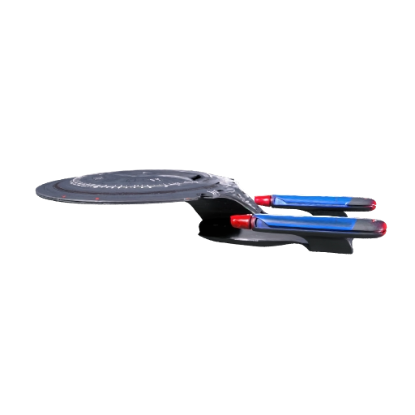

# Galaxy-class Meshy v2 — temporary stand-in

**Owner-selected temporary visual, 16 October 2026. Runtime integration pending.**
André selected this reference-based model for the project team to use as a stand-in
for now. This package supplies the source asset; it does not change gameplay,
ship identities, runtime mappings, prefabs, or the existing accepted art pack.



## Files

- `galaxy-class-v2.glb.gz.part01` through `part06`: losslessly compressed source.
- `restore_model.py`: reconstructs the original `galaxy-class-v2.glb` (56,507,400 bytes)
  and verifies every part and the final SHA-256.
- `galaxy-class-v2-preview.png`: provider-rendered preview, not a Unity capture.
- `provenance.json`: generation task, selected reference filenames, settings,
  geometry inventory, byte lengths, and SHA-256 hashes.

The GLB contains one mesh, one material, four embedded images, and **1,067,410
indexed triangles**. It is a source model, not an optimized fleet asset. There
are no external texture/buffer dependencies or required glTF extensions.
Keep the original intact and produce optimized runtime derivatives separately.

## Handoff to the art/frontend agents

1. Read the [existing art runtime contract](../../../docs/demo-art-runtime-contract.md)
   and coordinate Unity/import/render work with the project coordinator.
2. Import this GLB through the team's approved glTF workflow, or convert it to
   the project's FBX/material pipeline. At this handoff, the checked-in Unity
   package manifest contains no explicit glTF importer. Merely copying the GLB
   into `Assets` is not a verified integration.
3. Preserve the textured appearance. The current `ArtDemo/PreviewStudio` shader
   uses material colours and does not sample texture maps; its existing preview
   material conversion must be adapted for this model's textures. Check base
   colour, normal, packed metallic/roughness, and emission mapping in URP.
4. Create a runtime derivative with an appropriate triangle/texture budget and
   LODs before displaying many ships. Verify +Z bow, +Y up, metre bounds, pivot,
   root scale, normals, and framing; these are not yet validated for this GLB.
5. Use an explicit reversible visual binding, retaining the existing lawful
   visibility guard and generic fallback. The current contract's only enabled
   Federation binding is `civilization.federation` plus
   `ship-design.source-cruiser`; the coordinator should confirm the intended
   stand-in mapping. Do not infer equipment or gameplay stats from this model.
6. Commit Unity metadata, derived materials/textures/prefabs, and updated
   manifests together, then run the applicable art integrity and Unity checks.

## Provenance and limits

Generated with Meshy CLI 0.4.0, `multi-image-to-3d` task
`01a143e2-9d4c-74e9-891e-9655559ec73a`, using three owner-supplied Galaxy-class
reference images. Requested 4K textures, PBR, and lighting removal; actual charge
30 credits. This is **v2**, not the earlier text-only draft.

The rendered silhouette is closer to the references than v1, but surfaces and
details remain approximate. Visual review and GLB structure/hash checks are
complete. Topology quality, physical scale/orientation, texture fidelity in
Unity, performance, and native-player acceptance remain unverified. No Unity,
Blender, or GPU session was launched for this handoff.

The model is stored as losslessly compressed parts because the connected GitHub
API rejected a single blob of this size. The preview is stored directly. The team does not need
Meshy credentials or expiring provider download URLs. Reuse the existing Meshy
task for any subsequent provider conversion rather than generating a new model.

## Get this package

Asset branch: `codex/galaxy-class-meshy-stand-in`.

```sh
git fetch origin codex/galaxy-class-meshy-stand-in
```

From a clean, isolated integration branch, cherry-pick the asset commit or take
only `assets/art/galaxy-class-meshy-v2/` from that remote branch. Coordinate with
the repository's existing merge owner before integrating into `main`.

After bringing the package into your checkout, restore the GLB with Python 3
(no extra packages required):

```sh
python assets/art/galaxy-class-meshy-v2/restore_model.py
```

The restored GLB is locally ignored to avoid accidentally committing it again.
Its bytes match the original Meshy output; compression does not simplify or
otherwise change geometry or textures.
