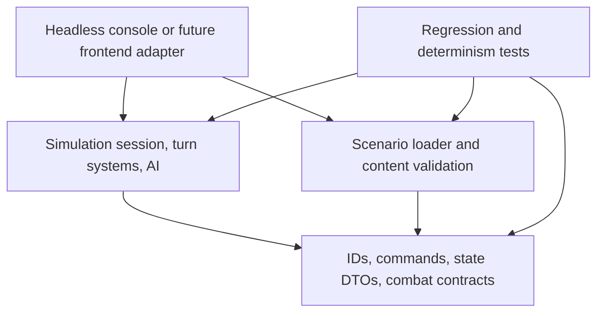
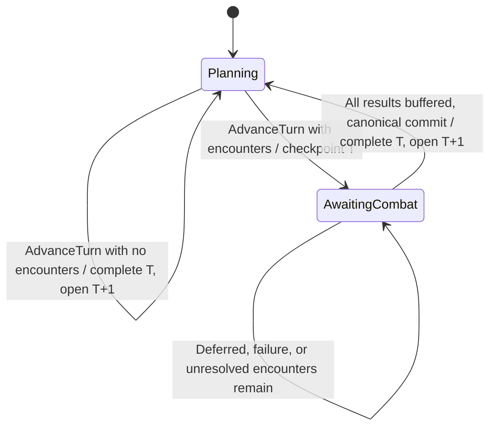

# Phase 1 portable strategy simulation

Status: Phase 1 identity/session foundations, Phase 3A civilization/scenario identity and galaxy graph, Phase 3B turn/staging lifecycle, Phase 4A colony economy, Phase 4B civilization research, and the separate combat-boundary scaffold. No legacy implementation is copied. The engine and initial scenario are new work based on the requirements in this project. Feature implementation follows this document in small, tested increments.

## Goal and boundaries

Build a headless strategic vertical slice with reproducible turns, explicit state and commands, and content separated from rules. The long-term product is a DS9/Dominion War-era BOTF spiritual successor, but the engine must contain no franchise names, UI objects or renderer assumptions.

Phase 1 includes seeded randomness, stable IDs, civilizations, systems/ownership, colonies/population, a small economy, production queues, research, ship designs, ships/fleets, graph movement orders, a strategic turn lifecycle and a simple rule-based AI. Combat has an authoritative pending-encounter lifecycle and request/result contracts; Phase 1 will use a deterministic no-loss placeholder resolver. Invasion, diplomacy, espionage, fog of war, faction-specific abilities, real tactical combat, multiplayer, frontend integration and legacy save import are deferred.

The current implementation contains typed stable IDs, persisted global entity allocation, campaign/encounter RNG, common identity/civilization/system DTOs and structural validation, plus the existing combat DTOs/interface and narrow combat-boundary helper for request allocation and result buffering. Tests exercise these boundaries. It now includes a SimulationSession with owned state, command validation/results, persisted deduplication and detached immutable snapshots. It includes the fixed scenario identity/graph skeleton, persisted Human/AI controllers and ownership, and deterministic route queries. It implements the atomic turn lifecycle, persisted campaign phase and the Economy phase for colony population/stocks and credits, plus research definitions/state, SetResearchTarget and the Research phase. It does not implement production, ship designs, fleets, movement, AI policy or campaign combat integration. Full gameplay determinism and combat lifecycle tests will accompany their implementation.

## Proposed solution

Use the pinned .NET 10 SDK to build the solution, with different runtime targets for portable libraries and hosts. SDK/compiler version does not determine a library's runtime requirement. All projects use nullable reference types, deterministic compiler output and warnings as errors. The test project uses xUnit; production projects have no external packages. No dependency on UnityEngine, WPF, networking libraries, BotF2 or 3DBOTF2 is allowed.

| Project | Target | Responsibility | Project references |
|---|---|---|---|
| HobbyDS9.Contracts | netstandard2.1 | Stable IDs, command/result contracts, explicit state/definition/save DTOs, combat boundary | None |
| HobbyDS9.Simulation | netstandard2.1 | State validation, command execution, turn systems, deterministic RNG, AI policies | Contracts |
| HobbyDS9.Scenarios | netstandard2.1 | Content DTO validation, reference validation, fixed scenario construction | Contracts |
| HobbyDS9.Headless | net10.0 | Console composition root, JSON/file I/O, scenario input, commands, turns, snapshots | Contracts, Simulation, Scenarios |
| HobbyDS9.Simulation.Tests | net10.0 | Determinism, lifecycle, boundary, persistence and scenario acceptance tests | Contracts, Simulation, Scenarios |

The three libraries use C# 9 and explicit usings. Avoid records/init-only properties that require an IsExternalInit shim, newer required-member metadata, and runtime APIs absent from .NET Standard 2.1. Use ordinary concrete DTO classes, readonly structs, List<T>/IReadOnlyList<T>, ordinal string comparisons, checked/unchecked integer arithmetic, Encoding.UTF8 and SHA256.Create/ComputeHash rather than newer static HashData APIs. System.Text.Json, file I/O and host services belong in adapters, not the portable contracts. Future APIs must compile against the netstandard2.1 reference surface; do not bypass that check with net10.0 packages or host project references.

The current Contracts implementation uses readonly identity structs, ordinary DTO classes, enums, string/int/long/ulong properties, nullable RNG state, List<T> and a synchronous interface. Simulation uses only .NET Standard 2.1 APIs: collections/LINQ, ordinal comparisons, invariant formatting/parsing, enum validation and explicit integer arithmetic. Scenarios remains empty except for a source manifest. Build validation checks the reference surface, and tests inspect compiled target/dependency metadata. This confirms the scaffold's API compatibility, not future APIs or Unity execution.

This is a modular monolith. Scenarios must not execute turns, and simulation must not load files, consult clocks, read console input, or know a scenario's franchise identity. The host performs I/O. Nothing in the domain depends on the host or tests.

Unity 6 can consume these .NET Standard 2.1 libraries directly through a frontend adapter, using Unity's .NET Standard 2.1 API compatibility setting. The simulation does not require a .NET 10 runtime. The console/test hosts use .NET 10 on Windows, Linux and macOS. Unity compilation, managed stripping and IL2CPP/AOT must still be verified during frontend integration; no Unity runtime is present in this workspace. Avoid reflection-based runtime construction and dynamic code generation in the libraries. Unity selects its own serialization adapter; the headless host's JSON implementation is not a mandatory Unity dependency.

## State, definitions and stable identity

Use a readonly EntityId value type with validated canonical string values, ordinal equality and ordinal ordering. All commands refer to EntityIds, not object references or list indices. Definition IDs use a separate readonly DefinitionId. Reject empty, noncanonical or duplicate IDs. Initial scenario IDs are authored; newly produced entities use a persisted monotonic sequence with category prefixes. Allocation order is part of the rules. Never use Guid.NewGuid, randomized string hashing or process-specific counters for simulation identity.

Canonical IDs match `[a-z][a-z0-9._-]{0,127}`. EntityId and DefinitionId validate without trimming or normalization and implement ordinal equality/ordering with deterministic ASCII FNV-1a hash codes. DefinitionId and EntityId.FromAuthored reject the reserved `.spawn.` namespace. A default identity struct is uninitialized: IsValid is false, and Value/CompareTo throw instead of treating it as a valid ID. DTO boundaries serialize validated strings, not the identity structs themselves.

Runtime IDs use `<category>.spawn.<16-digit-lowercase-hex-sequence>`. EntityIdAllocator uses one persisted unsigned 64-bit sequence across categories, beginning at 1. Invalid categories/overlong resulting IDs do not advance it. Categories use the canonical ID grammar, cannot contain `.spawn.` or end in `.spawn`, and must fit the full 128-character resulting ID limit. NextEntitySequence=ulong.MaxValue is a valid exhausted state; allocation refuses that value before changing the counter, so the final allocatable sequence is ulong.MaxValue-1. This avoids wrapping/recycling and needs no extra exhaustion flag. EntityAllocationStateDto captures/restores the counter independently of mutable DTO instances.

Definitions are immutable input records: civilization traits/capabilities, ship designs, facility upgrades, research nodes, colony economic profiles and map nodes/edges. State contains mutable facts: ownership, population, inventories, queue progress, research progress, ships, fleets, routes and RNG state. State refers to definitions by ID. UI names and descriptions belong in content, not simulation branches.

Runtime indexes may use dictionaries for lookup, but all iteration that affects rules must be explicitly sorted by ordinal IDs. JSON DTOs expose arrays/lists, not runtime dictionaries, controller references, polymorphic CLR type names or engine objects. Query snapshots are copies/read-only projections; consumers must not mutate session state through returned collections.

Proposed state records:

| State | Essential fields |
|---|---|
| GameState | TurnNumber, StateRevision, NextEntitySequence, RNG state, content/rules identity, phase, accepted command IDs for the current planning turn, pending encounters, buffered resolved requests/results, accumulated in-progress strategic turn events, all entity lists |
| CivilizationState | ID, definition ID, controller kind, credit treasury, research progress/unlocks |
| StarSystemState | ID, map-node kind, optional owner ID, optional colony ID |
| ColonyState | ID, system ID, population/capacity, economic profile ID, food/material inventory, production queue |
| QueueItemState | ID, definition ID, kind, required/completed industry, paid/reserved costs |
| ShipState | ID, design ID, owner ID, fleet ID, hull status |
| FleetState | ID, owner ID, location system ID, ordered route system IDs |
| PendingCombat | Detached combat request: encounter/turn/location IDs, canonical participant snapshots, resolver/content/rules identity, encounter-local initial RNG state |
| ResolvedCombat | Original frozen request plus validated result, buffered until canonical campaign commit |

Ownership is authoritative on StarSystemState; ColonyState persists an owner ID that validation requires to match its system. Fleets and ships carry explicit owners with invariants enforcing consistency. A neutral inhabited colony is valid, but receives no civilization commands or research contribution. Map nodes such as wormhole endpoints can have no colony and be noncolonizable. No capture mechanic is included in Phase 1.

## Explicit serialization and content separation

The headless host uses System.Text.Json over concrete DTOs. Contracts defines DTOs without serializer attributes or dependencies; Scenarios validates and constructs content from DTOs already decoded by the host. Define ScenarioDto, DefinitionCatalogDto, GameStateDto and SaveEnvelopeDto. A versioned envelope records SaveFormatVersion, RulesVersion, ScenarioId, ContentHash, TurnNumber/Revision, entity allocation state and RngStateDto. The serialized state includes all mutable simulation facts needed to continue, including SessionPhase, pending encounter requests, persisted encounter RNG inputs, buffered resolved requests/results, and accumulated in-progress strategic turn events. Loading partially resolved combat must never allocate seeds again or re-run a resolver for a buffered result. CombatCheckpointDto is the currently scaffolded combat subset of that future full GameStateDto; it is not a complete campaign save. Campaign resume must validate the supplied content hash/rules version rather than silently using different definitions.

The host converts DTOs through validation into an owned simulation session. Runtime classes are not the save contract. Validate every ID/reference, nonnegative bounded resource/population/queue values, route edge, design/faction association, RNG algorithm/version and sequence counter before accepting a save. Unknown schema/rules versions fail clearly; do not invent an automatic migration in this phase.

Canonical snapshot hashing uses fixed property order, entity arrays sorted by ID, encounter/result arrays normalized by location ID, and semantically ordered arrays preserved in order (routes, queues and events), ordinal strings, explicit UTF-8 encoding and invariant numerical representation. The portable canonical writer uses .NET Standard-compatible byte/string operations; do not make its algorithm depend on the host JSON serializer. Hash normalized logical state, not incidental whitespace or dictionary ordering. Diagnostic timings and trace strings are excluded. System.Text.Json output is not automatically a permanent cross-version canonical format; define/test the canonical writer separately.

ContentHash identifies canonical rules-relevant definitions and scenario structure; cosmetic labels/translations are excluded and may have a separate presentation-package hash. This allows content-label changes without changing simulation outcomes or gameplay identity.

The initial DS9-themed JSON package is under scenarios/ds9-slice, outside production source. It contains only authored names/IDs and numerical definitions, no imported art, sound, text descriptions or legacy data files. Engine tests should also use franchise-neutral fixtures to detect accidental content coupling.

## Implemented foundation contracts and validation

This increment introduces RngStateDto, EntityAllocationStateDto, EntityIdentityDto, DefinitionCatalogDto, GameStateDto, ScenarioDto and SaveEnvelopeDto. GameStateDto currently stores required SessionPhase and turn/revision stamps, next entity sequence, RNG state, accepted command IDs for the active planning turn, identity headers, civilization state with persisted ControllerKind, star-system state with optional civilization ownership, colony population/capacity/stocks, credits and civilization research reserve/target/unlocks. DefinitionCatalogDto stores the identity list plus civilization/system definitions with presentation labels and data-defined undirected galaxy edges; it now also contains EconomicProfileDefinitionDto and ResearchNodeDefinitionDto values; it contains no ship/building/race gameplay content. TurnNumber is persisted and advanced by the authoritative staged turn transaction. The existing CombatCheckpointDto remains a separate scaffold rather than being silently omitted from a playable campaign save.

FoundationVersions.SaveFormatVersion=6 and ContentFormatVersion=3 describe the identity/graph/phase/economy/research schema, not a complete campaign save. Required lists may be empty but cannot be missing/null. Save versions 1/2/3/4/5 and earlier/unknown content versions are rejected without automatic migration. The accepted-command ledger and Phase remain required. A missing/null phase is rejected; known phases are Planning and AwaitingCombat, and authored scenario initial state must be Planning. Format 6 additionally requires each civilization's UnlockedResearchDefinitionIds list. Content format 3 requires ResearchNodes and each node's PrerequisiteDefinitionIds list; empty lists are valid but missing/null lists are rejected. Civilization state persists ResearchReserve and nullable ResearchTargetDefinitionId. The fixed scenario uses RulesVersion phase-1-4b-v1 and adds a generic research node, changing its package hash. Expand/version the schema when gameplay facts and the combat checkpoint are integrated; never claim this skeleton envelope can resume an implemented campaign. Hosts use their own JSON adapters over these concrete DTOs. There are no serializer attributes, CLR type discriminators, reflection-based factories or runtime dictionaries in the save surface.

FoundationValidator returns an immutable ValidationReport of stable ValidationCode/path pairs without changing input DTOs. It validates null/missing payloads, canonical/duplicate/reserved IDs, identity-to-definition references, positive turn/allocation counters, nonnegative revisions, well-formed generated IDs, and a counter strictly greater than every allocated sequence present. Global allocated sequence reuse across categories is rejected. Removed/cancelled entities do not require a contiguous live sequence; allocation never rewinds. Authored ScenarioDto state starts at turn 1, revision 0 and next sequence 1, and cannot contain runtime IDs. Future gameplay invariants accompany those schemas.

RngStateDto requires the exact supported algorithm ID/version and a present full unsigned 64-bit State; nullable State distinguishes omitted data from valid zero. SaveEnvelopeDto also requires the supported save format and exact rules/scenario/content identity against an immutable host-supplied SaveCompatibility. ContentHash is a canonical lowercase 64-digit SHA256 string. This validator verifies its shape and compatibility, not the provenance of definitions or the future canonical content-hash computation. The host must provide the identity of the content it actually loaded. Unknown save/RNG versions fail; no migration or silent substitution is performed.

SplitMix64Random provides the campaign stream and detached RngStateDto capture/restore. EncounterRandomStream wraps an independently owned instance of the same generator; combat requests retain separate streams and outcomes remain order independent. The existing combat allocator now uses EntityIdAllocator and shared canonical-ID validation so there is one allocation/RNG/ID grammar implementation.

GitHub Actions runs locked restore, Release build and the complete test suite on pushes and pull requests, on Linux, Windows and macOS, using the SDK pinned in global.json. Local cloud bootstrap remains optional; CI uses setup-dotnet directly and needs no workspace-specific paths.

## Implemented Phase 3A galaxy model

StarSystemDefinitionDto contains DefinitionId and DisplayName; StarSystemStateDto contains stable SystemId, DefinitionId and nullable OwnerCivilizationId. Traversal-only nodes use the same model. CivilizationDefinitionDto holds labels separately from CivilizationStateDto, whose nullable ControllerKind distinguishes a missing controller from Human/AI. Phase 4A adds colony/population/stocks and credits separately; Phase 4B adds research state; no ship or fleet facts exist yet.

Catalog GalaxyEdges reference stable system entity IDs, with explicit Normal/Wormhole kinds. The supplied content catalog is pinned by the save's content/rules identity and provided again at reload; immutable topology is not duplicated into mutable campaign state. GalaxyGraph validates duplicate nodes, missing endpoints, self-edges, duplicate/reversed edges (even with different kinds), invalid IDs and missing/unknown kinds. Disconnected graphs and isolated nodes are valid. Runtime edges canonicalize A < B by ordinal ID and sort by endpoints; adjacency is immutable and sorted by neighboring system ID. Neither graph construction nor queries consume RNG, allocation or revisions.

FindRoute uses deterministic breadth-first search, returning the first shortest route according to sorted adjacency. RouteResult.Steps excludes the origin and includes the destination; origin == destination returns an empty route. ValidateRoute accepts an explicit ordered list of typed system IDs, checks origin and each edge, and returns stable route error codes. Empty routes are valid and backtracking is allowed; self steps, missing nodes and nonadjacent steps are rejected. Both edge kinds have unit traversal cost. These helpers are queries only and are not connected to commands, fleets or AdvanceTurn. SimulationSession.Galaxy and snapshot civilization/system/edge projections expose immutable data.

The headless adapter hashes the exact UTF-8 scenario.json bytes with SHA256 and supplies ContentHash after decoding; the file excludes its own hash. This is the implemented package fingerprint (currently content format 3), including labels and whitespace. The canonical rules-only hash described above remains future work and requires deliberate content versioning. Graph results remain independent of labels and DTO/input order.

## Implemented Phase 4A colony economy

EconomicProfileDefinitionDto is labeled content with FoodOutput, PopulationPerFood, MaterialOutput, PopulationPerCredit, BaseIndustry, PopulationPerIndustry, GrowthPerTurn, StarvationLossPerTurn and ResearchOutput. All values and economic state use signed 64-bit integers. Divisors must be positive; outputs/growth/loss must be nonnegative. No economic constants or franchise names are present in Simulation.

ColonyStateDto stores stable ColonyId, SystemId, nullable OwnerCivilizationId, EconomicProfileDefinitionId, Population, PopulationCapacity, Food and Materials. Its global identity header uses the same economic profile definition ID. There is at most one colony per system; all referenced systems/profiles/owners must exist, and colony/system ownership must match, including null for neutral colonies. Population is in [1, capacity], capacity is positive, and stocks/credits are nonnegative. ColonySnapshot and CivilizationSnapshot.Credits are immutable detached projections; session ingress, phase staging, commit and save export deep-copy all economic data and content profiles.

Economy processes colonies by ordinal ColonyId. It adds profile food/material output, calculates demand as ceiling(pre-growth Population / PopulationPerFood), consumes the lesser of available food and demand, then grows up to capacity if sufficient or applies starvation loss down to population 1 otherwise. Credit income is floor(pre-growth Population / PopulationPerCredit), credited only to an owner. Neutral colonies have the same local stock/population rules without a credit contribution. AI-owned colonies receive normal economic income without invoking any AI policy.

All arithmetic mutations are checked. Ceiling uses quotient plus a remainder test rather than population + divisor - 1; growth/starvation increments are clamped before checked addition/subtraction to avoid overflowing a mathematically bounded result. Food/material/credit overflow, invalid staged data or any later phase failure aborts the entire turn, including previously processed colonies. RNG, allocation, revision, phase and accepted IDs stay unchanged on failure. Industry is not persisted or executed; BaseIndustry and PopulationPerIndustry remain future inputs. ResearchOutput is now consumed by the Research phase but is not persisted as per-turn derived state. Routine economy changes emit no StrategicEvents, and result collections remain empty.

## Implemented Phase 4B civilization research

ResearchNodeDefinitionDto is content with a stable DefinitionId, presentation DisplayName, positive signed-64-bit ResearchCost and a required prerequisite DefinitionId list. The validator rejects missing/invalid/duplicate/non-research prerequisites, self prerequisites and cycles. An iterative Kahn traversal uses ordinal IDs and handles deep graphs without recursion. Owned content copies sort nodes and prerequisite lists by ordinal IDs; labels never affect rules.

CivilizationStateDto now stores nonnegative ResearchReserve, nullable ResearchTargetDefinitionId and required UnlockedResearchDefinitionIds. Every unlocked ID must be a unique canonical existing research node. An active target must exist, remain locked and have all prerequisites unlocked. Ingress accepts equivalent list ordering and session copies/export normalize unlocked IDs by ordinal order. No per-node partial-progress records exist. Snapshots include reserve/target and a copied read-only list of typed unlocked IDs.

The public SetResearchTarget command changes only the issuing Human civilization's target through the existing Planning/stamp/duplicate/transaction pipeline. Unknown or non-research targets return UnknownResearchNode; unlocked targets return ResearchAlreadyUnlocked; unmet prerequisites return ResearchPrerequisiteMissing. Retargeting preserves all reserve. Setting the same valid target with a fresh command ID returns ResearchTargetUnchanged, without revision increments or command-ID reservation. Replaying an already accepted ID still returns DuplicateCommand first. Accepted target changes increment revision once and persist that ID. Other gameplay commands remain unsupported; no AI target-selection policy exists.

Research runs after Economy and before Production, with civilizations and owned colonies processed by ordinal IDs. It sums profile ResearchOutput from owned colonies only, adds it to reserve using checked arithmetic, and retains reserve when no target exists or its cost is not yet met. When sufficient, it spends the cost once, adds that node to the canonical unlocked list and clears the target. Surplus reserve is retained; at most one node unlocks per civilization per turn. AI-owned colonies generate research normally, but AI civilizations choose no targets automatically. Research consumes no RNG and allocates no entity IDs.

Unlocks become visible to player commands after the turn atomically opens the next Planning state. The later no-op phases generate no commands. Economy cannot mutate research fields; Research cannot mutate economic fields, identity, ownership, capacity, controllers, lifecycle metadata, RNG or allocation. Arithmetic overflow, an invariant failure or exception discards the whole turn, including earlier Economy changes. No routine economy/research StrategicEvents are emitted; TurnResult event/command-result collections remain empty. Ship/building unlock requirements are future content, with no ship designs added now.

## Determinism contract

For the same validated definitions, rules version, initial state, command sequence and RNG state, the simulation must produce exactly the same ordered outcomes and logical state after every turn. This is an in-process rules contract across supported platforms, not a promise that different future rules versions have the same outcomes.

Use a specified SplitMix64 generator with explicitly unchecked 64-bit unsigned arithmetic. Persist its algorithm ID, algorithm version and full 64-bit state. Draw bounded integers with rejection sampling, not floating-point scaling or modulo bias. Version the exact bounded-draw algorithm too; variable retry draw counts are part of reproducibility. No System.Random, Random.Shared, Unity randomness, clocks or thread-local generator is permitted in rules.

Algorithm ID: splitmix64-rejection-v1. Each raw draw adds `0x9e3779b97f4a7c15` to state modulo 2^64; copy state to z, then apply `z = (z xor (z >> 30)) * 0xbf58476d1ce4e5b9`, `z = (z xor (z >> 27)) * 0x94d049bb133111eb`, and return `z xor (z >> 31)`, with both products modulo 2^64. For an exclusive positive bound b, compute threshold as `(0 - b) modulo 2^64`, then modulo b; reject draws smaller than threshold and return the accepted draw modulo b. A zero bound is rejected before drawing. Seeding sets state to the supplied unsigned 64-bit seed without additional draws.

Use integer units for population, food, materials, credits, industry, research and graph distances. Guard overflow and validate upper bounds. No floating-point physics or frame delta enters movement/economy/combat state. Use a single writer to advance turns; no parallel rule evaluation in Phase 1.

AI factions are processed by ID. Candidate actions are sorted by ID. The simple AI uses RNG only for ties where multiple equally scored legal options remain; deterministic options must not consume unnecessary draws. Rejected commands consume no randomness, IDs or resources. Serialization/reload must preserve the next draw and allocation order.

## Command API and atomicity

The public session entry point accepts a CommandEnvelope with CommandId, ActorCivilizationId, ExpectedTurn, ExpectedRevision, CommandKind and one concrete typed payload. Proposed Phase 1 commands are EnqueueProduction, CancelProduction, SetResearchTarget and SetFleetRoute. AdvanceTurn is a host/session operation, not a faction command.

Use an explicit closed command discriminator and DTO mapping; do not serialize CLR type names or load arbitrary subclasses. Stable command IDs permit duplicate detection within the current planning turn. StateRevision changes on each accepted state mutation; commands must match the current revision. The host can refresh/retry planning explicitly when a previous command changed revision. The complete replay includes rejection outcomes too, though rejection does not change state.

Validate actor existence/control, ownership, target references, prerequisites, resource availability, legal route adjacency and expected turn/revision before mutation. Return CommandResult with accepted/rejected status, stable error code and resulting revision. Exceptions are for programming/invariant errors, not ordinary invalid player actions. Commands and outcomes have canonical order matching submission order. AI submits through the same validator, with an internal trusted controller path that still enforces gameplay legality.

The implemented foundation session copies validated save/catalog inputs. Its constructor no longer accepts actor/control registries: actor existence and local Human control derive exclusively from persisted CivilizationStateDto. AI civilizations return ActorNotControlled on the public player-command path; no AI command policy or trusted AI submission path is implemented yet. ActorSnapshot.IsControlled is a convenience projection of ControllerKind == Human, not remote authentication. Typed civilization/system identities must match their global identity header and the correct definition category; system owners must reference existing civilizations. Public commands use the four concrete payload slots above, SetResearchTarget is now functional and the other gameplay handlers remain unsupported. The internal test handler registration seam remains for transaction tests.

Common validation order is envelope completeness, canonical command/actor IDs, actor existence/control, Planning phase, expected turn, duplicate ID, expected revision, discriminator, payload shape, handler availability, then revision capacity. ExpectedTurn and ExpectedRevision are nullable DTO fields so missing values cannot become valid defaults. Duplicate detection precedes stale revision detection, so replaying an accepted envelope reports DuplicateCommand. Rejections return stable CommandErrorCode values and the current turn/revision, reserve no IDs, and leave state, RNG, allocator and revision unchanged. Rejected IDs may be retried. Accepted transactions increment StateRevision exactly once and persist the command ID; long.MaxValue rejects further mutations without overflow.

Handlers receive only a detached staging copy. Validation and an additional copy at commit prevent retained handler references from mutating authority. Handlers cannot alter phase/turn/revision/deduplication bookkeeping; invariant/programming faults throw and preserve authoritative state. Snapshot projections contain immutable elements and copied read-only collections, ordered by ordinal IDs. ExportSave supplies a separate deep-copied DTO for host serialization. No JSON or file APIs enter Simulation. Inputs must not be mutated while being submitted. A session lock serializes reads and submissions; host submission order determines concurrent command order, and nested command execution is a programming error.

The ledger survives export/reload and is cleared only by a successful turn completion. Snapshots expose campaign phase and foundation diagnostic state without multiplayer visibility filtering.

### Implemented staged turn transaction (Phases 3B/4A/4B)

SimulationSession.AdvanceTurn(int expectedTurn, long expectedRevision) is a host operation, separate from CommandEnvelope. It checks Planning phase, expected turn, expected revision, turn-number capacity and revision capacity before executing any phase. Stable TurnErrorCode values report ordinary failures; int.MaxValue turns and long.MaxValue revisions reject without overflow. Replaying the same request after a successful turn returns StaleTurn, never another successful advancement. Commands outside Planning return CommandErrorCode.CombatPending, and AdvanceTurn returns TurnErrorCode.CombatPending without processing phases.

AdvanceTurn deep-copies all authoritative state and runs the fixed internal boundaries once in this order: AI planning, economy, research, production, movement, encounter creation. Economy and Research have built-in behavior; AI planning, production, movement and encounter creation remain no-ops. An internal test probe supports observation, deliberate rejection and exception injection; there is no public phase registration or plugin framework. Each boundary validates staged state and compares owned copies. Only Economy may change existing colony Population/Food/Materials and civilization Credits; only Research may change ResearchReserve, ResearchTargetDefinitionId and unlocked research IDs. Identity, ownership, capacity, controller, RNG, allocation and lifecycle bookkeeping remain protected. No-op phases cannot modify economic or research values. Test probes may observe, reject or throw but cannot supply rule mutations.

A single validated commit completes current turn T, opens Planning T+1, increments StateRevision once and clears accepted IDs. Economy and Research changes commit with the turn; all other facts, including RNG and NextEntitySequence, are preserved. The session makes another deep copy before commit so retained phase references cannot mutate authority. A returned PhaseFailed rejection, exception or invariant failure discards the entire staging copy and preserves the ledger and every authoritative field. Nested command/turn mutation is a programming error; the shared session lock serializes mutation and reads, so partial turns cannot be observed.

TurnResult has stable Rejected, Completed and AwaitingCombat statuses; only Rejected/Completed are produced now. AttemptedTurnNumber records the authoritative turn at entry, TurnNumber/StateRevision/Phase record authoritative state after the operation, and CompletedTurnNumber is present only for Completed. Ordered immutable Events (StrategicEvent with stable event/subject codes/IDs) and CommandResults collections remain empty in this increment. No fake gameplay or completion events are emitted. A future encounter checkpoint can return AwaitingCombat for the same T through this API without falsely reporting completion.

Save format 6 preserves known phase markers. Restoring AwaitingCombat deliberately leaves the session blocked; this phase-only skeleton has no combat-resolution operation and cannot reopen Planning. CombatEncounterScaffold and its fleet/ship requests, pending batches and buffered results remain separate. Integrating them now would require premature fleet/combat state, so campaign encounter creation/resolution and full phase/batch validation are deferred to a later versioned schema. These saves resume Planning economy/research turns, while fleet/combat campaigns remain unimplemented.

The target gameplay lifecycle (not implemented in Phase 3B) extends the owned staging transaction: AdvanceTurn applies AI decisions and strategic phases there, creates pending encounters, validates invariants, and commits one checkpoint plus ordered events. If there are no encounters, it completes the turn; otherwise it commits AwaitingCombat without incrementing TurnNumber. A strategic-phase fault leaves authoritative state, RNG, IDs and revision unchanged.

The future ResolveCombat(EncounterId) is a separate host/session operation. The host may choose any pending encounter, supply a detached frozen request to the injected ICombatResolver, and buffer its validated result. Resolving one encounter never changes campaign entities, another request or the campaign RNG. A failed/invalid resolution leaves the checkpoint unchanged, including previously buffered results. The host can resolve/view battles in any order without changing their outcomes. The guarantee assumes the same frozen request, doctrine/orders and resolver version for each battle; deliberately different player battle choices may change that battle's result.

When all results are available, a single campaign transaction applies consequences in canonical location-ID order, appends events in encounter/event order, validates invariants and finalizes the turn. Intermediate resolutions advance revision but do not apply campaign damage or retreat. Finalization is separate from buffering the last result so its failure can be retried without recomputing battles. Turn results distinguish AwaitingCombat from Completed and expose readiness to finalize; no result falsely reports a completed turn while encounters remain. Submission/rejection history can record user order for diagnostics, but canonical authoritative completed-turn events/results do not depend on that order.

This slice has one host-owned planning session. Multiplayer readiness, per-player deadlines, hidden-information filtering and remote authentication are future adapters/policies, not dependencies added now.

## Turn lifecycle

The initial state is Planning turn 1. Human strategic commands are accepted only in Planning. There is no wall-clock advancement. The table and diagram describe the full target lifecycle. The current implementation executes Economy and Research inside the Phase 3B no-encounter Planning-to-Planning transaction; the other phase boundaries remain empty.

| Phase | Behavior and ordering |
|---|---|
| 1. AI planning | AI civilizations sorted by ID generate legal commands using pre-economy state; execute through command validation |
| 2. Economy | Colonies sorted by ID produce food/materials/credits, pay food consumption, then change population |
| 3. Research | Sum controlled-colony research output, apply to one target per civilization, unlock completed node; at most one unlock per turn initially |
| 4. Production | Apply industry to each colony's queue head; at most one completion per colony per turn; excess industry is discarded for this slice |
| 5. Movement | Each fleet traverses at most one graph edge; route is consumed in order; wormhole edges use the same deterministic movement cost |
| 6. Encounter checkpoint | Group opposing fleets by node, create canonical PendingCombat requests and allocate encounter-local RNG inputs; commit AwaitingCombat if any exist |
| 7. Combat resolution | Resolve any pending encounter using its own frozen RNG input; validate and buffer each result atomically; Deferred keeps the session blocked |
| 8. Finalize | Only with all results buffered: apply results/events in canonical order, validate, increment turn once, clear deduplication and open Planning |

AwaitingCombat is authoritative state, not a notification. Strategic commands and AdvanceTurn return a stable CombatPending rejection in this phase, without changes to state, RNG or IDs. After combat integration, save/load preserves this phase and resumes at resolution, never re-running AI, economy, research, production or movement. No intermediate planning turn exists. Phase 1 needs no general phase cursor: Planning means strategic processing has not run; AwaitingCombat means all strategic phases have committed. Partial strategic processing is never persisted.

When encounter state is integrated, validate the phase/batch invariant on every commit and load: Planning has no pending encounters, buffered results or in-progress strategic turn events. AwaitingCombat has a nonempty encounter batch (the union of pending requests and buffered resolved requests), all stamped with current TurnNumber and matching campaign content/rules identity. No encounter ID, fleet or ship appears more than once across that union. An empty pending list with buffered results is valid AwaitingCombat state ready to finalize; it still blocks strategic commands/AdvanceTurn until the campaign commit succeeds.

With no encounter, AdvanceTurn(T) opens Planning(T+1) in its single commit. With encounters, AdvanceTurn(T) leaves TurnNumber=T in AwaitingCombat. Each accepted resolved result increases revision once; final campaign commit increments revision once more and TurnNumber once. Completed turn events combine strategic and combat events exactly once in phase/location/event order. A host may automatically resolve all pending encounters and finalize, but this convenience is outside AdvanceTurn; callers can save the authoritative checkpoint or a partially resolved batch first. Failed finalization preserves all buffered results for retry.

Movement snapshots the fleet-ID list at the start of the movement phase. Ships completed during production join an existing stationary owned fleet at the colony, chosen by lowest fleet ID, or create a new stationary fleet; a newly created fleet has no route and therefore does not move. Existing stationary fleets have empty routes by definition. A ship must not join a routed departing fleet implicitly.

Production pays credit/material costs atomically when enqueued, recording the paid amount on the queue item. Cancellation refunds the unused proportion of paid costs using documented integer floor division; completed industry is discarded. The first slice does not support queue reordering, rushing, maintenance, stockpiled industry or recurring templates. Research spending cannot also consume production industry; the simple research output is a separate profile value. Future resource allocation must be an intentional rules change.

For each paid cost, cancellation refunds floor(paid × (requiredIndustry − completedIndustry) / requiredIndustry), using checked sufficiently wide intermediates and a strictly positive requiredIndustry. Generated ship/queue IDs are not recycled on cancellation. Accepted command IDs are persisted for the current planning turn and cleared only when that turn finalizes and opens the next planning turn, not when the AwaitingCombat checkpoint commits.

For the baseline economic profile: add FoodOutput and MaterialOutput; compute food demand as ceiling(pre-growth population / PopulationPerFood); consume available food. Sufficient food permits GrowthPerTurn up to capacity. Insufficient food instead reduces population by StarvationLossPerTurn, floored at 1. Credit income is floor(pre-growth population / PopulationPerCredit), credited only to an owner. Industry equals BaseIndustry + floor(post-growth population / PopulationPerIndustry). ResearchOutput is a separate integer value. All profile constants come from content. The DTO validator prohibits zero divisors and invalid capacities.

Research prerequisites are definition-ID lists. EnqueueProduction checks current unlocks; an unlock during turn processing affects new commands in the next planning turn. Research overflow is retained as civilization research reserve, available for a subsequent target, but does not cascade into multiple unlocks in one phase.

## Fleets, movement and combat boundary

The galaxy is a node/edge graph rather than a renderer coordinate system. A route command provides an explicit ordered list of destination system IDs; validate every edge from the current location before accepting. Phase 1 does not need pathfinding: host/AI can use deterministic breadth-first search over ordinal neighbor IDs to choose a route. Traversal is one edge per turn; future variable speed and travel distance require a versioned movement rule.

### Authoritative encounters and resolver contract

Phase 1 treats every distinct civilization as opposing when its fleet shares a node with another civilization. Diplomacy can replace this hostility policy later. Create one multi-participant encounter per contested location, ordered by ordinal location ID. Allocate encounter IDs from the persisted entity sequence as `encounter.spawn.<16-digit-lowercase-hex-sequence>` in that order, keeping IDs within the canonical length limit regardless of location ID length. Turn and location remain explicit request fields. Participant snapshots sort by civilization ID, then fleet ID, then ship ID. A fleet participates in only one encounter in a turn. Snapshot creation occurs after all movement, not during sequential fleet updates.

The scaffold exposes SessionPhase, CombatCheckpointDto, PendingCombatDto, ResolvedCombatDto, CombatRequestDto, CombatResultDto and ICombatResolver in Contracts. Stable IDs are canonical strings only at this DTO boundary. CombatEncounterScaffold validates every encounter/location/civilization/fleet/ship/design/resolver ID at creation, restore, detached request retrieval and result ingress. IDs must match the documented lowercase ASCII grammar and length, without trimming, case folding or Unicode normalization. Allocated encounter IDs must fit the persisted sequence. Participant fleet/ship uniqueness and current turn stamps are also checked. A future session maps validated EntityId/DefinitionId values into its domain immediately and additionally checks existence, ownership and catalog references against authoritative state; canonical syntax alone does not prove those references exist. PendingCombat contains a detached, persisted request. Mutable DTOs are serialization carriers only: the session holds owned copies and supplies a fresh copy to a resolver, never live state or externally writable authoritative collections.

ICombatResolver.Resolve(CombatRequestDto) returns CombatResultDto synchronously. Its output depends only on the request and an immutable injected combat-definition catalog whose content hash matches the request. Inputs identify encounter, turn, location, participants, ship design/hull snapshots, rules/content identity, resolver ID/version, and encounter-local RNG algorithm/state. Ship-design battle statistics can be obtained from that versioned catalog; future battle-specific snapshots and choices can extend the request schema without altering the turn engine's resolution protocol. No Unity objects, callbacks tied to frames, real-time clocks, networking or global mutable RNG are allowed.

During canonical encounter creation, draw exactly one unsigned seed per encounter from the world RNG and persist it as CombatRequestDto.RandomState: the initial state of this encounter's independent stream, not the live campaign state. EncounterRandomStream owns a SplitMix64Random implementing the specified SplitMix64/rejection algorithm. Advance the campaign RNG during creation and checkpoint that advanced state with NextEntitySequence. Each resolver constructs a fresh local stream initialized from its own request state; it has no access to the campaign stream or other battles. Results return its final local state; combat draw counts never consume the world stream. Once generated, an encounter's result is independent of the order battles are resolved or viewed, or the number of draws consumed by another battle. Replaying cinematic events never calls RNG or submits another result. Deferred/failed retries use the same frozen request and RNG input. Resolver ID/version and content hash are pinned in pending saves; a missing or incompatible resolver fails clearly rather than silently substituting a different algorithm.

Results carry encounter/resolver identity, Deferred or Resolved status, final encounter RNG state, ship hull changes, fleet hold/retreat/destruction changes, and concrete ordered events. Events have contiguous zero-based Sequence values; never sort them by entity ID after resolution. Changes are canonical lists sorted by stable ship/fleet IDs. Rules consequences come from explicit changes, not by replaying presentation effects. Events are data for later playback and have no effect on simulation timing.

The combat boundary validates a result before buffering it: it may target any still-pending encounter with the pinned resolver/version, must reference only participant IDs, contain no duplicate changes, satisfy hull bounds, and carry contiguous valid event sequences ending in exactly one EncounterResolved event. Null/malformed DTO fields or unknown enum values are rejected. A future session additionally requires expected turn/revision for host-submitted results, checks event/consequence consistency and full fleet/ship invariants, validates retreat edges and occupancy against the frozen end-of-movement state, and applies changes in the final transaction. Public DTO buffers are serialization carriers; the future session owns them and exports copies. The scaffold only returns new copies and deliberately does not apply campaign consequences.

Phase 1 creates encounters exactly once after movement. A fleet can belong to only one encounter in a turn, including both unresolved and already-buffered resolved encounters. Retreat never triggers a second encounter or additional movement that turn. Reject retreat into any original encounter location (including already-resolved locations), or a location containing an opposing fleet in the frozen end-of-movement snapshot. This rule never depends on which battles have resolved first. Multiple retreats to one node must be validated as a batch against original occupancy and each other; opposing retreating fleets cannot share a destination. A later battle-chaining rules version can relax this deliberately. The scaffold enforces the original-encounter-location restriction; graph and whole-campaign occupancy validation await the strategic engine. At final commit, destruction/retreat clears movement orders and removes destroyed ships/fleets consistently.

Deferred is an explicit unresolved result: no ship/fleet changes or events, unchanged encounter RNG, no revision change, and the pending request remains. It never opens Planning. Duplicate resolution cannot apply twice because a successful Resolved result moves its request from pending to the buffered result list; both original request and result remain persisted until campaign commit. No fleet can escape an unresolved encounter by receiving another strategic movement order.

For the initial implemented slice, inject `no-loss-v1`: emit one EncounterResolved event, return Resolved with unchanged RNG and empty change lists. This explicitly settles an encounter without damage, retreat, capture or victory. Surviving opposing fleets may encounter again on a later turn; they do so only after the previous encounter has been resolved. The placeholder is a test policy, not strategic combat gameplay, and is not implemented in the present scaffold. An Endless Space-style deterministic strategic battle resolver can later produce actual changes/events through the same contract; graphics only consume event playback. Interactive battle choices, if added, require dedicated encounter-ID commands while AwaitingCombat, never reopening strategic planning.

## Simple AI policy

Each AI faction can take a legal turn without a frontend: choose an available research node by lowest cost then ID; if a controlled colony queue is empty and affordable, enqueue a permitted ship design by lowest industry cost then ID; route an idle fleet toward an adjacent interesting neutral/foreign node using deterministic candidate scoring. Break equal scores with the specified RNG. If no legal action exists, emit no command. AI does not colonize/capture or conduct diplomacy/combat in this slice.

Persist the controller kind on each civilization. Human factions are not secretly automated. AI choices depend only on the session snapshot/definitions/RNG, never on UI visibility, real time or thread scheduling. Events may include AI command IDs for repeatable diagnostics.

## Fixed DS9-themed scenario

Implemented skeleton scenario ID: ds9-strategic-slice-v1, in scenarios/ds9-slice/scenario.json. Seed: 47. The host validates the package and constructs a queryable session without advancing turns. This is a testing setup, not a historically balanced campaign.

| ID | Content label | Initial owner / behavior |
|---|---|---|
| civ.federation | Federation | Human |
| civ.cardassian | Cardassian Union | AI |
| civ.dominion | Dominion | AI |
| system.sol | Sol | Federation owned, colony.sol |
| system.cardassia | Cardassia | Cardassian owned, colony.cardassia |
| system.founders-homeworld | Founders' Homeworld | Dominion owned, colony.founders-homeworld |
| system.bajor | Bajor | Unowned, neutral colony.bajor |
| system.bajoran-wormhole | Bajoran Wormhole | Unowned traversal node |
| system.gamma-exit | Gamma Exit | Unowned traversal node |

Undirected edges: Sol—Bajor, Cardassia—Bajor, Bajor—Bajoran wormhole, Bajoran wormhole—Gamma exit, Gamma exit—Founders' Homeworld. Every edge has unit traversal cost in this slice. The wormhole edge is tagged in content; engine names/labels do not affect movement. Frontend coordinates are not part of rules.

Implemented economy content: three owned colonies and neutral Bajor have population 1,000, capacity 2,000, initial food 20/materials 10, and civilizations start with 50 credits. The data-defined economy.baseline profile values are: FoodOutput 12, PopulationPerFood 100, MaterialOutput 4, PopulationPerCredit 100, BaseIndustry 4, PopulationPerIndustry 250, GrowthPerTurn 50, StarvationLossPerTurn 50, ResearchOutput 3. Bajor uses the same profile with no owning treasury/research contribution.

The implemented research.advanced-engineering node costs 9 research and has no prerequisites. All civilizations begin with reserve 0, no target and no unlocked nodes. Content labels can differ while structural IDs/stats remain identical; that must not alter outcomes.

Planned later content, absent from the skeleton: each faction has one starting scout and fleet at its home system, plus an available new scout design costing 20 industry, 8 materials and 10 credits. A ship design requiring the research node remains future content. A small neutral fixture will include tied AI route candidates to exercise seeded decisions.

## Tests and acceptance gates

Add meaningful behavior tests as systems are implemented. Phase 4B tests cover target command/revision/deduplication, unchanged-target rejection, retargeting without reserve loss, ordinary research error codes, prerequisite/cycle/deep-graph validation, three-turn scenario completion, aggregation/neutral/no-target behavior, one unlock and retained surplus, chains, canonical state under reordered inputs, mid-research reload, overflow/failure rollback of earlier Economy, immutable research projections and phase isolation. Phase 4A tests verify exact baseline arithmetic, food sufficiency/ceiling boundaries, growth clamps, starvation/floor, neutral local economy, credit aggregation, known multi-turn growth/starvation and reload, colony/profile reference and ownership validation, duplicate colony/system rejection, numerical/profile invariants, Int64 limits, overflow rollback after partial staged work, no-op phase protection and detached economic snapshots/content/state. Phase 3B tests verify exact empty-turn/revision increments, ledger clearing only on successful completion, RNG/allocation and campaign-fact preservation, stale requests/commands, Planning guards, injected failure/exception/invariant rollback at every phase boundary, retained-reference isolation, phase persistence, overflow, ordered empty results, consecutive empty turns, concurrent retry serialization and reordered-state determinism. Phase 3A tests verify the exact scenario skeleton, controller/ownership persistence, graph validation, known BFS routes, shortest-path tie ordering, all-pair route stability under input permutations, route validation, save/content round trips and detached graph/state projections. Current session tests additionally verify input/staging/export ownership, immutable historical snapshots, expected turn/revision, exact revision increments and overflow, persisted duplicate detection, payload/discriminator round trips, concurrent submission serialization, and rejected-command/fault immutability including RNG/allocation. Current tests verify compiled netstandard2.1 targets/dependencies, identity grammar/equality/ordering/defaults, allocation across categories/overflow/reload, foundation save/scenario validation and RNG continuation, DTO round trips, independently fixed RNG vectors, stable seed/ID allocation under reordered input, all six three-battle resolution permutations, isolation from another battle's draw count, partially resolved save/resume, detached snapshot ownership, duplicate fleet/ship/result rejection, ID ingress validation, the planning guard, and retreat restrictions. These validate the narrow boundary helper, not a campaign engine, strategic combat gameplay or full-turn determinism.

| Test | Required evidence |
|---|---|
| RNG known vectors and persistence | Specified seed produces independently fixed values; save/reload yields the same next draw; bounded draws respect ranges/rejection behavior |
| Seeded turn reproducibility | Two sessions with identical inputs/seed match normalized state and ordered events after each of at least 20 turns |
| Randomness is effective | A controlled tie-case fixture has asserted known outcomes for two selected seeds; do not assume every different seed must change every scenario |
| Round-trip continuation | Save after several turns, load explicit DTOs, continue with the same commands and match an uninterrupted run including RNG/ID allocation |
| IDs and iteration order | Duplicate/missing IDs rejected; reordered DTO entity arrays produce identical results after normalization; newly produced IDs remain stable |
| Turn lifecycle | No-combat turn increments once; encounters checkpoint at T and block commands/AdvanceTurn; only canonical final commit opens T+1; production/research/movement each happen once |
| Command legality | Wrong owner, nonexistent IDs, illegal route, insufficient resources, duplicate command and stale turn/revision rejected without state/RNG/ID changes |
| Population/economy | Exact sufficient-food/starvation/capacity arithmetic; bounded nonnegative stocks; neutral colony contributes no faction credits/research |
| Production | Costs reserved once, ordered queue-head progress, one completion cap, cancellation/refund arithmetic, new ship/fleet reference invariants |
| Research | Prerequisites and targets checked; one unlock/turn; overflow reserve preserved; unlock applies to subsequent planning commands |
| Movement | One legal edge/turn, stable route consumption, wormhole traversal, empty route stays put |
| AI | Each AI faction takes legal useful actions and eventually builds/researches/moves; human remains unautomated; no invalid commands or dead loop |
| Combat boundary | Multi-faction encounters are canonical; Deferred stays blocked; no-loss resolves without damage; results independent of resolution order and other battle draw counts; canonical event order; invalid/stale/duplicate results rejected atomically |
| Pending save/resume | Save AwaitingCombat after one of several encounters, reload, resolve the rest in a different order and match uninterrupted state/events without reallocating seeds or repeating strategic phases |
| Resolver replacement | Inject two independently deterministic resolvers without changing turn code; ordered valid results apply and invalid ones preserve checkpoint state |
| Failure atomicity | Strategic-phase failure preserves planning state/RNG/IDs; resolver failure preserves its pending checkpoint and buffered results; final campaign commit failure preserves the complete result batch |
| Architectural boundaries | Production dependency graph contains only permitted projects/.NET libraries; no legacy/UI/network types or references |

Headless acceptance: load the fixed JSON scenario, accept a Federation route/production/research plan by IDs, advance 20 turns with two AI factions, emit structured state/events, and save/resume identically. Until that gate passes, the slice is not called ready.

## Implementation order

1. IDs and concrete DTOs, content/state validation, specified RNG and known-vector tests.
2. Session state ownership, command envelope/results, deterministic allocation, snapshots and serialization continuation tests (foundation implemented; gameplay handlers pending).
3. Phase 3A fixed scenario identity/ownership and graph queries (implemented). Phase 3B exact empty-turn/staging lifecycle is implemented. Phase 4A Economy is implemented; Phase 4B Research is implemented; other gameplay phases and graph movement remain future increments.
4. Phase 4A colony economy with invariants and arithmetic tests (implemented). Phase 4B research state/definitions, target command and Research phase are implemented. Production remains future work.
5. Ship/fleet creation, movement commands, authoritative pending checkpoints, validated result application, injected no-loss resolver and combat-blocking/save-resume tests.
6. AI through the same command path, headless scenario runner and multi-turn reproducibility gate.

Resolve discrepancies by changing documented rules and tests together, not by copying legacy implementation to match incidental behavior. Later UI, transport and combat adapters must preserve these contracts or explicitly version them.

## Production/fleets/AI milestone — Stage A

Stage A implements ship-design content, ordered colony queues, enqueue/cancel commands and Production after Research. Save format 7 and content format 4 require queues, ship designs, ships, fleets and routes; older formats are rejected without migration. Queues, fleet membership and routes retain semantic order; entity/catalog collections remain ordinal. Costs are pinned to the matching package: required industry and both paid costs must equal the design. Only the head may have progress; neutral colonies cannot have queues.

Enqueue validates ownership, research and both balances before allocating one queue-item ID and paying. Cancellation uses BigInteger intermediate multiplication for the exact floor of the unused fraction, checks refund destination totals, removes the header/item and never reduces the global sequence. BigInteger is part of .NET Standard 2.1 and adds no package dependency. Production uses post-Economy population for industry, touches only the head, completes at most one item per colony, and discards excess.

A completed ship allocates its ID first, then a fleet ID only if needed. It joins the ordinal-lowest owned stationary fleet at the colony system; routed fleets are excluded. New ships start at maximum hull; new fleets start with an empty route. Minimal ship/fleet state is implemented in Stage A because successful production must leave valid membership; movement remains Stage B. Phase guards protect queue costs/order, existing ships, fleet ownership/location/routes, economics/research and bookkeeping outside their owning phase. A production or later fault discards all earlier staged work.

Scenario scout costs are industry 20/materials 8/credits 10/hull 10; advanced scout costs 24/10/12/hull 15 and requires advanced engineering. There are no weapons or different combat rules. Stage B will add starting fleets and movement; Stage C will add autonomous AI. EncounterCreation remains a strict no-op.

### Milestone Stage B — routes and movement

The scenario now starts each civilization with one scout and stationary home-system fleet. Public SetFleetRoute validates actor ownership and the explicit ordered steps against GalaxyGraph; an empty list cancels movement. It performs no pathfinding. Movement snapshots fleet IDs at entry and processes them ordinally, consuming exactly one route element per turn for either edge kind. Production-created fleets have no automatic route and remain stationary. Opposing fleets may overlap; EncounterCreation remains a no-op and no combat state is created. Queue progress, routes, membership, ships and design metadata are exposed as copied immutable projections. Stage B changes rules/content bytes but not the Stage A schema versions (7/4).
