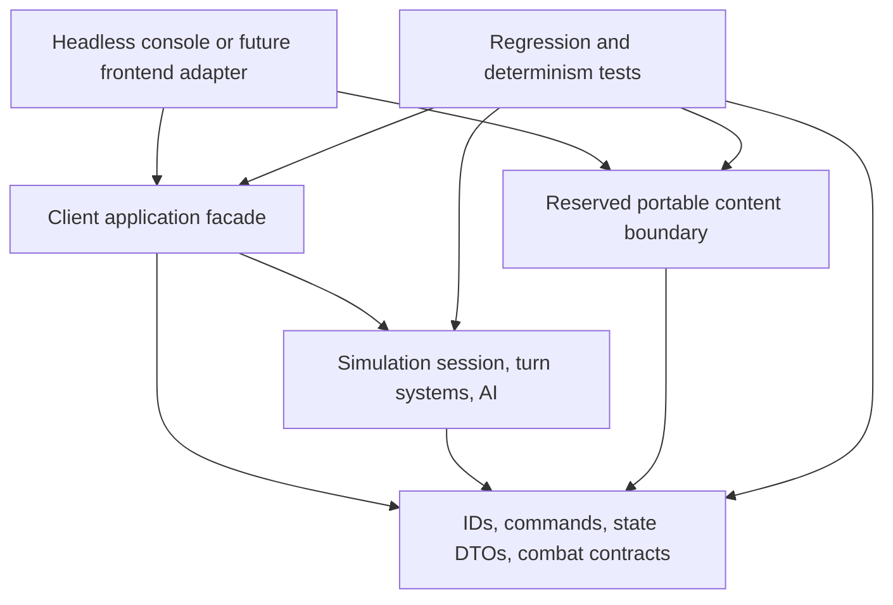
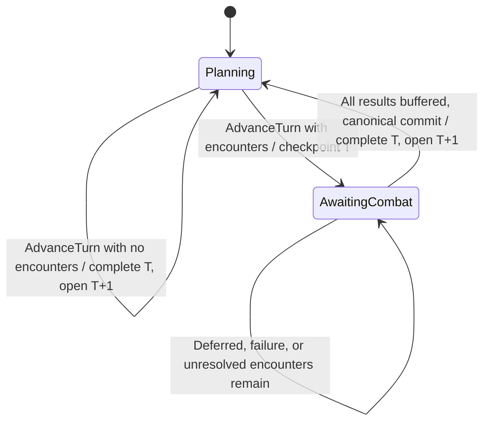

# Phase 1 portable strategy simulation

Status: Phase 1 identity/session foundations, Phase 3A civilization/scenario identity and galaxy graph, Phase 3B turn/staging lifecycle, Phase 4A colony economy, Phase 4B civilization research, Stage A production, Stage B fleets/routes/movement, Stage C deterministic AI/headless acceptance, Stages D1–D3 campaign combat lifecycle integration, and Stages E1–E3 deterministic phased combat using the shared combat-boundary scaffold, a portable client Application boundary, the accepted strategic Unity UI, and Economy/Planets/Population Foundation v1. The accepted base includes Population Politics & Strategic Geography v1. The current candidate implements Science & Engineering foundation v1; see [current rules/versions/baseline](science-engineering-v1.md). The population/economy reference below is historical. No legacy implementation is copied. The engine and initial scenario are new work based on the requirements in this project. Feature implementation follows this document in small, tested increments.

## Goal and boundaries

Build a headless strategic vertical slice with reproducible turns, explicit state and commands, and content separated from rules. The long-term product is a DS9/Dominion War-era BOTF spiritual successor, but the engine must contain no franchise names, UI objects or renderer assumptions.

Phase 1 includes seeded randomness, stable IDs, civilizations, systems/ownership, colonies/population, a small economy, production queues, research, ship designs, ships/fleets, graph movement orders, a strategic turn lifecycle and a simple rule-based AI. Combat has an authoritative pending-encounter lifecycle and request/result contracts; Phase 1 uses DeterministicPhasedCombatResolver with detached pre-battle fleet plans, simultaneous range volleys, shields, hull damage, destruction and retreat. NoLossCombatResolver remains a separately identified reference resolver. Invasion, diplomacy, espionage, fog of war, faction-specific abilities, tactical movement/individual weapons, multiplayer and legacy save import are deferred.

The current implementation contains typed stable IDs, persisted global entity allocation, campaign/encounter RNG, common identity/civilization/system DTOs and structural validation, plus the existing combat DTOs/interface and narrow combat-boundary helper for request allocation and result buffering. Tests exercise these boundaries. It now includes a SimulationSession with owned state, command validation/results, persisted deduplication and detached immutable snapshots. It includes the fixed scenario identity/graph skeleton, persisted Human/AI controllers and ownership, and deterministic route queries. It implements the atomic turn lifecycle, persisted campaign phase and the Economy phase for colony population/stocks and credits, plus six-discipline Science state, Engineering application definitions/maturity, stamped research plan commands and the Research phase. It now connects ship-design content, colony production queues, ships/fleets, explicit routes/movement and deterministic AI through the shared command path. Twenty-five-turn acceptance tests cover repeated runs, reordered inputs and save/reload. Post-Movement encounter detection, authoritative AwaitingCombat checkpoints, canonical result buffering/finalization and the production phased battle resolver are implemented. Acceptance includes arbitrary result order and reloads during combat.

## Proposed solution

Use the pinned .NET 10 SDK to build the solution, with different runtime targets for portable libraries and hosts. SDK/compiler version does not determine a library's runtime requirement. All projects use nullable reference types, deterministic compiler output and warnings as errors. The test project uses xUnit; production projects have no external packages. No dependency on UnityEngine, WPF, networking libraries, BotF2 or 3DBOTF2 is allowed.

| Project | Target | Responsibility | Project references |
|---|---|---|---|
| HobbyDS9.Contracts | netstandard2.1 | Stable IDs, command/result contracts, explicit state/definition/save DTOs, combat boundary | None |
| HobbyDS9.Simulation | netstandard2.1 | State validation, command execution, turn systems, deterministic RNG, AI policies | Contracts |
| HobbyDS9.Scenarios | netstandard2.1 | Reserved portable content boundary; current scenario is a host-loaded JSON package | Contracts |
| HobbyDS9.Application | netstandard2.1 | Client session facade, scenario/save construction, immutable content/navigation projections, detached combat resolution | Contracts, Simulation |
| HobbyDS9.Headless | net10.0 | Console composition root, JSON/file I/O, scenario input, commands, turns, snapshots | Contracts, Application, Scenarios |
| HobbyDS9.Simulation.Tests | net10.0 | Determinism, lifecycle, boundary, persistence and scenario acceptance tests | Contracts, Simulation, Scenarios, Application |

The four libraries use C# 9 and explicit usings. Avoid records/init-only properties that require an IsExternalInit shim, newer required-member metadata, and runtime APIs absent from .NET Standard 2.1. Use ordinary concrete DTO classes, readonly structs, List<T>/IReadOnlyList<T>, ordinal string comparisons, checked/unchecked integer arithmetic, Encoding.UTF8 and SHA256.Create/ComputeHash rather than newer static HashData APIs. System.Text.Json, file I/O and host services belong in adapters, not the portable contracts. Future APIs must compile against the netstandard2.1 reference surface; do not bypass that check with net10.0 packages or host project references.

The current Contracts implementation uses readonly identity structs, ordinary DTO classes, enums, string/int/long/ulong properties, nullable RNG state, List<T> and a synchronous interface. Simulation uses only .NET Standard 2.1 APIs: collections/LINQ, ordinal comparisons, invariant formatting/parsing, enum validation, explicit integer arithmetic and System.Numerics.BigInteger for safe refund/combat multiplication, aggregation and ratio comparisons. Scenarios remains empty except for a source manifest. Build validation checks the reference surface, and tests inspect compiled target/dependency metadata. This confirms the scaffold's API compatibility, not future APIs or Unity execution.

This is a modular monolith. Scenarios must not execute turns, and simulation must not load files, consult clocks, read console input, or know a scenario's franchise identity. The host performs I/O. Nothing in the domain depends on the host or tests.

Unity 6 can consume these .NET Standard 2.1 libraries directly through a frontend adapter, using Unity's .NET Standard 2.1 API compatibility setting. The simulation does not require a .NET 10 runtime. The console/test hosts use .NET 10 on Windows, Linux and macOS. Unity compilation, managed stripping and IL2CPP/AOT must still be verified during frontend integration; no Unity runtime is present in this workspace. Avoid reflection-based runtime construction and dynamic code generation in the libraries. Unity selects its own serialization adapter; the headless host's JSON implementation is not a mandatory Unity dependency.

## Client/application boundary

`HobbyDS9.Application` is a synchronous, local facade. `ICampaignSession` exposes only Application/Contracts types; no Simulation session, graph implementation, compatibility helper, handler registration or trusted AI path is public through this API. `CampaignApplication` has a private constructor. Its factories validate inputs, construct Simulation compatibility internally, and retain no caller-owned mutable DTOs. Simulation remains the sole authoritative state owner; the facade adds no mutable gameplay state and does not duplicate rules or transactions.

`StartScenario(ScenarioDto)` validates content and initial state. `LoadSave(ScenarioDto, SaveEnvelopeDto)` validates the content package and matching save identity and returns a new session, so failed loads cannot replace a running session. `ExportSave` returns a deep detached DTO. `ValidateScenario` and `ValidateSave` expose immutable lists of Contracts validation issues without exposing Simulation's ValidationReport. Invalid creation/load inputs throw ArgumentException; ordinary live command, turn and combat-submission failures return the existing stable codes. File selection, JSON parsing/writing, exact-byte content hashing and atomic file replacement are host responsibilities, not portable engine services. There is no new save schema or serialization dependency.

`CaptureSnapshot` returns a `CampaignSnapshot` containing the existing immutable `SessionSnapshot`, immutable scenario names/research definitions and an immutable navigation map. Names remain content, never rules. Ship design facts already appear in the campaign snapshot. `AcceptedPlayerCommandIds` projects the current persisted ledger excluding the reserved `ai-command.` namespace; it is not a historical action log and does not retain command payloads. `CommandResult` reports acceptance immediately, and the ledger remains until successful turn completion. All existing campaign facts remain available; this is a local trusted client boundary, not multiplayer authorization or fog-of-war filtering.

`SubmitCommand` delegates the four existing command variants unchanged. `SubmitFleetRoute` translates navigation node steps into the existing fleet-route envelope, then uses the same handler/control/stamp validation. Callers provide stable command IDs and the turn/revision they observed. The facade never generates IDs, silently refreshes revisions, retries commands, automates humans or exposes trusted AI execution. Every mutating operation retains Simulation's staging, rollback and exactly-once revision behavior. Snapshots are atomic observations; separate calls may observe different revisions, so clients must handle stale results. DTOs supplied to calls must not be concurrently modified by the caller.

Combat remains explicit: `AdvanceTurn` runs strategic phases once, requests are frozen at AwaitingCombat, `GetPendingCombatRequests` / `GetResolvedCombats` return detached DTO copies, and `ResolveCombat` performs pure independent phased resolution with default or explicit plans. It neither buffers nor finalizes. `SubmitCombatResult` performs existing stamped validation/buffering; `FinalizeCombat` commits all consequences canonically. Old snapshots and returned DTOs cannot mutate the checkpoint. Invalid plans throw without mutating campaign state. The facade pins the existing phased resolver; it does not add a resolver registry, tactical system, combat-plan persistence or replay history. A client may resolve off its UI thread on detached inputs, but scheduling/cancellation belongs to the host. Campaign RNG/allocation never participates in resolution.

Navigation presentation uses a distinct `NavigationNodeId`, optional `AssociatedSystemId`, explicit link costs, and route steps/cost independent of turn estimates. The compatibility adapter currently maps each existing graph node one-to-one with its system ID and delegates deterministic BFS; all links cost one, including wormholes. Client code should associate nodes with systems through the projection, never by casting/parsing node IDs. A future navigation model can supply transit nodes without systems and change the adapter while retaining this client vocabulary. Current fleet/system DTOs and raw route envelopes retain their existing semantics for compatibility; presentation navigation should use `FindRoute` / `SubmitFleetRoute`. No independent navigation graph, Voronoi geometry, variable costs, movement budgets or weighted route search is implemented. Those require a later versioned gameplay increment.

Headless is the first consumer and references Application instead of Simulation. CI still runs locked restore, Release build, all tests and canonical/reverse 25-turn smoke runs on Linux, Windows and macOS. Application acceptance additionally compares every turn/result and persisted checkpoint with the direct Simulation path, exercises ownership/validation/failed turns, and verifies netstandard2.1 plus a public API free of Simulation types. The population milestone now versions saves/content/rules as described below; combat resolver version 1 remains unchanged.

## State, definitions and stable identity

Use a readonly EntityId value type with validated canonical string values, ordinal equality and ordinal ordering. All commands refer to EntityIds, not object references or list indices. Definition IDs use a separate readonly DefinitionId. Reject empty, noncanonical or duplicate IDs. Initial scenario IDs are authored; newly produced entities use a persisted monotonic sequence with category prefixes. Allocation order is part of the rules. Never use Guid.NewGuid, randomized string hashing or process-specific counters for simulation identity.

Canonical IDs match `[a-z][a-z0-9._-]{0,127}`. EntityId and DefinitionId validate without trimming or normalization and implement ordinal equality/ordering with deterministic ASCII FNV-1a hash codes. DefinitionId and EntityId.FromAuthored reject the reserved `.spawn.` namespace. A default identity struct is uninitialized: IsValid is false, and Value/CompareTo throw instead of treating it as a valid ID. DTO boundaries serialize validated strings, not the identity structs themselves.

Runtime IDs use `<category>.spawn.<16-digit-lowercase-hex-sequence>`. EntityIdAllocator uses one persisted unsigned 64-bit sequence across categories, beginning at 1. Invalid categories/overlong resulting IDs do not advance it. Categories use the canonical ID grammar, cannot contain `.spawn.` or end in `.spawn`, and must fit the full 128-character resulting ID limit. NextEntitySequence=ulong.MaxValue is a valid exhausted state; allocation refuses that value before changing the counter, so the final allocatable sequence is ulong.MaxValue-1. This avoids wrapping/recycling and needs no extra exhaustion flag. EntityAllocationStateDto captures/restores the counter independently of mutable DTO instances.

Definitions are immutable input records: civilization traits/capabilities, ship designs, facility upgrades, Engineering applications, planet/species/infrastructure/resource definitions and map nodes/edges. State contains mutable facts: ownership, population, inventories, queue progress, research progress, ships, fleets, routes and RNG state. State refers to definitions by ID. UI names and descriptions belong in content, not simulation branches.

Runtime indexes may use dictionaries for lookup, but all iteration that affects rules must be explicitly sorted by ordinal IDs. JSON DTOs expose arrays/lists, not runtime dictionaries, controller references, polymorphic CLR type names or engine objects. Query snapshots are copies/read-only projections; consumers must not mutate session state through returned collections.

State records (implemented fields except future definition capabilities):

| State | Essential fields |
|---|---|
| GameState | TurnNumber, StateRevision, NextEntitySequence, RNG state, phase, accepted command IDs for the current planning turn, pending encounters, buffered resolved requests/results, all entity lists (content/rules identity lives on the envelope) |
| CivilizationState | ID, definition ID, controller kind, credit treasury, research progress/unlocks |
| StarSystemState | ID, definition ID, optional owner ID (colonies reference systems) |
| ColonyState | ID, system ID, planet ID, cohorts, infrastructure, stability, food/resource inventories, production queue |
| QueueItemState | ID, definition ID, kind, required/completed industry, paid/reserved costs |
| ShipState | ID, design ID, owner ID, fleet ID, hull status |
| FleetState | ID, owner ID, location system ID, ordered route system IDs |
| PendingCombat | Detached combat request: encounter/turn/location IDs, canonical participant snapshots, resolver/content/rules identity, encounter-local initial RNG state |
| ResolvedCombat | Original frozen request plus validated result, buffered until canonical campaign commit |

Ownership is authoritative on StarSystemState; ColonyState persists an owner ID that validation requires to match its system. Fleets and ships carry explicit owners with invariants enforcing consistency. A neutral inhabited colony is valid, but receives no civilization commands or research contribution. Map nodes such as wormhole endpoints can have no colony and be noncolonizable. No capture mechanic is included in Phase 1.

## Explicit serialization and content separation

The headless host uses System.Text.Json over concrete DTOs. Contracts defines DTOs without serializer attributes or dependencies; Scenarios validates and constructs content from DTOs already decoded by the host. Define ScenarioDto, DefinitionCatalogDto, GameStateDto and SaveEnvelopeDto. A versioned envelope records SaveFormatVersion, RulesVersion, ScenarioId, ContentHash, TurnNumber/Revision, entity allocation state and RngStateDto. The serialized campaign state includes all current mutable strategic facts needed to continue. Campaign saves include pending encounter requests with local RNG inputs and buffered resolved requests/results. Strategic events remain empty; no in-progress event history is invented. Loading partially resolved combat must never allocate seeds again or re-run a resolver for a buffered result. CombatCheckpointDto is the shared combat subset adapted from GameStateDto; it is not a complete campaign save. Campaign resume must validate the supplied content hash/rules version rather than silently using different definitions.

The host converts DTOs through validation into an owned simulation session. Runtime classes are not the save contract. Validate every ID/reference, nonnegative bounded resource/population/queue values, route edge, design/faction association, RNG algorithm/version and sequence counter before accepting a save. Unknown schema/rules versions fail clearly; do not invent an automatic migration in this phase.

Future canonical snapshot hashing will use fixed property order, entity arrays sorted by ID, encounter/result arrays normalized by location ID, and semantically ordered arrays preserved in order (routes, queues and events), ordinal strings, explicit UTF-8 encoding and invariant numerical representation. The planned portable canonical writer will use .NET Standard-compatible byte/string operations; do not make its algorithm depend on the host JSON serializer. Hash normalized logical state, not incidental whitespace or dictionary ordering. Diagnostic timings and trace strings are excluded. System.Text.Json output is not automatically a permanent cross-version canonical format; define/test the canonical writer separately.

The future canonical ContentHash will identify rules-relevant definitions and scenario structure; cosmetic labels/translations are excluded and may have a separate presentation-package hash. This allows content-label changes without changing simulation outcomes or gameplay identity.

The initial DS9-themed JSON package is under scenarios/ds9-slice, outside production source. It contains only authored names/IDs and numerical definitions, no imported art, sound, text descriptions or legacy data files. Engine tests should also use franchise-neutral fixtures to detect accidental content coupling.

## Implemented foundation contracts and validation

This increment introduces RngStateDto, EntityAllocationStateDto, EntityIdentityDto, DefinitionCatalogDto, GameStateDto, ScenarioDto and SaveEnvelopeDto. GameStateDto currently stores required SessionPhase and turn/revision stamps, next entity sequence, RNG state, accepted command IDs for the active planning turn, identity headers, civilization state with persisted ControllerKind, star-system state with optional civilization ownership, planets, population cohorts, infrastructure, stability, local resources, displacement, delivery receipts and cumulative statistics, credits, civilization Science/Engineering state and research receipts, production queues, ships and fleets/routes, pending combats and buffered resolved request/results. DefinitionCatalogDto stores the identity list plus civilization/system definitions with presentation labels and data-defined undirected galaxy edges; it now also contains PlanetDefinitionDto, SpeciesDefinitionDto, InfrastructureDefinitionDto, ResourceDefinitionDto, EngineeringApplicationDefinitionDto and ShipDesignDefinitionDto values; infrastructure construction remains deferred. TurnNumber is persisted and advanced by the authoritative staged turn transaction. CombatCheckpointDto remains the shared validated combat subset; its required fields are persisted in the full campaign state.

FoundationVersions.SaveFormatVersion=13 and ContentFormatVersion=9 describe the current candidate schema. Required lists may be empty but cannot be missing/null: campaign civilizations, systems, colonies, ships, fleets, accepted IDs, PendingCombats and ResolvedCombats; colony queues; fleet membership/routes; six Science disciplines; Engineering progress/Mature applications/prerequisites/Science requirements; ship designs/Engineering requirements. Ship designs and frozen combat ships require aggregate combat profiles. Versions 1–12 and earlier/unknown content formats are rejected without migration. Known campaign phases are Planning and AwaitingCombat; authored state starts in Planning. The fixed scenario pins science-engineering-v1 and its exact package hash. DTOs resume both strategic turns and partially resolved combat; hosts use their own JSON adapters with no serializer attributes, CLR type discriminators or runtime dictionaries in portable contracts.

FoundationValidator returns an immutable ValidationReport of stable ValidationCode/path pairs without changing input DTOs. It validates null/missing payloads, canonical/duplicate/reserved IDs, identity-to-definition references, positive turn/allocation counters, nonnegative revisions, well-formed generated IDs, and a counter strictly greater than every allocated sequence present. Global allocated sequence reuse across categories is rejected. Removed/cancelled entities do not require a contiguous live sequence; allocation never rewinds. Authored ScenarioDto state starts at turn 1, revision 0 and next sequence 1, and cannot contain runtime IDs. Future gameplay invariants accompany those schemas.

RngStateDto requires the exact supported algorithm ID/version and a present full unsigned 64-bit State; nullable State distinguishes omitted data from valid zero. SaveEnvelopeDto also requires the supported save format and exact rules/scenario/content identity against an immutable host-supplied SaveCompatibility. ContentHash is a canonical lowercase 64-digit SHA256 string. This validator verifies its shape and compatibility, not the provenance of definitions or the future canonical content-hash computation. The host must provide the identity of the content it actually loaded. Unknown save/RNG versions fail; no migration or silent substitution is performed.

SplitMix64Random provides the campaign stream and detached RngStateDto capture/restore. EncounterRandomStream wraps an independently owned instance of the same generator; combat requests retain separate streams and outcomes remain order independent. The existing combat allocator now uses EntityIdAllocator and shared canonical-ID validation so there is one allocation/RNG/ID grammar implementation.

GitHub Actions runs locked restore, Release build and the complete test suite on pushes and pull requests, on Linux, Windows and macOS, using the SDK pinned in global.json. Local cloud bootstrap remains optional; CI uses setup-dotnet directly and needs no workspace-specific paths.

## Implemented Phase 3A galaxy model

StarSystemDefinitionDto contains DefinitionId and DisplayName; StarSystemStateDto contains stable SystemId, DefinitionId and nullable OwnerCivilizationId. Traversal-only nodes use the same model. CivilizationDefinitionDto holds labels separately from CivilizationStateDto, whose nullable ControllerKind distinguishes a missing controller from Human/AI. Phase 4A adds colony/population/stocks and credits separately; Phase 4B adds research state; ship/fleet facts and production queues are now implemented separately.

Catalog GalaxyEdges reference stable system entity IDs, with explicit Normal/Wormhole kinds. The supplied content catalog is pinned by the save's content/rules identity and provided again at reload; immutable topology is not duplicated into mutable campaign state. GalaxyGraph validates duplicate nodes, missing endpoints, self-edges, duplicate/reversed edges (even with different kinds), invalid IDs and missing/unknown kinds. Disconnected graphs and isolated nodes are valid. Runtime edges canonicalize A < B by ordinal ID and sort by endpoints; adjacency is immutable and sorted by neighboring system ID. Neither graph construction nor queries consume RNG, allocation or revisions.

FindRoute uses deterministic breadth-first search, returning the first shortest route according to sorted adjacency. RouteResult.Steps excludes the origin and includes the destination; origin == destination returns an empty route. ValidateRoute accepts an explicit ordered list of typed system IDs, checks origin and each edge, and returns stable route error codes. Empty routes are valid and backtracking is allowed; self steps, missing nodes and nonadjacent steps are rejected. Both edge kinds have unit traversal cost. These helpers are pure queries; SetFleetRoute uses route validation and Movement consumes the validated route. SimulationSession.Galaxy and snapshot civilization/system/edge projections expose immutable data.

The headless adapter hashes the exact UTF-8 scenario.json bytes with SHA256 and supplies ContentHash after decoding; the file excludes its own hash. This is the implemented package fingerprint (currently content format 6), including labels and whitespace. The canonical rules-only hash described above remains future work and requires deliberate content versioning. Graph results remain independent of labels and DTO/input order.

## Implemented planet/population economy v1

The prototype economic profiles and scalar colony population have been replaced. [Economy/population v1](economy-population-v1.md) specifies the authoritative formulas, habitat allocation, infrastructure, local physical resources/logistics, stability, migration, refugees and compaction. Save 10/content 6/rules `population-economy-v1` require explicit planet, cohort, infrastructure, stockpile, displacement and statistics state. Systems can contain multiple planets; the DS9 slice includes Earth and Mars within Sol. Settlement ownership remains consistent with system ownership in this increment.

All mutations occur on turn staging. Economy may allocate/retire cohort and displacement identities; unrelated identities, controllers, topology, installed infrastructure and definitions stay protected. Research consumes derived institution/skilled-population output; Production consumes powered installed industry. Neither stores derived output. Overflow, invalid state or later phase failure rolls back the entire transaction, including demographic memories, delivery receipts, RNG and allocation. No new political/combat triggers are introduced.

## Implemented Science & Engineering foundation v1

[Science & Engineering v1](science-engineering-v1.md) replaces the generic research-node/reserve/unlock path. Save 13/content 9/rules `science-engineering-v1` persist research pace, per-civilization discovery seed, six explicit level/progress disciplines, focus, allocation BPS, separate reserves, Engineering target/per-application progress/Mature IDs and counters. The former save 12/content 8 is deliberately rejected without automatic migration. Research is inherited as flat explicit DTO fields on civilization state; no availability cache or derived schedule is persisted.

Science uses the specified 1–10 cost table, integer pace scaling, isolated deterministic schedules and exact threshold/level carry. Engineering uses checked adjusted costs, cross-discipline structural breakthrough requirements and acyclic Mature prerequisites. Integer floor maturity bands support Development/Prototype/Operational/Mature; only Mature unlocks ship designs. Existing world R&D output is split with a floor Science allocation and exact Engineering remainder, banked before spending. Nonzero starting reserves are starting stock, not generated-point counters.

`SetResearchAllocation`, `SetScienceFocus` and nullable-target `SetEngineeringTarget` use the same Planning/control/stamp/deduplication/staging boundary. Rejections change nothing. Accepted plan mutations increment revision once and spend no points; Research executes after Economy and before Production on turn staging. Discovery seeds, allocation and focus are protected from non-command turn phases; only Research may change research progress/reserves/receipts. Economy, Production, Movement and Combat cannot mutate research state. Exceptions/invariant failures discard the entire staged turn.

AI retains authored allocation and a valid non-maxed focus, otherwise selects by lowest level/exact progress fraction/enum. It retains a valid target, otherwise picks an eligible application by adjusted remaining cost/ordinal ID. All AI plan changes use the trusted stamped command handlers; humans are never automated. Research consumes no campaign RNG or entity IDs.

The Application facade supplies immutable research summaries/cards/requirements/options and bounded canonical latest-turn receipts. Unity's existing Research section displays these projections, with explicit split Apply/focus/target/clear actions and typed SFX outcomes; no rule arithmetic runs in Unity. Client-only VSync defaults do not enter saves, Simulation or project graphics settings. Final cloud baseline and local Unity acceptance commands are in the milestone document.

## Determinism contract

For the same validated definitions, rules version, initial state, command sequence and RNG state, the simulation must produce exactly the same ordered outcomes and logical state after every turn. This is an in-process rules contract across supported platforms, not a promise that different future rules versions have the same outcomes.

Use a specified SplitMix64 generator with explicitly unchecked 64-bit unsigned arithmetic. Persist its algorithm ID, algorithm version and full 64-bit state. Draw bounded integers with rejection sampling, not floating-point scaling or modulo bias. Version the exact bounded-draw algorithm too; variable retry draw counts are part of reproducibility. No System.Random, Random.Shared, Unity randomness, clocks or thread-local generator is permitted in rules.

Algorithm ID: splitmix64-rejection-v1. Each raw draw adds `0x9e3779b97f4a7c15` to state modulo 2^64; copy state to z, then apply `z = (z xor (z >> 30)) * 0xbf58476d1ce4e5b9`, `z = (z xor (z >> 27)) * 0x94d049bb133111eb`, and return `z xor (z >> 31)`, with both products modulo 2^64. For an exclusive positive bound b, compute threshold as `(0 - b) modulo 2^64`, then modulo b; reject draws smaller than threshold and return the accepted draw modulo b. A zero bound is rejected before drawing. Seeding sets state to the supplied unsigned 64-bit seed without additional draws.

Use integer units for population, food, physical resources, credits, industry, research and graph distances. Guard overflow and validate upper bounds. No floating-point physics or frame delta enters movement/economy/combat state. Use a single writer to advance turns; no parallel rule evaluation in Phase 1.

AI factions are processed by ID. Candidate actions are sorted by ID. The simple AI uses RNG only for ties where multiple equally scored legal options remain; deterministic options must not consume unnecessary draws. Rejected commands consume no randomness, IDs or resources. Serialization/reload must preserve the next draw and allocation order.

## Command API and atomicity

The public session entry point accepts a CommandEnvelope with CommandId, ActorCivilizationId, ExpectedTurn, ExpectedRevision, CommandKind and one concrete typed payload. Implemented commands are EnqueueProduction, CancelProduction, SetResearchAllocation, SetScienceFocus, SetEngineeringTarget, SetFleetRoute and SetWorldGovernancePolicy. AdvanceTurn is a host/session operation, not a faction command.

Use an explicit closed command discriminator and DTO mapping; do not serialize CLR type names or load arbitrary subclasses. Stable command IDs permit duplicate detection within the current planning turn. StateRevision changes on each accepted state mutation; commands must match the current revision. The host can refresh/retry planning explicitly when a previous command changed revision. The complete replay includes rejection outcomes too, though rejection does not change state.

Validate actor existence/control, ownership, target references, prerequisites, resource availability, legal route adjacency and expected turn/revision before mutation. Return CommandResult with accepted/rejected status, stable error code and resulting revision. Exceptions are for programming/invariant errors, not ordinary invalid player actions. Commands and outcomes have canonical order matching submission order. AI submits through the same validator, with an internal trusted controller path that still enforces gameplay legality.

The implemented foundation session copies validated save/catalog inputs. Its constructor no longer accepts actor/control registries: actor existence and local Human control derive exclusively from persisted CivilizationStateDto. AI civilizations return ActorNotControlled on the public player-command path; AI planning uses an internal trusted path requiring persisted AI control while preserving the same validation/handler/staging pipeline. ActorSnapshot.IsControlled is a convenience projection of ControllerKind == Human, not remote authentication. Typed civilization/system identities must match their global identity header and the correct definition category; system owners must reference existing civilizations. Public commands use the four concrete payload slots above, all four gameplay handlers are functional. The internal test handler registration seam remains for transaction tests.

Common validation order is envelope completeness, canonical command/actor IDs (including rejection of the reserved ai-command. prefix on public calls), actor existence/control, Planning phase, expected turn, duplicate ID, expected revision, discriminator, payload shape, handler availability, then revision capacity. ExpectedTurn and ExpectedRevision are nullable DTO fields so missing values cannot become valid defaults. Duplicate detection precedes stale revision detection, so replaying an accepted envelope reports DuplicateCommand. Rejections return stable CommandErrorCode values and the current turn/revision, reserve no IDs, and leave state, RNG, allocator and revision unchanged. Rejected IDs may be retried. Accepted transactions increment StateRevision exactly once and persist the command ID; long.MaxValue rejects further mutations without overflow.

Handlers receive only a detached staging copy. Validation and an additional copy at commit prevent retained handler references from mutating authority. Handlers cannot alter phase/turn/revision/deduplication bookkeeping; invariant/programming faults throw and preserve authoritative state. Snapshot projections contain immutable elements and copied read-only collections. Entity collections are ordinal; queues, membership and routes retain semantic order. ExportSave supplies a separate deep-copied DTO for host serialization. No JSON or file APIs enter Simulation. Inputs must not be mutated while being submitted. A session lock serializes reads and submissions; host submission order determines concurrent command order, and nested command execution is a programming error.

The ledger survives export/reload and is cleared only by a successful turn completion. Snapshots expose campaign phase and foundation diagnostic state without multiplayer visibility filtering.

### Implemented staged turn transaction (strategic vertical slice)

SimulationSession.AdvanceTurn(int expectedTurn, long expectedRevision) is a host operation, separate from CommandEnvelope. It checks Planning phase, expected turn, expected revision, turn-number capacity and revision capacity before executing any phase. Stable TurnErrorCode values report ordinary failures; int.MaxValue turns and long.MaxValue revisions reject without overflow. Replaying the same request after a successful turn returns StaleTurn, never another successful advancement. Commands outside Planning return CommandErrorCode.CombatPending, and AdvanceTurn returns TurnErrorCode.CombatPending without processing phases.

AdvanceTurn deep-copies all authoritative state and runs the fixed internal boundaries once in this order: AI planning, economy, research, production, movement, encounter creation. All six phases have built-in behavior. EncounterCreation may change only combat lists, phase, campaign RNG and allocation; it cannot change any strategic gameplay facts. An internal test probe supports observation, deliberate rejection and exceptions, never rule mutations; there is no public phase registration or plugin framework. Every phase validates staged state. AI changes arise only from accepted shared-handler commands and successful tied-route draws. Economy owns cohorts/food/resources/stability/credits, deposits, displacement, delivery receipts and demographic statistics; Research owns reserve/target/unlocks; Production owns queue head progress/removal and ship/fleet creation/membership/allocation; Movement owns exact one-step location/route consumption. Unrelated identities/ownership/controllers/installed infrastructure and content capacity definitions stay protected. Phase probes cannot mutate even valid facts.

Without encounters, a single validated turn commit completes T, opens Planning T+1, increments StateRevision once beyond staged revision and clears accepted IDs. With encounters, it instead commits AwaitingCombat at T, advances revision once beyond staged revision and retains accepted IDs. Each accepted AI command already increments staged revision once; all those increments commit together or roll back together. Economy/Research/Production/Movement do not separately increment revision. Campaign RNG changes for successful AI route ties and one draw per encounter; allocation changes for enqueue, produced entities and one transient encounter ID per battle. A final deep copy protects authority from retained phase references. Any PhaseFailed rejection, exception, invariant failure or overflow discards every phase and preserves the original ledger/state/RNG/sequence. Nested mutation is a programming error, and the session lock prevents partial-turn observations.

TurnResult has stable Rejected, Completed and AwaitingCombat statuses; all three are implemented. AttemptedTurnNumber records the authoritative turn at entry, TurnNumber/StateRevision/Phase record authoritative state after the operation, and CompletedTurnNumber is present only for Completed. CommandResults contains AI submission results in actor/action execution order; rejected turns return no committed action results. Events remains empty. No gameplay/completion event codes were introduced. AwaitingCombat reports the same T without falsely reporting completion; finalization reports Completed for T and opens T+1.

Save format 10 requires explicit PendingCombats/ResolvedCombats lists and authoritative phase. Planning requires an empty batch. AwaitingCombat requires a nonempty union of pending/resolved requests frozen from the end-of-Movement state. Validation checks current turn, content/rules/resolver identity, complete contested locations, original fleet membership/owner/location and ship design/hull. Encounter IDs advance the global sequence but are transient and have no normal EntityIdentities headers; sequence reuse with live headers is rejected. Older schemas are rejected without migration.

SubmitCombatResult(CombatResultDto, expectedTurn, expectedRevision) is a separate owned mutation. Hosts may select any pending detached request and call ICombatResolver outside the session. Ordinary invalid submissions return stable errors; Deferred leaves everything unchanged. Resolved buffers a canonical owned request/result and increments revision once without applying damage/retreat. Previously resolved requests are excluded from pending queries and duplicate submission is rejected. A resolver exception cannot alter authoritative state.

FinalizeCombat(expectedTurn, expectedRevision) is explicit and requires no pending requests and at least one resolved result. It stages the entire batch, applies canonical consequences, validates, then atomically clears the batch/ledger, opens Planning T+1 and increments revision once. It consumes no RNG or IDs. Failure preserves the complete AwaitingCombat checkpoint for retry without recomputing results. GetResolvedCombats supplies canonical detached requests, ordered events and results before finalization; TurnResult.Events remains an empty strategic collection. Hosts that need playback/history retain those detached results before the batch is cleared.

This slice has one host-owned planning session. Multiplayer readiness, per-player deadlines, hidden-information filtering and remote authentication are future adapters/policies, not dependencies added now.

## Turn lifecycle

The initial state is Planning turn 1. Human strategic commands are accepted only in Planning. There is no wall-clock advancement. The table and diagram describe the implemented lifecycle. All strategic phases run on one staging copy; independent resolution and finalization are separate explicit operations.

| Phase | Behavior and ordering |
|---|---|
| 1. AI planning | AI civilizations sorted by ID generate legal commands using pre-economy state; execute through command validation |
| 2. Economy | Worlds produce food/resources, execute physical logistics, update needs/growth/stability/credits, then migrate/resolve displacement |
| 3. Research | Sum controlled-colony research output, apply to one target per civilization, unlock completed node; at most one unlock per turn initially |
| 4. Production | Apply industry to each colony's queue head; at most one completion per colony per turn; excess industry is discarded for this slice |
| 5. Movement | Each fleet traverses at most one graph edge; route is consumed in order; wormhole edges use the same deterministic movement cost |
| 6. Encounter checkpoint | Group opposing fleets by node, create canonical PendingCombat requests and allocate encounter-local RNG inputs; commit AwaitingCombat if any exist |
| 7. Combat resolution | Resolve any pending encounter using its own frozen RNG input; validate and buffer each result atomically; Deferred keeps the session blocked |
| 8. Finalize | Only with all results buffered: apply consequences in canonical order (events are presentation data), validate, increment turn once, clear deduplication and open Planning |

AwaitingCombat is authoritative state, not a notification. Strategic commands and AdvanceTurn return a stable CombatPending rejection in this phase, without changes to state, RNG or IDs. Save/load preserves this phase and resumes at resolution, never re-running AI, economy, research, production or movement. No intermediate planning turn exists. Phase 1 needs no general phase cursor: Planning means strategic processing has not run; AwaitingCombat means all strategic phases have committed. Partial strategic processing is never persisted.

Validate the phase/batch invariant on every commit and load: Planning has no pending encounters, buffered results (strategic events are empty). AwaitingCombat has a nonempty encounter batch (the union of pending requests and buffered resolved requests), all stamped with current TurnNumber and matching campaign content/rules identity. No encounter ID, fleet or ship appears more than once across that union. An empty pending list with buffered results is valid AwaitingCombat state ready to finalize; it still blocks strategic commands/AdvanceTurn until the campaign commit succeeds.

With no encounter, AdvanceTurn(T) opens Planning(T+1) in its single commit. With encounters, AdvanceTurn(T) leaves TurnNumber=T in AwaitingCombat. Each accepted resolved result increases revision once; final campaign commit increments revision once more and TurnNumber once. TurnResult.Events stays empty; ordered combat events are available in the buffered detached results before finalization. A host may automatically resolve all pending encounters and finalize, but this convenience is outside AdvanceTurn; callers can save the authoritative checkpoint or a partially resolved batch first. Failed finalization preserves all buffered results for retry.

Movement snapshots the fleet-ID list at the start of the movement phase. Ships completed during production join an existing stationary owned fleet at the colony, chosen by lowest fleet ID, or create a new stationary fleet; a newly created fleet has no route and therefore does not move. Existing stationary fleets have empty routes by definition. A ship must not join a routed departing fleet implicitly.

Production pays credit/strategic-resource costs atomically when enqueued, recording the paid amount on the queue item. Cancellation refunds the unused proportion of paid costs using documented integer floor division; completed industry is discarded. The first slice does not support queue reordering, rushing, maintenance, stockpiled industry or recurring templates. Research spending cannot also consume production industry; the research output derives from institutions and skilled population. Future resource allocation must be an intentional rules change.

For each paid cost, cancellation refunds floor(paid × (requiredIndustry − completedIndustry) / requiredIndustry), using checked sufficiently wide intermediates and a strictly positive requiredIndustry. Generated ship/queue IDs are not recycled on cancellation. Accepted command IDs are persisted for the current planning turn and cleared only when that turn finalizes and opens the next planning turn, not when the AwaitingCombat checkpoint commits.

The current economy formulas and rounding rules are specified in [economy-population-v1.md](economy-population-v1.md). Local industry comes from powered infrastructure/automation; named resources are reserved at enqueue and consumed on completion or partially spent cancellation. Generic Materials and scalar population state have been removed.

Research prerequisites are definition-ID lists. EnqueueProduction checks current unlocks; an unlock during turn processing affects new commands in the next planning turn. Research overflow is retained as civilization research reserve, available for a subsequent target, but does not cascade into multiple unlocks in one phase.

## Fleets, movement and combat boundary

The galaxy is a node/edge graph rather than a renderer coordinate system. A route command provides an explicit ordered list of destination system IDs; validate every edge from the current location before accepting. Phase 1 does not need pathfinding: host/AI can use deterministic breadth-first search over ordinal neighbor IDs to choose a route. Traversal is one edge per turn; future variable speed and travel distance require a versioned movement rule.

### Authoritative encounters and resolver contract

Phase 1 treats every distinct civilization as opposing when its fleet shares a node with another civilization. Diplomacy can replace this hostility policy later. Create one multi-participant encounter per contested location, ordered by ordinal location ID. Allocate encounter IDs from the persisted entity sequence as `encounter.spawn.<16-digit-lowercase-hex-sequence>` in that order, keeping IDs within the canonical length limit regardless of location ID length. Turn and location remain explicit request fields. Participant snapshots sort by civilization ID, then fleet ID, then ship ID. A fleet participates in only one encounter in a turn. Snapshot creation occurs after all movement, not during sequential fleet updates.

The scaffold exposes SessionPhase, CombatCheckpointDto, PendingCombatDto, ResolvedCombatDto, CombatRequestDto, CombatResultDto and ICombatResolver in Contracts. Stable IDs are canonical strings only at this DTO boundary. CombatEncounterScaffold validates every encounter/location/civilization/fleet/ship/design/resolver ID at creation, restore, detached request retrieval and result ingress. IDs must match the documented lowercase ASCII grammar and length, without trimming, case folding or Unicode normalization. Allocated encounter IDs must fit the persisted sequence. Participant fleet/ship uniqueness and current turn stamps are also checked. SimulationSession maps IDs to immutable snapshot projections and checks existence, ownership and catalog references against authoritative state; canonical syntax alone does not prove those references exist. PendingCombat contains a detached, persisted request. Mutable DTOs are serialization carriers only: the session holds owned copies and supplies a fresh copy to a resolver, never live state or externally writable authoritative collections.

ICombatResolver.Resolve(CombatRequestDto) is the synchronous quick-resolve boundary. IPlannedCombatResolver adds Resolve(request, plans) for detached pre-battle choices. The resolver needs only the frozen request and plans, never a catalog or session lookup. Every request includes ship identifiers, current Hull, MaxHull and the complete combat profile, plus rules/content identity, resolver ID/version and encounter-local RNG algorithm/state. Resolver inputs never expose controller kind, franchise behavior, Unity objects, frame callbacks, clocks, networking or shared RNG. Future profile/plan extensions require deliberate versions but do not change campaign submission/finalization.

During canonical encounter creation, draw exactly one unsigned seed per encounter from the world RNG and persist it as CombatRequestDto.RandomState: the initial state of this encounter's independent stream, not the live campaign state. EncounterRandomStream owns a SplitMix64Random implementing the specified SplitMix64/rejection algorithm. Advance the campaign RNG during creation and checkpoint that advanced state with NextEntitySequence. Each resolver constructs a fresh local stream initialized from its own request state; it has no access to the campaign stream or other battles. Results return its final local state; combat draw counts never consume the world stream. Once generated, an encounter's result is independent of the order battles are resolved or viewed, or the number of draws consumed by another battle. Replaying cinematic events never calls RNG or submits another result. Deferred/failed retries use the same frozen request and RNG input. Resolver ID/version and content hash are pinned in pending saves; a missing or incompatible resolver fails clearly rather than silently substituting a different algorithm.

Results carry encounter/resolver identity, Deferred or Resolved status, final encounter RNG state, ship hull changes, fleet hold/retreat/destruction changes, and concrete ordered events. Events have contiguous zero-based Sequence values; never sort them by entity ID after resolution. Changes are canonical lists sorted by stable ship/fleet IDs. Rules consequences come from explicit changes, not by replaying presentation effects. Events are data for later playback and have no effect on simulation timing.

The combat boundary validates a result before buffering it: it may target any still-pending encounter with the pinned resolver/version, must reference only participant IDs, contain no duplicate changes, satisfy hull bounds, and carry contiguous valid event sequences ending in exactly one EncounterResolved event. Null/malformed DTO fields or unknown enum values are rejected. SimulationSession additionally requires expected turn/revision for host-submitted results, checks event/consequence consistency and full fleet/ship invariants, validates retreat edges and occupancy against the frozen end-of-movement state, and applies changes in the final transaction. Public DTO buffers are serialization carriers; the session owns them and exports copies. The scaffold only returns new copies and deliberately does not apply campaign consequences.

Phase 1 creates encounters exactly once after movement. A fleet can belong to only one encounter in a turn, including both unresolved and already-buffered resolved encounters. Retreat never triggers a second encounter or additional movement that turn. Reject retreat into any original encounter location (including already-resolved locations), or a location containing an opposing fleet in the frozen end-of-movement snapshot. This rule never depends on which battles have resolved first. Multiple retreats to one node must be validated as a batch against original occupancy and each other; opposing retreating fleets cannot share a destination. A later battle-chaining rules version can relax this deliberately. The scaffold enforces the original-encounter-location restriction; the campaign additionally validates graph adjacency, frozen occupancy and opposing retreat conflicts. At final commit, destruction/retreat clears movement orders and removes destroyed ships/fleets consistently.

Deferred is an explicit unresolved result: no ship/fleet changes or events, unchanged encounter RNG, no revision change, and the pending request remains. It never opens Planning. Duplicate resolution cannot apply twice because a successful Resolved result moves its request from pending to the buffered result list; both original request and result remain persisted until campaign commit. No fleet can escape an unresolved encounter by receiving another strategic movement order.

Normal campaign encounters pin combat-resolver.phased version 1 and use the phased resolver described below. NoLossCombatResolver retains combat-resolver.no-loss version 1 for reference/unit/lifecycle isolation: it requires its own identity, returns one EncounterResolved event, unchanged local RNG and no consequences. It cannot impersonate the phased resolver. A surviving opposing fleet may encounter again on a later strategic turn, after the previous encounter completes. Plans are independent resolver inputs; they neither reopen strategic Planning nor enter the command ledger. Graphics can consume the resulting ordered trace without recalculating rules.

## Simple AI policy

Each AI faction can take a legal turn without a frontend: retain authored Science allocation/focus or choose a new focus by level/exact progress fraction/enum, and choose an eligible Engineering application by adjusted remaining cost then ID; if a controlled colony queue is empty and affordable, enqueue a permitted ship design by lowest industry cost then ID; route an idle fleet toward an adjacent interesting neutral/foreign node using deterministic candidate scoring. Break equal scores with the specified RNG. If no legal action exists, emit no command. AI does not colonize/capture or conduct diplomacy/combat in this slice.

Persist the controller kind on each civilization. Human factions are not secretly automated. AI choices depend only on the session snapshot/definitions/RNG, never on UI visibility, real time or thread scheduling. TurnResult.CommandResults carries AI command IDs for repeatable diagnostics; StrategicEvents remains empty.

## Fixed DS9-themed scenario

Implemented skeleton scenario ID: ds9-strategic-slice-v1, in scenarios/ds9-slice/scenario.json. Seed: 47. The host validates the package and constructs a queryable session without advancing turns. This is a testing setup, not a historically balanced campaign.

| ID | Content label | Initial owner / behavior |
|---|---|---|
| civ.federation | Federation | Human |
| civ.cardassian | Cardassian Union | AI |
| civ.dominion | Dominion | AI |
| system.sol | Sol | Federation owned, colony.sol |
| system.cardassia | Cardassia | Cardassian owned, colony.cardassia |
| system.founders-homeworld | Founders' Homeworld | Dominion owned, colony.founders-homeworld |
| system.bajor | Bajor | Unowned, neutral colony.bajor |
| system.bajoran-wormhole | Bajoran Wormhole | Unowned traversal node |
| system.gamma-exit | Gamma Exit | Unowned traversal node |

Undirected edges: Sol—Bajor, Cardassia—Bajor, Bajor—Bajoran wormhole, Bajoran wormhole—Gamma exit, Gamma exit—Founders' Homeworld. Every edge has unit traversal cost in this slice. The wormhole edge is tagged in content; engine names/labels do not affect movement. Frontend coordinates are not part of rules.

Implemented economy content: Earth has mixed Human/Vulcan/Andorian cohorts; Mars is a smaller automated world in Sol; Cardassia, Founders’ Homeworld and neutral Bajor have explicit habitats, cohorts, finite Dilithium deposits and installed infrastructure. Bajor has a Bajoran majority and Cardassian resident minority. The initial species matrix also defines Klingons and Ferengi; Breen remain deferred. Exact content values live in scenario.json.

The implemented research.advanced-engineering node costs 9 research and has no prerequisites. All civilizations begin with reserve 0, no target and no unlocked nodes. Content labels can differ while structural IDs/stats remain identical; that must not alter outcomes.

Each faction has one starting scout/fleet at its home system. Scout costs 20 industry/2 Dilithium/10 credits with hull 10; Advanced Scout costs 24/3/12 with hull 15 and requires advanced engineering. Initial queues/routes are empty. A franchise-neutral fixture exercises seeded tied AI route candidates.

## Tests and acceptance gates

Add meaningful behavior tests as systems are implemented. Phase 4B tests cover target command/revision/deduplication, unchanged-target rejection, retargeting without reserve loss, ordinary research error codes, prerequisite/cycle/deep-graph validation, three-turn scenario completion, aggregation/neutral/no-target behavior, one unlock and retained surplus, chains, canonical state under reordered inputs, mid-research reload, overflow/failure rollback of earlier Economy, immutable research projections and phase isolation. Phase 4A tests verify exact baseline arithmetic, food sufficiency/ceiling boundaries, growth clamps, starvation/floor, neutral local economy, credit aggregation, known multi-turn growth/starvation and reload, colony/profile reference and ownership validation, duplicate colony/system rejection, numerical/profile invariants, Int64 limits, overflow rollback after partial staged work, no-op phase protection and detached economic snapshots/content/state. Phase 3B tests verify exact empty-turn/revision increments, ledger clearing only on successful completion, RNG/allocation and campaign-fact preservation, stale requests/commands, Planning guards, injected failure/exception/invariant rollback at every phase boundary, retained-reference isolation, phase persistence, overflow, ordered empty results, consecutive empty turns, concurrent retry serialization and reordered-state determinism. Phase 3A tests verify the exact scenario skeleton, controller/ownership persistence, graph validation, known BFS routes, shortest-path tie ordering, all-pair route stability under input permutations, route validation, save/content round trips and detached graph/state projections. Current session tests additionally verify input/staging/export ownership, immutable historical snapshots, expected turn/revision, exact revision increments and overflow, persisted duplicate detection, payload/discriminator round trips, concurrent submission serialization, and rejected-command/fault immutability including RNG/allocation. Current tests verify compiled netstandard2.1 targets/dependencies, identity grammar/equality/ordering/defaults, allocation across categories/overflow/reload, foundation save/scenario validation and RNG continuation, DTO round trips, independently fixed RNG vectors, stable seed/ID allocation under reordered input, all six three-battle resolution permutations, isolation from another battle's draw count, partially resolved save/resume, detached snapshot ownership, duplicate fleet/ship/result rejection, ID ingress validation, the planning guard, and retreat restrictions. Combat tests cover both the shared boundary helper and real campaign transactions, every three-encounter resolution permutation, canonical sparse consequences, rollback and all combat save points. Production/fleet/AI tests additionally validate full strategic turns, safe large refunds, pinned queue costs, membership/routes, human isolation, command ordering, RNG ties, entity-creation rollback and 25-turn continuous/reload/reordered equality. Economy/research arithmetic tests use explicit Human controllers to preserve their isolated expectations; autonomous scenario behavior has separate acceptance coverage.

| Test | Required evidence |
|---|---|
| RNG known vectors and persistence | Specified seed produces independently fixed values; save/reload yields the same next draw; bounded draws respect ranges/rejection behavior |
| Seeded turn reproducibility | Two sessions with identical inputs/seed match normalized state and ordered events after each of at least 20 turns |
| Randomness is effective | A controlled tie-case fixture has asserted known outcomes for two selected seeds; do not assume every different seed must change every scenario |
| Round-trip continuation | Save after several turns, load explicit DTOs, continue with the same commands and match an uninterrupted run including RNG/ID allocation |
| IDs and iteration order | Duplicate/missing IDs rejected; reordered DTO entity arrays produce identical results after normalization; newly produced IDs remain stable |
| Turn lifecycle | No-combat turn increments once; encounters checkpoint at T and block commands/AdvanceTurn; only canonical final commit opens T+1; production/research/movement each happen once |
| Command legality | Wrong owner, nonexistent IDs, illegal route, insufficient resources, duplicate command and stale turn/revision rejected without state/RNG/ID changes |
| Population/economy | Exact sufficient-food/starvation/capacity arithmetic; bounded nonnegative stocks; neutral colony contributes no faction credits/research |
| Production | Costs reserved once, ordered queue-head progress, one completion cap, cancellation/refund arithmetic, new ship/fleet reference invariants |
| Research | Prerequisites and targets checked; one unlock/turn; overflow reserve preserved; unlock applies to subsequent planning commands |
| Movement | One legal edge/turn, stable route consumption, wormhole traversal, empty route stays put |
| AI | Each AI faction takes legal useful actions and eventually builds/researches/moves; human remains unautomated; no invalid commands or dead loop |
| Combat boundary | Multi-faction encounters are canonical; Deferred stays blocked; phased battles cause real damage/destruction; no-loss reference coverage remains; results independent of resolution order and other battle draw counts; canonical event order; invalid/stale/duplicate results rejected atomically |
| Pending save/resume | Save AwaitingCombat after one of several encounters, reload, resolve the rest in a different order and match uninterrupted state/events without reallocating seeds or repeating strategic phases |
| Resolver replacement | Inject two independently deterministic resolvers without changing turn code; ordered valid results apply and invalid ones preserve checkpoint state |
| Failure atomicity | Strategic-phase failure preserves planning state/RNG/IDs; resolver failure preserves its pending checkpoint and buffered results; final campaign commit failure preserves the complete result batch |
| Architectural boundaries | Production dependency graph contains only permitted projects/.NET libraries; no legacy/UI/network types or references |

Implemented headless acceptance advances 25 turns with two AI factions and an idle Human Federation; a second 25-turn test supplies deliberate Human production/route commands. Continuous, repeatedly reloaded, reordered and repeated sessions match complete canonical DTO state, RNG, entity allocation and ordered command results. Reloads include partial queue progress, new entities and unconsumed multi-step routes. The console --turns option prints deterministic diagnostics without a UI. Acceptance traverses AwaitingCombat on 15 of the 25 turns, resolves 18 encounters, reloads pending/partial/all-resolved checkpoints and matches uninterrupted/reordered state. Canonical and reverse host resolution orders produce identical final saves.

## Implementation order

1. IDs/DTOs, validation, global allocation and specified RNG (implemented).
2. Owned session, commands/revisions/ledger, detached snapshots and persistence (implemented).
3. Civilization/scenario identity, graph queries and staged turn lifecycle (implemented).
4. Colony Economy and civilization Research (implemented).
5. Stage A production/content/queues, Stage B ships/fleets/routes/movement, Stage C AI/shared commands/headless reproducibility (implemented).
6. Stages D1–D3 campaign encounter checkpoints, no-loss resolver integration/generic consequence application and combat save/resume are implemented. Stages E1–E3 add deterministic planned range-phase battle rules; richer combat and presentation remain deferred. Frontend, networking and other gameplay systems remain separate later increments.

Resolve discrepancies by changing documented rules and tests together, not by copying legacy implementation to match incidental behavior. Later UI, transport and combat adapters must preserve these contracts or explicitly version them.

## Production/fleets/AI milestone — Stage A

Stage A implements ship-design content, ordered colony queues, enqueue/cancel commands and Production after Research. The current save format 10 and content format 6 require queues, ship designs, ships, fleets and routes; older formats are rejected without migration. Queues, fleet membership and routes retain semantic order; entity/catalog collections remain ordinal. Costs are pinned to the matching package: required industry, paid credits and named resource reservations must equal the design. Only the head may have progress; neutral colonies cannot have queues.

Enqueue validates ownership, research and both balances before allocating one queue-item ID and paying. Cancellation uses BigInteger intermediate multiplication for the exact floor of the unused fraction, checks refund destination totals, removes the header/item and never reduces the global sequence. BigInteger is part of .NET Standard 2.1 and adds no package dependency. Production uses post-Economy population for industry, touches only the head, completes at most one item per colony, and discards excess.

A completed ship allocates its ID first, then a fleet ID only if needed. It joins the ordinal-lowest owned stationary fleet at the colony system; routed fleets are excluded. New ships start at maximum hull; new fleets start with an empty route. Minimal ship/fleet state is implemented in Stage A because successful production must leave valid membership; movement was connected in Stage B. Phase guards protect queue costs/order, existing ships, fleet ownership/location/routes, economics/research and bookkeeping outside their owning phase. A production or later fault discards all earlier staged work.

Scenario scout costs are industry 20/Dilithium 2/credits 10/hull 10; advanced scout costs 24/3/12/hull 15 and requires advanced engineering. Combat profiles and resolver behavior are unchanged by population/economy v1.

### Milestone Stage B — routes and movement

The scenario now starts each civilization with one scout and stationary home-system fleet. Public SetFleetRoute validates actor ownership and the explicit ordered steps against GalaxyGraph; an empty list cancels movement. It performs no pathfinding. Movement snapshots fleet IDs at entry and processes them ordinally, consuming exactly one route element per turn for either edge kind. Production-created fleets have no automatic route and remain stationary. Opposing fleets now create frozen battles after movement (Stages D1–D3). Queue progress, routes, membership, ships and design metadata are exposed as copied immutable projections. The current schema is save 9/content 5, including frozen battle profiles and events.

### Milestone Stage C — deterministic autonomous planning

AI runs before Economy, in ordinal CivilizationId order, with research then owned colonies then owned fleets (both ordinal). It chooses the eligible locked node by ResearchCost/DefinitionId, then affordable research-permitted designs by IndustryCost/DefinitionId for empty queues. Affordability uses current pre-Economy balances after earlier accepted AI commands. Human civilizations receive no AI actions. An idle fleet considers adjacent nodes: foreign owner scores 2, neutral scores 1, own nodes are excluded. Highest-scoring candidates are ordinal; a unique winner consumes no RNG. An actual tie uses campaign SplitMix64.NextBelow; the proposed draw is committed only when the shared route handler accepts.

AI command IDs are ai-command.t<Turn:d10>.a<ActorOrdinal:d8>.k<CommandKind>.n<ActionOrdinal:d8>. ActorOrdinal is the ordinal position among all campaign civilizations; ActionOrdinal is the ordinal position among owned colonies/fleets, or zero for research. This represents actor identity without overlong IDs even for maximum-length authored actor IDs. IDs are canonical, turn-scoped, unique by actor/kind/action, unaffected by DTO order, and never allocated entities. Public calls reject the reserved ai-command. namespace with ReservedCommandId, preventing player commands from preempting AI IDs.

The trusted submission path is private to the session, requires persisted AI control, and uses the same envelope/stamp/deduplication checks and gameplay handlers as the Human path. Each AI action receives its own deep command staging copy. A rejected action has no partial effects; accepted actions increment staged revision once and are reported in deterministic order. The whole AdvanceTurn retains the original authoritative state until final commit. Guards compare later phases against the state after legal AI planning, protecting AI-updated revision/ledger/RNG through the remainder of the turn. Full-turn failures after AI enqueue, new entity creation, Movement or EncounterCreation observation discard all effects; revision/allocation exhaustion also rolls back.

The historical phased-combat checkpoint used save/content 9/5; the current candidate uses 13/9 and RulesVersion science-engineering-v1. Strategic AI policy remains unchanged by phased combat; acceptance covers rebuilding from no fleets and handling damaged ships.

## Campaign combat integration — Stages D1–D3

Save format 10 requires PendingCombats and ResolvedCombats lists on GameStateDto with frozen aggregate profiles and rich events. Content schema is 6; RulesVersion is population-economy-v1 and the exact-byte package hash reflects these changes. Combat hull/change fields now use Int64 like campaign hull, avoiding truncation/caps. Older saves are rejected.

After Movement, every location with fleets from at least two civilizations creates exactly one encounter containing all local fleets. Distinct civilizations are temporarily opposing without diplomacy. Locations sort ordinally; participants sort by civilization/fleet and ships by ship ID. CombatEncounterScaffold remains the shared allocator, validator and copy/canonicalization boundary. Each battle allocates one transient encounter ID (not a normal entity header), then draws one campaign UInt64 for its local seed. Validation detects sequence reuse between headers and encounters, incomplete batches and mismatched frozen ownership/location/membership/design/hull, stamps and content/resolver identity.

AdvanceTurn commits strategic effects plus frozen requests, advanced RNG/sequence and AwaitingCombat, at turn T and staged revision +1. It retains the command ledger. No-combat turns still finish T+1. Query collections are read-only and contain detached DTOs; snapshot combat projections are immutable. Repeated AdvanceTurn/commands cannot recreate a batch or rerun phases. Every phase protects combat state; EncounterCreation can change only batch/phase/RNG/sequence. Failures after partial allocation or at checkpoint commit discard all earlier phases.

D1 established persistence/detection/checkpoints, D2 completed result submission/generic consequences and the no-loss reference resolver, and D3 added host resolution order and combat persistence acceptance. E1–E3 add real detached combat rules and richer frozen data through that same lifecycle. Hosts explicitly resolve and finalize; the session never resolves implicitly.

### Result application and resolver

SubmitCombatResult uses expected turn/revision and stable rejection codes, shared scaffold validation and campaign reference/topology checks. Deferred changes nothing; each accepted Resolved buffer advances revision once, remains AwaitingCombat and preserves frozen campaign hull/location/routes. Duplicate resolution is rejected. Canonical finalization uses detached staging, applies all results by location/encounter and effects by ship/fleet ID, validates, then advances turn/revision once and clears the ledger/batch. Exceptions or invariant failures preserve the complete checkpoint for retry. No campaign RNG or allocation is consumed by buffering/finalization.

Sparse omitted effects mean unchanged facts. Positive hull updates; zero hull removes a ship, membership and identity. Empty fleets are removed even if Destroyed was omitted. Explicit Held or Retreated with zero survivors is invalid; Destroyed removes all remaining members. Held preserves route; Retreated requires a directly adjacent non-battle destination, relocates immediately and clears the route. Frozen foreign occupancy and opposing buffered retreats to the same destination are rejected, preventing a new collision during finalization. No encounter detection runs again until the next strategic turn. Events are contiguous with one final EncounterResolved; supplied consequence events must match explicit deltas, but events never drive rules.

The production default is DeterministicPhasedCombatResolver, combat-resolver.phased version 1. CombatEncounterScaffold remains the shared request/result validator, allocator and copy/canonicalization implementation. The no-loss reference retains its own identity and tests. Hosts resolve outside the session, whose generic consequence application contains no tactics, hit formula, shields or target-selection logic.

### Host and acceptance

The headless runner handles AwaitingCombat outside AdvanceTurn using DeterministicPhasedCombatResolver, expected-stamp submissions and explicit finalization. --combat-order canonical (default) or reverse selects deterministic host order; both complete exactly the same campaign. Diagnostics include generated/resolved combats, checkpoint count, entity/queue/research counts, RNG/allocation and a host save hash. CI runs locked restore, Release build, the full tests and both 25-turn smoke orders on Linux, Windows and macOS.

The current 25-turn canonical/reverse baseline and population/resource conservation totals are recorded in [economy-population-v1.md](economy-population-v1.md#deterministic-acceptance-baseline). The combat resolver remains unchanged; the new economy and production costs deliberately change strategic outcomes.

Repeated/reordered/reloaded sessions match complete canonical DTO state and command results. Pending-only, partial and all-resolved saves preserve every frozen profile, event, local RNG state and delta without repeating battles, allocating IDs or consuming campaign RNG. Both real-result and scripted three-battle acceptance run all six submission permutations. Real damage finalization failures preserve the entire buffered checkpoint. No faction winner is required; human factions remain unautomated even if their ships are destroyed.

## Phased combat profiles and plans

SaveFormatVersion 10 / ContentFormatVersion 6 / RulesVersion population-economy-v1 deliberately supersede the Stage D versions; older schemas are rejected without migration. Ship designs require a ShipCombatProfileDto with nonnegative Int64 ShieldCapacity and Long/Medium/CloseRangeAttack, and AccuracyBps/EvasionBps in 0..10000. Requests freeze those values and MaxHull after Movement, copy them across every ownership boundary and validate them against the pinned catalog. Snapshot profiles have get-only properties. The resolver performs no battle catalog lookup.

FleetCombatPlanDto is detached resolver input, never campaign state or a strategic command. Exactly one plan per fleet supplies three known tactics, a target priority, and a 0..100 retreat threshold. Zero disables retreat and requires a null destination; a positive threshold requires a canonical destination ID. Galaxy legality remains campaign validation. IPlannedCombatResolver extends the existing quick-resolve interface. LongRange/MediumRange/CloseRange have explicit values 1/2/3. Existing event enum values 0..3 are preserved; PhaseStarted/AttackHit/AttackMissed/ShieldDamaged append 4..7. Events add optional phase, source IDs and Int64 amount. Shared structural validation checks references, membership, positive damage amounts, terminal uniqueness and consistency with final consequences without recalculating battle rules. ShipDamaged may describe a ship ultimately destroyed later in the battle.

Scout profile: shield 4, attacks 3/4/5, accuracy 7000, evasion 1000. Advanced Scout: shield 6, attacks 4/5/6, accuracy 7500, evasion 1500. MaxHull remains 10/15. The no-loss resolver now owns its fixed identity independently of campaign defaults. Campaign encounters now pin the phased identity; explicit plans and default quick resolution use the same implementation.

## Deterministic phased combat rules

DeterministicPhasedCombatResolver implements IPlannedCombatResolver as combat-resolver.phased version 1. It validates, copies frozen inputs, creates private battle state and attempts LongRange, MediumRange, CloseRange. It stops before a phase if fewer than two civilizations have active fleets. Its quick method delegates with FocusFire/Standard/Overcharge, LowestHullRatio and disabled retreat for every fleet; explicit plans can change deterministic outcomes. This is the normal campaign/headless resolver.

Tactic modifiers (damage/accuracy/evasion basis points): Standard 10000/0/0, FocusFire 10000/+1500/-1000, Evasive 7500/-500/+2000, Overcharge 12500/-1000/-1500. Effective accuracy and target evasion clamp separately to 0..10000, then hit chance clamps their difference. Each legal positive-attack intent consumes exactly one encounter NextBelow(10000) hit roll; roll < chance hits. Zero attack or no target consumes none. No other battle action draws RNG.

Every phase snapshots living active ships, ranks enemy targets using each fleet's priority (exact hull ratio, highest raw phase attack, or lowest ShipId), breaks ties by ordinal ShipId and rolls all intents in attacker ShipId order before damage. Damage scales by floor(raw * multiplier / 10000), with a minimum of one for a positive attack. Scaling, aggregation and ratio comparisons use BigInteger. Incoming totals may exceed Int64 without wrapping: shield loss and hull loss are each bounded by their current Int64 capacity before conversion, and overkill is discarded. This supports the entire valid content range without hidden caps.

Shields start full even on a damaged hull, never regenerate between phases and never become campaign state. Aggregated damage applies to shields then hull; all phase-start living ships get their shot even if destroyed in the volley. Events are PhaseStarted, attacker-ordered hit/miss, target-ordered shield loss, target-ordered hull loss, target-ordered destruction, then fleet-ordered retreats. One terminal EncounterResolved ends the trace. Amounts are actual loss, not attempted overkill. Attack events identify source and target fleets/ships; aggregated damage has no single source. Events carry no timing/coordinates and never drive consequences.

Retreat evaluates after damage, using sum remaining hull / sum MaxHull of every ship originally in that fleet, including destroyed members in the denominator. A surviving fleet retreats at or below its positive percentage threshold, becomes inactive and returns the chosen destination; the campaign validates topology. Destroyed fleets never retreat. Results contain one canonical hull delta per changed ship, Destroyed/Retreated fleet deltas, and omit unchanged/Held entries. Only hit rolls change FinalRandomState; campaign RNG and allocation are inaccessible. Tests include exact vectors, tactic boundaries, event ordering, input isolation and 192 fixed-seed neutral compositions with repeat/reorder/shared-validation checks.

## Deferred combat work

This model has no coordinates, tactical movement, individual weapon slots/types, armor, subsystems, critical hits, repair/regeneration, morale, commanders, formations, faction bonuses, capture, planetary combat, multiplayer, Unity or cinematic presentation. There is no replay history persisted after campaign finalization. Hosts may retain detached results for immediate playback before the batch clears. Plans are not saved campaign state; saving an unresolved request preserves its full battle inputs except the host's unsubmitted choices, which the host must retain or choose again. Shield state resets for each new encounter. Default quick resolution never voluntarily retreats; explicit plans exercise retreat and campaign topology validation in tests.

## Unity client vertical slice

`client/HobbyDS9.Unity` retains the supplied 6000.6.5f1 URP scaffold. Its runtime assembly explicitly references Application/Contracts plus Unity's JSON adapter; it does not reference Simulation. Release netstandard2.1 binaries are prepared by `scripts/PrepareUnity.proj`; Simulation is supplied only as Application's runtime dependency. DTOs and engine types are retained by link.xml for reflection/dependency loading. No portable project, gameplay rule, balance value or persisted schema is changed.

`CampaignHost` loads/hashes the exact scenario resource and creates a session through Application. `ClientEntry` builds a UI Toolkit view; `GalaxyProjection` maps explicit navigation/system associations into detached presentation facts; `GalaxyMap` owns only layout, pan and zoom. Selection is local and reconciled against each fresh snapshot. Empty-space nodes require no system identity. Display positions never enter campaign state or route rules. Tactics/retreat choices are ephemeral resolver inputs, not persisted authoritative changes. Combat uses independent resolution, stamped buffering and explicit finalization.

The UI is a trusted local campaign host and currently exposes plans for every participant in the shown encounter. This adds no multiplayer/actor authorization model; strategic human/AI control in Simulation is unchanged. Default resolution retains the existing tested campaign behavior. UI sidebars use bounded flex sizing, scroll for encounter controls and scale by screen height. The project owner reported successful local acceptance on Unity 6000.6.5f1: compilation, map/selection/pan/zoom, authoritative End Turn/AI movement, combat planning/buffering/finalization with persistent damage, 4/4 EditMode tests, and Windows x64 IL2CPP build/launch. Cloud CI covers .NET/static verification; the final control-sizing and stylesheet importer metadata cleanup was checked statically, without a new Unity execution. Windows builds require Windows Build Support (IL2CPP), Visual Studio C++ desktop tools and the Windows SDK.

## Strategic Gameplay UI v1

Implemented on the feature branch, pending local Unity compilation/EditMode/Windows acceptance. `StrategicClient` is a pure C# client controller in the Unity Runtime assembly; its source is linked into the ordinary .NET tests. It submits existing Application commands with caller-observed stamps, maintains detached snapshots, previews navigation via FindRoute and publishes a replacement session only after load validation and snapshot capture succeed. It does not own mutable campaign DTOs. Its player-ui counter skips the active accepted-player ledger and is independent of entity allocation, AI IDs and RNG. Rejected commands never retry.

`StrategicOptions` adds immutable advisory research state and production availability projections to Application, computed solely from detached snapshots and existing content. These provide disabled-state explanations, not authority; submission still goes through Simulation's unchanged validators. No DTO/schema or compatibility versions change.

Unity uses one contextual tabbed sidebar for empire, selection/colonies/fleets, research, save/load and existing combat. Route previews and plan choices remain presentation state; a route submission retains the original observed stamp. Colony cancellation uses existing proportional refunds. CampaignHost owns JSON; SaveSlotStore owns three fixed files under the host's persistent user-data path, writes/flushes a same-directory temporary file and uses atomic replacement without deleting the previous valid save first. A failed load leaves the current session intact. Successful load clears selected objects, previews, plans and camera; pending/resolved encounters remain authoritative save state. Tab changes preserve in-session combat plans. The fixed scenario's first ordinal Human civilization is the player; multi-human switching is deferred.

Validation covers availability projections, real stamped client commands, rejected-command immutability, route previews/replacement, command IDs after reload, detached snapshots, atomic slot overwrite, invalid-load preservation and 25-turn client/Application equivalence with repeated reloads. New EditMode cases cover the actual Newtonsoft host, map preview and filesystem adapter; their execution and Windows IL2CPP launch remain a local acceptance gate.

## Population politics / strategic geography checkpoint

The next milestone is specified in [population-politics-geography-v1.md](population-politics-geography-v1.md). P1 introduces explicit governance/memory-effect definitions, durable political history/timers/reports and conditional legal transition progress; a closed SetWorldGovernancePolicy command uses the existing owned-state transaction/revision/ledger pipeline. Political updates run inside Economy and share its rollback boundary. All projections are detached; no species identity implies loyalty or resistance. P1 is save 11/content 7/rules population-politics-v1, before the separate weighted-navigation schema. The accepted economy baseline above is historical until final I1 acceptance is recorded.

G1 on the population-politics/geography feature branch implements save 12/content 8 weighted independent navigation, persisted fleet budgets/progress and knowledge-filtered Dijkstra routes. Fleet, combat and logistics DTO location/route IDs are navigation IDs, not system IDs. The old BFS `GalaxyGraph` is a legacy foundation query only. Application exposes weighted costs and authoritative fleet travel projections; see `population-politics-geography-v1.md`. Unity presentation, resistance economic effects and final authored scenario are completed in I1 before local acceptance.

I1 integrates policy economic/refugee trade-offs, local resistance/disruption effectiveness, weighted physical logistics, species-neutral AI policy selection through the shared stamped handler, and atomic detached campaign/navigation/knowledge/travel projections. The Unity client uses explicit associations for labels, navigation IDs for fleet/combat positions, an owned-world governance control and expandable political reasons, plus weighted cost/budget/progress/ETA presentation. The authored scenario has seven navigation regions including empty hazardous Badlands, with ship budgets 3/4 and meaningful wormhole links. No combat algorithm/version changes or earlier excluded systems are implemented. Local Unity/Windows acceptance for this candidate remains outstanding.

## Combat player control and buffered battle reports

Application exposes `GetPlayerCombatPlans(encounterId, actorId)` and
`ResolvePlayerCombat(encounterId, actorId, humanPlans)`. The actor must have
persisted Human control. Overrides must uniquely identify fleets owned by that
actor in the authoritative frozen pending request; AI/foreign/unknown fleet plans
are rejected before any resolution or state mutation. Resolution looks up the
pending request by ID rather than trusting a caller-edited request DTO. All
remaining fleets receive the same existing resolver-v1 default policy through a
shared factory (FocusFire/Standard/Overcharge, LowestHullRatio, no retreat). This
extraction changes no combat modifiers, targeting, RNG consumption or balance.
The lower-level pure `ResolveCombat` overloads remain for trusted host/resolver
integration; Unity's StrategicClient player path uses the Human-controller-scoped API.
Stamped submission, buffering and explicit finalization remain separate operations.

Current hostility is a **free-for-all between different civilizations**: same
civilization fleets do not target each other, but no different civilization is
implicitly allied. Encounter headings count distinct civilizations, not fleets.
Presentation names never imply combat sides. Future explicit sides/hostility
belong in versioned combat inputs and authoritative target validation; this
correction adds neither alliances nor diplomacy.

`GetBattleReports()` returns immutable, detached Application projections of the
persisted ResolvedCombats request/result pairs in canonical encounter order. They
include every fleet/ship, initial and final hull (respecting unchanged/Held omission
semantics), fleet dispositions/retreat destinations, and event-derived shield/hull
damage totals. Totals use BigInteger so summing valid Int64 damage cannot overflow.
Ordered event snapshots are grouped into LongRange/MediumRange/CloseRange phases;
Unity only formats them, without simulating attacks or consequences. Buffered
reports remain queryable with other pending encounters and after checkpoint
reload. They clear with the existing combat batch on explicit finalization; no
persistent battle history or new save field is introduced. Unsubmitted human
plan choices remain presentation state.

Unity provides editable controls only for the player's fleets, read-only summaries
for other participants, and expandable authoritative reports for every buffered
battle. The finalization control appears only after every request is buffered.
Save 12, content 8, rules population-politics-geography-v1 and phased resolver v1
remain unchanged, as does the established deterministic smoke hash.

## Combat client orchestration and recent reports (stacked candidate)

Application adds `GetHumanCombatPlans` / `ResolveHumanCombat` for local clients with
any number of persisted Human controllers; AI overrides are rejected and canonical
resolver defaults fill every other fleet. The actor-scoped APIs remain available.
`CombatOrchestrator` explicitly auto-buffers AI-only encounters after advancement or
load and finalizes AI-only checkpoints through stamped Application operations. Mixed
checkpoints pause for human plans/reports and explicit completion. Rendering alone
has no side effects. Immutable successful receipts/recent reports remain in client
memory after finalization; load clears history and reconstructs only the loaded
checkpoint's buffered pairs. History is excluded from campaign saves. The immutable
Application projection itself still reflects only authoritative buffered results.
See [combat-ux-report-fix-v1.md](combat-ux-report-fix-v1.md) for behavior, testing and
local acceptance. Save 12/content 8/rules/resolver/RNG and baseline are unchanged.

## Responsive console presentation (stacked candidate)

Unity's reusable LCARS-inspired shell/components contain no game APIs. Responsive
policy uses logical panel dimensions, a 1920×1080 height-matched design and a 0.9
readability floor for small windows. Resize updates persistent layout classes and
bounds without recreating controls or executing campaign commands. Production is a
drawer in Compact/Standard, optionally docked in Wide; user override persists. The
map owns extra width, details remain scrollable/bounded, and vector elbows repaint
through UI Toolkit. Existing Application/simulation/combat/audio/save boundaries
are unchanged. See [lcars-ui-foundation-v1.md](lcars-ui-foundation-v1.md) for tokens,
implementation/testing limits and local acceptance. Save/content/rules/resolver/RNG
and the deterministic baseline are unchanged.
