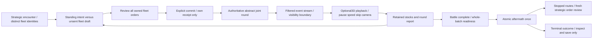

# Coherent interface mockups — design handoff

19 October2026. **Proposed interface, fictional data, browser evidence only.** The owner requested all required GUI screens, a procedural galaxy/map workflow and the 3D battle resolver presentation. [Inventory](inventory.md) distinguishes implemented capabilities, agreed future design, proposed controls and open mechanics. Existing features belong to different supported profiles; these concepts do not merge them into a fictional fully implemented campaign.

## Review deliverables

The generated review bundle is `artifacts/art/coherent-interface/` in this isolated checkout. `gallery.html` opens every screen at1280×720,1920×1080 and3440×1440; `index.html?screen=map-overview` opens the interactive concept. `coverage.json` records every ID, capability scope, screenshot dimensions/hashes, source hashes and original artwork provenance. `interaction-checks.json` records the actual browser checks. Contact sheets, family sheets and annotated map/battle storyboards are generated by the packaging recipe. Screens are design compositions, not captured Unity screens or gameplay evidence.

All94distinct views receive all three sizes. Views include action-specific confirmations, not generic relabelled save dialogs; owned hardware inspection is separate from editable local-v1 class design. Lists/cards/tables support decision and comparison views; the map uses generated regions/lanes and an inspector; the battle retains fleet rail/viewer/order dock; profiles show allocation; save and terminal screens have their own consequences and disabled actions. Feature-specific remaining open details are named, rather than assigned invented prices or approved durations.

The source is under `tools/interface-mockups/`, outside Unity. No production UI/backend/assets/mappings, old saves/packages, PR49/model pins or coordinator checkpoint change. No new generation, credits, downloaded branded art, Unity/Blender/GPU/native operation was used. Chrome ran headless with `--disable-gpu`; this is software/browser composition evidence.

## Visual system and responsive rules

Retain the accepted central battle organisation and amber/lavender Federation grammar. Thin native borders, strong selection edges and restrained layered surfaces provide structure. Viewer artwork carries atmosphere; numbers and controls remain separate. Main text is18px; secondary/body data16px; short technical annotations and review-only badges may be smaller. Main controls have44px hit targets; compact desktop navigation uses40px rows and its own scroll area. Focus has a contrasting outer ring, independent from the selected card's amber edge.

`tokens.json` defines shared colours, spacing, typography and component states. Measured solid-colour contrast against the lightest chosen panel `#243449`: body10.64:1, secondary6.24:1, amber6.72:1, lavender6.08:1, ice8.23:1. This calculation is not a complete accessibility audit of gradients, controls, artwork or native font metrics. Disabled controls retain explicit reasons, never communicate availability through colour alone.

| Size | Composition |
|---|---|
|1280×720|Reduced rail/padding; persistent primary footer; independently scrolling navigation/long details. All six Science rows and its footer review remain visible. Battle keeps three columns; own condition has a dedicated inspector state. Never shrink body data to make an oversized illustration fit.|
|1920×1080|Full selected-object inspector beside generous map/viewer; bounded paragraphs; actions adjacent to their data. Modal body scrolls while actions remain fixed.|
|3440×1440|Console bounded to2860logical pixels and centred; wider viewer, bounded side docks. Extra width is atmosphere/orientation, not indefinitely stretched prose or detached actions.|

All text, table rows, borders, glyphs, graph geometry, bars, focus and hit targets should be native UI Toolkit/USS/Painter2D. Browser CSS gradients/blur are illustrative; Unity equivalence is unproven. Use simple native surfaces first. The same selection/action hierarchy is reused across factions while framing changes: Klingon stepped/angular, Cardassian layered curved junctions, Romulan swept/open junctions, Dominion interlocked ribs. Four supplemental theme comparisons are proposals, not approved final fonts or recoloured production skins.

## Procedural map: interaction and information boundary

The browser generates deterministic seeded points and clipped region shapes for **design exploration only**. It is not the campaign generator, route validator, fair-start algorithm or approved sector-cost model. Generation has a bounded attempt budget and an explicit failure state retaining settings. Pre-campaign preview shows neutral geography, with no opponent spawn/empire information. Current demo remains authored; frontier opt-in only charts public lanes on actual arrivals.

Hover/focus is temporary; click/Enter pins known-node inspection. Wheel/zoom/fit and pointer pan affect geometry only; focused viewport arrows/Home provide a keyboard alternative. Layers independently suppress permitted primitives. Current/stale/unobserved sensing are visibly different **future** concepts. Unknown stars/lanes are absent, not faint targets; even visible region clipping excludes uncharted point positions. No observed contact means no promise of an empty region.

```mermaid
flowchart LR
 A[Known map / own outliner] --> B[Hover or focus / pin known region]
 B --> C[Select owned fleet]
 C --> D[Known route preview / projected cost / known steps (current demo has no ETA)]
 D --> E[Review / explicit strategic submission]
 E --> F[Accepted order / actual intermediate transit]
 F --> G[Lawful contact / owned encounter]
 F --> H[Actual arrival / next Planning charting receipt]
 H --> I[Body survey concept / capability gate]
 D --> J[Unavailable route / retain accepted intent]
```

The prototype demonstrates viewport and inspector interactions. Cross-page navigation is an independent authored-state gallery, not a continuously simulated campaign; native implementation must retain camera/selection through workspace navigation, clear it on successful host replacement and preserve accepted orders on rejection. The proposed full generator needs versioned seed/schema, connectivity, fairness, navigation/knowledge projection and save tests before integration. Polygon appearance does not decide weighted cost or secretly add a second distance penalty.

## 3D battle resolver: command and playback boundary

The viewer depicts a **planned 3D projection** using an existing original hull preview and a generic permitted-contact symbol. CSS camera motion is a composition prototype, not a live WebGL/Unity scene. A later Unity stage consumes actor-filtered authoritative results; spacing, camera, projectile timing and mesh collision cannot decide range, facing, hits, stocks or campaign time. Opening “deployment” is inspection/readiness at the agreed Distant start, not drag-to-place formations.



One strategic fleet remains one tactical command unit. Only fleet maneuver and visible enemy-fleet preference are offered; ship selection means inspection. Screen is fleet-local. No opponent fresh orders/readiness, enemy ammunition, hidden fit, concealed ship count/location or omniscient trace appears. A hidden-target state removes the contact marker/name entirely. Ordinary round-one cloak attacks use ordinary eligibility/resources, incoming ordnance can be defended, surviving cloaked ships reveal after round1, mutual full cloak yields a maneuver-only first round within the same three-round cap. No mid-battle re-cloak, sector escape or fourth round is drawn.

Playback is paused initially; Play/Pause, speed, next observed event, camera orbit/reset and skip-to-report are presentation controls. Their authored fixture events do not run RNG or apply results. The after-battle inspector retains depleted pools, never refills. Own waiting locks commitment. Aftermath and fresh strategic submissions are separate. Terminal inspection removes mutation actions; successful load replaces the old terminal context with the selected slot's state.

## Artwork, implementation order and open decisions

Reuse the project-owned generated backdrop and freshly authored procedural cruiser preview, both byte-pinned in the [asset manifest](../../../tools/interface-mockups/asset-manifest.json). No old downloaded noncommercial Galaxy artwork is used. The1600×1000RGBA preview is about6.1MiB uncompressed base level; the1672×940backdrop about6.0MiB asRGBA8, before mip/compression. Those are arithmetic examples, not measured GPU residency. Dynamic data must never be baked into a raster. Future live ship previews need isolated owned cameras/resources and disposal on detach; the existing ArtDemo colour-only stage and unbound textured Galaxy candidate have separate receiving gates.

1. Finish current demo acceptance; implement small reversible hierarchy/context/confirmation changes using existing lawful projections and native controls.
2. Agree map workspace/selection retention and filtered3D event adapter. Validate real native input, long names, focus, all three sizes, clean replacement/clear/disposal and actual memory/frame behaviour under a coordinator lease.
3. Select one next strategic vertical slice: opt-in charting UI, body survey or peaceful contact. Settlement/conquest and treaty concepts remain design reviews until their actual authority/AI/persistence contracts exist.
4. Resolve generator topology/cost policy and fairness; sensor uncertainty/timing; event-to-art mapping/playback defaults; v1 versus authored-v2 publication/refit; colony quantities/supply/dispute lifecycle; treaty terms/refusal/rights; and full-campaign difficulty/search budgets. None is approved by selecting a mockup.

Research inspiration: [root-delegated4X gameplay report at exact a294bc4](https://github.com/AndreBal1983/HobbyDS9/blob/a294bc4068f6c0791475edc4ff724737554d5443/docs/research/4x-gameplay-inspiration-2026-10-19.md). Its researcher actually viewed paused frames; this art pass used that report rather than claiming independent video viewing. Applied ideas are stable object context, explicit next action, production/pay/completion distinctions, truthful research payoff and strategic→battle→aftermath continuity. No branded artwork, era reset, tile combat, old Stellaris planet tiles, arbitrary fleet cap or new physics rule was imported.

Secondary review corrections: selected Bajor shows Bajoran permitted bodies, while Earth/Mars yard actions retain their own context. Fleet stock panels explicitly identify the selected own ship. Hold/maintain distance is one maneuver, with Fighting withdrawal separately available; retain/clear target preference are distinct even with no visible target. Aftermath prioritizes own survivors/losses and retained pools for the selected current-session encounter. Saved campaigns expose current stocks, not a stored battle-report archive. Current route offers contain cost/steps without ETA; cancellation has no refund quote projection; illustrated research before/after pairs are not a generic receipt archive.
