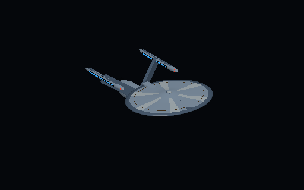
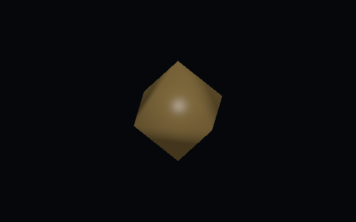

# Demo art runtime evidence

14 October 2026. Source branch `codex/demo-art-runtime`, based on `8ae866556e21cef47a9e5b0efaea49e01d30f3f6`. [Contract](demo-art-runtime-contract.md); [current checkpoint](demo-art-runtime-checkpoint.md).

## Completed evidence

- CPU-only portable Prepare and PrepareUnityIntegrated targets: successful, zero-warning library builds; no gameplay source changed.
- Runtime binary integrity: 49 tracked resource files with SHA-256/size pins and resolved local prefab GUID dependencies, nine FBXs, nine URP materials, three prefabs, preview shader. Total shipped resource payload approximately 1.35 MB. No runtime dependency on ignored Blender/artifact directories.
- Unity **6000.6.5f1**, graphics-enabled **Editor** EditMode filter `HobbyDS9.ArtDemo.Tests`: initial 13/15 pass, corrected run **15/15 pass**. Tests cover exact/hidden/unsupported mapping, all three prefab and nine LOD triangle counts/metre bounds/axes/normals/UV/materials, real cruiser/fallback pixels without error shader, external scene-light/object invariance, same-frame replacement/clear, simultaneous distinct previews, disposal and preservation of external state.
- Independent source review caught the initial unsupported `Camera.scene` assumption. It is removed, not suppressed in the test. First run also exposed ordinary `SceneManager.CreateScene` being unavailable in EditMode. No scene creation is now needed. Model bounds are derived from mesh bounds, including inactive instances.
- Lease released immediately after corrected run; no desktop input, native player launch or Blender workload. Original editable sources and previous packages remain preserved.

Actual Editor captures from the corrected run (not Blender renders or whole-screen concepts):

## Final narrow follow-up

**Pending a coordinated recheck:** after the 15/15 run, Unity's serialized material normalization exposed four luminous materials with missing AnyEmissive flags. Their world URP emission flags/keywords were corrected; the preview shader's colour/emission source values are unchanged. The fixture now asserts world emission retention and additionally counts inactive cameras, owned materials, fallback meshes and render textures after disposal. These final assertions/data edits have not yet been rerun; do not apply the prior green count to the new final head without that check.

Raw reports/logs: `C:/Users/ambal/.codex/worktrees/demo-art-runtime/HobbyDS9/artifacts/art-demo-runtime/editmode.xml`, `editmode.log`, `editmode-2.xml`, `editmode-2.log`. Receipt and runtime manifest preserve exact tested/source hashes; Git/PR records delivery pins. Generated receiving-project/Unity settings deltas from preparation/import are excluded from this art branch's commits.

## Limits

Simple provisional hull art and fixed studio preview lighting; no final texture atlases, canon-class claim, new gameplay ships/equipment, physics/combat authority, native player interaction proof or profiled fleet performance budget. Only the exact Federation source-cruiser binding is enabled. Unsupported faction/design identities remain generic; hidden/non-visible selections clear. Frontend call-site binding and combined player validation are separate deliveries owned by Secondary/coordinator.
