# ENG-TREE-MODEL-01 — existing Engineering tree and design review

13 November 2026. **Model only, before GUI implementation.** This document separates the implemented catalogue from recommendations. It changes no project, balance value, runtime, GUI, schema or save. The owner commissioned this model; the proposed refinements below are not approved mechanics.

**Conclusion:** the existing 20 projects form a valid, broad starter catalogue, with useful fitting trade-offs and a shallow prerequisite graph. The more urgent current-Cycle issue is deployment: all 19 new version rewards are utility-only, while Cycle construction has no support mappings for those versions or utility hulls. Advanced Scout is also excluded. The research and designer unlocks are real; the current campaign cannot yet build their new outputs.

## Source and interpretation

- Integrated content: ENG-CONTENT-01 **`fd0bb6c2d7ea74479e94f5e4045d8aa02f15e88a`**, preserving PR85 `e365ec1ecf3d686b114548f805f68f73f742e89b`.
- Inspected descendant: **`1fb8bbe84543291b191b9074a6b5f84422610f93`**, remotely verified integration head at inspection. Its catalogue, ScienceRules and EngineeringRules match the content pin. Shared main was not used as current authority.
- Actual PB input: [engineering-development-v1/scenario.json](../../scenarios/engineering-development-v1/scenario.json#L5444), prepared as `Review/Resources/PlayableFleetPackages/v1/engineering-scenario.json`; source/prepared SHA256 **`147af76fabf1903a195ab58d571b3ed7c6eb9bad5efd170b13d2656b223cbbb1`**.
- Read alongside [design index](README.md), [ship-design intent](ship-design.md), [architecture](../architecture.md#engineering-development-tree-candidate), [Science/Engineering rules](../science-engineering-v1.md), [original project/trade-off table](../engineering-development-tree-v1.md) and [received Cycle content contract](../engineering-playable-content-v1.md). Historical one-project or static-Scout wording is not the current catalogue scope.

**Workload units:** one conceptual Engineering point = 600 internal units. The table gives **base / current PB points**, where current is `ceil(BaseEngineeringCost × 5000 / 10000) / 600`. These are Engineering workloads, not credit payments or turn estimates. The complete catalogue costs 1095 base points / **547.5 current points**, excluding Science. Version manufacturing Industry/credits/materials are separate from project workload.

**Document conflict:** actual [pace factor is 5000](../../scenarios/engineering-development-v1/scenario.json#L7299). The foundation calls 5000 “Fast” and 6700 “Quick”; the receiving document calls the half-cost edition “Quick.” Use **factor 5000, ×0.5 cost** in this model; no label correction or mechanics change is silently made. The older `integrated-playtest-v1` input is another profile, not this PB content.

## Implemented development graph

Every arrow below is an **actual mature-Engineering prerequisite**, not a suggested edge, Science sequence, version-parent relationship or automatic upgrade. Both incoming arrows to N20 are required. All 20 nodes also have the Science gates in the table. Group boxes are explanatory groupings, not extra prerequisites or existing UI tabs. Isolated nodes are deliberately shown.

```mermaid
flowchart TB
  subgraph power_hulls["Power and utility hulls"]
    direction LR
    N01["N01: Advanced Starship Engineering<br/>60 base / 30 current points"]
    N02["N02: Compact Reactor<br/>40 base / 20 current points"]
    N03["N03: High-output Reactor<br/>75 base / 37.5 current points"]
    N19["N19: Reinforced Utility Hull<br/>60 base / 30 current points"]
    N20["N20: Expanded Utility Hull<br/>75 base / 37.5 current points"]
    N02 --> N03
    N01 --> N19
    N01 -->|AND| N20
    N03 -->|AND| N20
  end
  subgraph drives["Drive alternatives"]
    direction LR
    N04["N04: Efficient Drive<br/>45 base / 22.5 current points"]
    N05["N05: High-speed Drive<br/>80 base / 40 current points"]
    N06["N06: Maneuver Drive<br/>55 base / 27.5 current points"]
    N04 --> N05
  end
  subgraph shields["Shield alternatives"]
    direction LR
    N07["N07: Resilient Shield<br/>50 base / 25 current points"]
    N08["N08: Efficient Shield<br/>35 base / 17.5 current points"]
    N09["N09: Multilayer Shield<br/>85 base / 42.5 current points"]
    N07 --> N09
  end
  subgraph weapons["Weapon alternatives"]
    direction LR
    N10["N10: Compact Energy Bank<br/>40 base / 20 current points"]
    N11["N11: Long-range Energy Bank<br/>65 base / 32.5 current points"]
    N12["N12: Improved Launcher<br/>55 base / 27.5 current points"]
    N10 --> N11
  end
  subgraph life["Life support"]
    direction LR
    N13["N13: Compact Life Support<br/>30 base / 15 current points"]
    N14["N14: Efficient Life Support<br/>50 base / 25 current points"]
    N13 --> N14
  end
  subgraph computing["Computing"]
    direction LR
    N15["N15: Expanded Computing<br/>40 base / 20 current points"]
    N16["N16: Precision Fire Control<br/>65 base / 32.5 current points"]
    N15 --> N16
  end
  subgraph science_outputs["Sensors and laboratories"]
    direction LR
    N17["N17: Long-range Sensors<br/>45 base / 22.5 current points"]
    N18["N18: Compact Laboratories<br/>45 base / 22.5 current points"]
  end
```

### Exact nodes, gates, workloads and outputs

**N** = NewCapability; **R** = Refinement. `Discipline L/#O` means structural breakthrough ordinal O in interval **L→L+1**; a higher attained discipline level also satisfies it. All Science predicates and listed development prerequisites are **AND** requirements. A dash means no *Engineering* prerequisite, not immediate availability.

| Node, exact title, kind and canonical ID | Science gates | Mature developments | Base / current points | Exact new output and immutable parent |
| --- | --- | --- | ---: | --- |
| N01 · **Advanced Starship Engineering** (N) `engineering.advanced-starship-engineering` | Construction 1/#1 AND Propulsion 1/#2 | — | 60 / **30** | `ship-design.advanced-scout` Static-design gate; Cycle excludes it |
| N02 · **Compact Reactor** (R) `engineering.compact-reactor` | Construction 1/#1 AND Energy 1/#1 | — | 40 / **20** | `component.utility.reactor.v2` Parent: `component.utility.reactor.v1` |
| N03 · **High-output Reactor** (N) `engineering.high-output-reactor` | Energy 2/#1 | N02 | 75 / **37.5** | `component.utility.reactor.v3` Parent: `component.utility.reactor.v2` |
| N04 · **Efficient Drive** (R) `engineering.efficient-drive` | Propulsion 1/#1 | — | 45 / **22.5** | `component.utility.propulsion.v2` Parent: `component.utility.propulsion.v1` |
| N05 · **High-speed Drive** (N) `engineering.high-speed-drive` | Propulsion 2/#1 | N04 | 80 / **40** | `component.utility.propulsion.v3` Parent: `component.utility.propulsion.v2` |
| N06 · **Maneuver Drive** (R) `engineering.maneuver-drive` | Propulsion 1/#2 AND Computing 1/#1 | — | 55 / **27.5** | `component.utility.propulsion.v4` Parent: `component.utility.propulsion.v1` |
| N07 · **Resilient Shield** (N) `engineering.resilient-shield` | Energy 1/#2 | — | 50 / **25** | `component.utility.escort-shield.v2` Parent: `component.utility.escort-shield.v1` |
| N08 · **Efficient Shield** (R) `engineering.efficient-shield` | Energy 1/#1 | — | 35 / **17.5** | `component.utility.small-shield.v2` Parent: `component.utility.small-shield.v1` |
| N09 · **Multilayer Shield** (N) `engineering.multilayer-shield` | Energy 2/#2 | N07 | 85 / **42.5** | `component.utility.escort-shield.v3` Parent: `component.utility.escort-shield.v2` |
| N10 · **Compact Energy Bank** (R) `engineering.compact-energy-bank` | Construction 1/#1 AND Weapons 1/#1 | — | 40 / **20** | `component.utility.energy-bank.v2` Parent: `component.utility.energy-bank.v1` |
| N11 · **Long-range Energy Bank** (N) `engineering.long-range-energy-bank` | Weapons 1/#2 | N10 | 65 / **32.5** | `component.utility.energy-bank.v3` Parent: `component.utility.energy-bank.v1` |
| N12 · **Improved Launcher** (R) `engineering.improved-launcher` | Weapons 1/#1 AND Computing 1/#1 | — | 55 / **27.5** | `component.utility.launcher.v2` Parent: `component.utility.launcher.v1` |
| N13 · **Compact Life Support** (R) `engineering.compact-life-support` | Biotech 1/#1 AND Construction 1/#1 | — | 30 / **15** | `component.utility.life-support.v2` Parent: `component.utility.life-support.v1` |
| N14 · **Efficient Life Support** (R) `engineering.efficient-life-support` | Biotech 1/#2 | N13 | 50 / **25** | `component.utility.life-support.v3` Parent: `component.utility.life-support.v2` |
| N15 · **Expanded Computing** (R) `engineering.expanded-computing` | Computing 1/#1 | — | 40 / **20** | `component.utility.command.v2` Parent: `component.utility.command.v1` |
| N16 · **Precision Fire Control** (R) `engineering.precision-fire-control` | Computing 1/#2 AND Weapons 1/#1 | N15 | 65 / **32.5** | `component.utility.command.v3` Parent: `component.utility.command.v2` |
| N17 · **Long-range Sensors** (N) `engineering.long-range-sensors` | Computing 1/#1 AND Energy 1/#1 | — | 45 / **22.5** | `component.utility.survey-sensors.v2` Parent: `component.utility.survey-sensors.v1` |
| N18 · **Compact Laboratories** (R) `engineering.compact-laboratories` | Construction 1/#1 AND Computing 1/#1 | — | 45 / **22.5** | `component.utility.labs.v2` Parent: `component.utility.labs.v1` |
| N19 · **Reinforced Utility Hull** (R) `engineering.reinforced-hull` | Construction 1/#2 | N01 | 60 / **30** | `hull.utility.v2` Parent: `hull.utility.v1` |
| N20 · **Expanded Utility Hull** (N) `engineering.expanded-hull` | Construction 2/#1 AND Energy 1/#2 | N01 **AND** N03 | 75 / **37.5** | `hull.utility.v3` Parent: `hull.utility.v1` |

Extraction: [applications](../../scenarios/engineering-development-v1/scenario.json#L5444), [version access gates](../../scenarios/engineering-development-v1/scenario.json#L3912), [derived component definitions](../../scenarios/engineering-development-v1/scenario.json#L2561), [utility hull definitions](../../scenarios/engineering-development-v1/scenario.json#L328). All 20 `ParameterChange` fields are null: these completions do not directly rewrite an implementation parameter. N01 also enables the two hull projects through the development graph; base `hull.utility.v1` is already available and is not its reward.

**Two different relationships must stay separate.** N11 requires N10, but its energy-bank v3 is derived from v1, not compact v2. Expanded hull v3 is derived from hull v1, not reinforced v2; N20 does not require N19. Maneuver Drive v4 derives from propulsion v1 and does not require N04 or N05. Version numbers therefore do not define a universal power tier or development sequence.

## Structural and reachability audit

Computed directly from the input arrays, with an independent read-only cross-check:

| Check | Result and meaning |
| --- | --- |
| Cardinality / kind | 20 unique projects: 8 NewCapability, 12 Refinement, 0 CivilApplication. |
| Development edges / cycles | 9 edges; no missing prerequisite IDs; topological traversal visits all 20; **no cycle**. |
| Breadth / depth | 12 development roots; 12 terminal nodes; 11 weakly connected components. Depth by prerequisite edges: 12 at depth 0, 7 at depth 1, N20 at depth 2. Longest chain has 3 projects. |
| Structure | One 5-node reactor/hull component, five 2-node chains, and five isolated projects: N06, N08, N12, N17, N18. N20 is the only two-parent join. |
| Science gates | 30 predicate occurrences, 16 distinct predicates; ten projects have one predicate and ten have two. All refer to valid disciplines and ordinals 1 or 2 in intervals 1 or 2. |
| Mathematical reachability | No node is blocked by a nonexistent/cyclic prerequisite. With sufficient Science/Engineering funding and legal target selection, all 20 can mature. This is a graph/rules conclusion, not a promise of a fixed completion week. |
| Initial availability | The authored civilizations have all six disciplines at level 1/progress 0, no target, mature applications or reserves. **All 20 start Science-locked**, including the 12 development roots. |
| Terminal / “dead-end” interpretation | A terminal project is not automatically a bad design: it may be a useful specialization. None of the 20 lacks an authored output, but all current-Cycle outputs have the deployment qualifications below. Graph reachability and a usable campaign payoff are separate checks. |

A one-parent path cost is not sufficient for a joined project. The following totals include the selected project and every distinct transitive Engineering prerequisite once, but no Science:

| Target | Full development closure | Base / current points |
| --- | --- | ---: |
| N03 High-output Reactor | N02, N03 | 115 / **57.5** |
| N05 High-speed Drive | N04, N05 | 125 / **62.5** |
| N09 Multilayer Shield | N09, N07 | 135 / **67.5** |
| N11 Long-range Energy Bank | N10, N11 | 105 / **52.5** |
| N14 Efficient Life Support | N13, N14 | 80 / **40** |
| N16 Precision Fire Control | N15, N16 | 105 / **52.5** |
| N19 Reinforced Utility Hull | N01, N19 | 120 / **60** |
| N20 Expanded Utility Hull | N01, N02, N20, N03 | 250 / **125** |

For N20, Compact Reactor → High-output Reactor → Expanded Utility Hull alone costs 190 / 95. **The actual prerequisite closure costs 250 / 125**, because Advanced Starship Engineering is also required. There is no refund or exclusion discount.

### Science gates and progression

| Discipline | Direct project predicate occurrences | Complete level sufficient for its part of every current gate |
| --- | ---: | ---: |
| Biotech | 2 | 2 |
| Computing | 6 | 2 |
| Construction | 7 | 3 |
| Energy | 7 | 3 |
| Propulsion | 4 | 3 |
| Weapons | 4 | 2 |

These are counts of uses, not independent research payments. One achieved breakthrough can satisfy several projects. Partial progress can satisfy gates earlier than the complete levels listed.

**Six Science disciplines can progress in parallel; Engineering funds one project at a time.** [Science schedules](../../src/HobbyDS9.Simulation/ScienceRules.cs#L32) shuffle structural ordinals into each civilization's deterministic threshold order. Ordinal 2 is not inherently later than ordinal 1; do not add `#1 → #2` progression arrows. The [satisfaction rule](../../src/HobbyDS9.Simulation/EngineeringRules.cs#L12) also accepts a later discipline level.

For this model, “early/middle/late” describes relative catalogue progression, not dated turns or the setting's technological era:

- **Opening:** Science unlocks choices among the twelve development roots. Their parallel choice competes for the same Engineering target and bank; it is not twelve concurrent Engineering projects.
- **Follow-through:** five short paired branches and the reactor/hull cluster create further options. Sixteen projects use only interval 1→2 Science. This gives breadth, but little long dependency depth.
- **Later within these 20:** N03, N05, N09 and N20 require interval 2→3 Science. N20 combines two development lines. No project requires later Science intervals although Science continues to level 10. **This is not a full late-campaign tree.**

Biotech currently serves only life support; Construction/Energy/Computing enable most choices. Equalizing these counts would not by itself improve play: the useful outcomes and opportunity costs matter more than symmetry.

## What completion actually changes

[EngineeringRules](../../src/HobbyDS9.Simulation/EngineeringRules.cs#L23) spends `min(bank, remaining workload)` on the one selected project during Research. Switching or clearing costs no Engineering and retains invested work; it does not refund that investment to the bank. New income still banks with no target. At 100%, maturity is recorded and the target clears; excess reserve remains banked. There is **no same-phase cascade into a second project**. Science is spent before Engineering in the [Research phase](../../src/HobbyDS9.Simulation/ResearchPhase.cs#L22).

Work-in-progress does not grant partial versions. The existing Development/Prototype/Operational/Mature bands do not implement overmaturity or simultaneous portfolios. Those ideas and [refits](ship-design.md#refit-and-fleet-modernization) remain design proposals/future scope.

Completion permits a newly available version in a valid new fit. [Publication](../../src/HobbyDS9.Simulation/CampaignBlueprints.cs#L94) freezes the selected fit, catalogue facts, compiled result and costs into an immutable revision; [construction](../../src/HobbyDS9.Simulation/CampaignBlueprints.cs#L120) resolves an exact revision. Already published revisions, queued builds and built ships do not automatically change. A future revised class is different from refitting a deployed vessel.

### Deployment matrix: implemented access is not construction support

| Output | Current PB Cycle | Original DS9 / ordinary utility path |
| --- | --- | --- |
| N01 Advanced Scout | Static definition remains in content, but **not admitted to Cycle construction**. Maturity and downstream hull prerequisites work. | Static design is gated by this project and ordinary production validation. |
| N02–N18: 17 component versions | Access unlocks and designer/publication inputs exist. All are compatible only with `hull-family.utility`; no supported Cycle construction fit can use them at this pin. | Valid utility fits use the ordinary compiler/publication/blueprint-construction path, subject to actual compatibility, power, yard/resources and validation. |
| N19–N20: 2 hull versions | Access unlocks and designer/publication inputs exist; utility hull v1/v2/v3 have no Cycle support entries. | New utility fits can use the released hull version under ordinary rules; no automatic conversion of earlier revisions. |
| N17 sensors / N18 labs specifically | Capacity/power/manufacturing facts are real designer facts, but Sensor/Science outputs are **preview ratings**, not campaign detection, study, colony R&D or mission bonuses. | The same output-consumer limitation applies even where a valid ship can be constructed. |

**Source-supported inference for the all-19 Cycle construction gap:** reward components permit only the utility family; [ordinary fitting rejects incompatible families](../../src/HobbyDS9.Simulation/ShipDesignCompiler.cs#L115). [Cycle support](../../scenarios/colonisation-v1/support.json#L21) lists Constitution/Galaxy/Defiant hulls and no utility reward component IDs. [Support compilation](../../src/HobbyDS9.Simulation/PublishedTacticalSupportCompiler.cs#L96) requires exact hull/component IDs, with no parent fallback. [Cycle enqueue](../../src/HobbyDS9.Simulation/CampaignTacticalReviewSession.ColonisationProduction.cs#L24) requires supported publication; [legacy construction admission](../../src/HobbyDS9.Simulation/CampaignTacticalReviewSession.Integrated.cs#L88) cannot bypass the activities path. This is not a claim that these versions are unusable in every profile, nor a new per-version construction test.

[Compiler integration-gap warnings](../../src/HobbyDS9.Simulation/ShipDesignCompiler.cs#L206) keep preview Sensor/Science/range distinct from compiled hull/movement/aggregate combat output. The [receiving contract](../engineering-playable-content-v1.md#catalogue-and-publication-boundary) explicitly preserves these limits. More prerequisite arrows would not fix a missing gameplay consumer or construction mapping.

## Design assessment and player examples

The variants are not a simple ladder of always-better hardware. Compactness costs more Industry; speed competes with space and power; higher shields consume capacity and power; long-range energy output trades away close-range output; a stronger hull loses capacity. Keep the older versions available. In Cycle, normal streamed construction does not charge upfront credits, so an increased credit value alone is not a meaningful construction trade-off there.

**An existing dependency with deferred benefit:** High-output Reactor supplies 72, but utility hull v1 and reinforced v2 distribute only 60. Expanded hull v3 distributes 72 and requires High-output Reactor. Completing the reactor alone therefore does not raise usable power on those earlier hulls. The full payoff is a coordinated reactor/hull package, not two independent immediate rewards. These are existing [hull facts](../../scenarios/engineering-development-v1/scenario.json#L328) and [reactor facts](../../scenarios/engineering-development-v1/scenario.json#L2621).

Illustrative decisions below use existing values/rules; balances and missions are examples, not an inspected owner save or proof of current Cycle deployment:

| Player decision | Existing trade-off / lesson |
| --- | --- |
| “My next utility fit needs three more capacity.” | Compact Reactor frees 18→15 capacity at the same 60 output, while its component Industry cost rises 9→12. It can be valuable without requiring a higher-output reactor. In current Cycle the deployment gap must be resolved before that becomes a buildable ship. |
| “I want an economical traveller or a fast one.” | Efficient Drive reduces Cruise full/minimum power 30/15→24/12 at movement 4. High-speed Drive follows it, reaches movement 5, but uses space 20 and Cruise full/minimum power 32/16. Fit and role decide which remains useful; a v3 label alone does not. |
| “I need range rather than close fire.” | Long-range Energy Bank changes long-range output 4→7 and close output 12→8 relative to its base parent. It requires the Compact project but is not merely the compact hardware with a free range bonus. |
| “Should I change projects after investing?” | If 10 points are invested in a current-cost 20-point Compact Reactor, switching retains those 10; it does not add 10 back to the bank. Funding another eligible project delays the reactor. This already creates opportunity cost without a loss-on-switch penalty. |
| “Can I finish the whole reactor/hull path immediately with a large bank?” | Bank can finish the selected eligible project next Research, but the target clears and another project must be selected for a later phase. N20 still needs its full 125-current-point Engineering closure and Science gates. Branch depth and stored reserves both affect timing; no week ETA follows from the graph alone. |

## PROPOSED refinements — review choices, not implementation

**P1 — establish a deployable outcome before adding depth.** For each project, distinguish scientific enabler, development work, immutable output, compatible family and actual campaign consumer. First decide whether these exact utility outputs should become a supported Cycle ship line, or whether future family-specific developments should serve the existing ready ships. The former preserves this catalogue; the latter introduces new compatibility/content/balance decisions. Neither is performed here. Preview-only sensors/labs need an explicit intended gameplay consumer before claiming campaign benefits.

**P2 — preserve specialization, but give the existing branches a clear combined purpose.** Treat the reactor/expanded-hull package as one meaningful role milestone with two real development commitments. Retain separate efficient/compact and high-output variants; do not force every standalone option into one universal chain just to make the diagram denser. For a later model revision, require a legal example fit where each branch helps and an example where its costs favor an older option. Keep N20's AND join and version lineage explicit unless the owner deliberately chooses to change them.

**P3 — treat these 20 as an opening chapter unless the owner chooses a full redesign.** Add conceptual later role milestones only after their outcomes are supported and the desired campaign horizon is agreed. Frontier/civilian development could eventually compete with ship development for the same single Engineering target—for example settler support or scientific operations—but these are proposed outcome families, not new approved projects or existing hooks. Do not stretch Science gates, add unlocks, rebalance costs or introduce concurrent portfolios under this model assignment.

### Consequential questions for the next model review

1. **Which deployment target should this tree serve first?** Preserve and support the exact utility-hull line, or design later family-specific versions for the current Constitution/Galaxy/Defiant fleet? Recommendation: choose one complete supported line first; the choice determines compatibility, consumers and what a player can actually build.
2. **Are these 20 the opening catalogue or the whole campaign tree?** Recommendation: opening catalogue. Covering early/middle/late play with roughly 20 would require a separately approved restructuring of Science gates, costs and outcomes.
3. **Should later Engineering remain mainly ship development, or should frontier/civilian outcomes compete substantially for the same budget?** Recommendation: preserve the current ship-focused core while reserving a deliberate noncombat branch in the next conceptual model, rather than adding cosmetic “civil” categories without working outcomes.

No GUI design or implementation decision is needed to review these questions. GUI refresh and Art production can continue independently.

## Verification and limits

The exact catalogue was parsed; prerequisite references/topological traversal, roots/leaves/components/depth, transitive workload closure, kind counts, Science predicates and output/parent mapping were checked. The Mermaid node/edge set and table are generated from those inspected facts and checked against all 20 projects / 9 edges. Independent read-only domain reviews covered graph metrics, output admission and design critique. Source links and diff are checked before delivery.

No gameplay tests, Unity run, actual construction exercise, rebalancing, scenario/GUI/runtime/schema/save change, main merge or package promotion is part of this work. Source reasoning about deployability and historical test evidence are not relabelled as fresh native acceptance.
