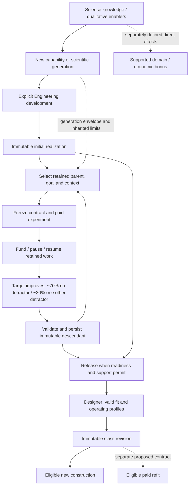

# ENG-TREE-MODEL-01 — goal-directed Engineering refinement

13 November 2026, **R2 owner decisions and proposed integration model. The diminishing-return curve below is canon; no gameplay, GUI, schema or save implementation.**

**The core loop is settled: Science knowledge → a new hull/module capability or generation → explicit Engineering → player-selected iterative refinement → a new immutable version → designer, construction and eligible refit.** Science does not automatically award improved hardware. The existing 20 projects were a temporary playable/UI exercise, **not the intended full model, a mandatory opening tree or a target project count**. Their [exact graph and source audit](engineering-tree-model-01-catalogue-audit.md) are retained as implementation evidence.

Every completed refinement improves its selected target. The initial tunable policy is approximately **70% without a detractor / 30% with a detractor in another supported attribute**. There is no 30% failure branch. The maturity-based diminishing-return curve is also settled below. Net-improvement evaluation, generation overlap and branch policy retain the explicit proposals below; a displayed maturity percentage cannot settle them.

## Agreed direction, current code and open tuning

| Status | Meaning |
| --- | --- |
| **Owner-specified direction** | Choose a meaningful supported goal. Every completed refinement improves that target; the initial tunable mixture is ~70% no detractor / ~30% a detractor in another attribute. Every recognized increment must be an overall improvement while allowing useful competing branches. Later paid work can target a downside. Once a generation/direction is unlocked, refinement needs no additional Science, conquest or survey until its finite potential is exhausted. |
| **Canon — diminishing returns** | Use factor `r(M)=1` through maturity 100, `(150-M)/50` between 100 and 150, and `0` at/above 150. Apply it to target improvement, maturity increment and downside magnitude. Standard cycle workload is initially fixed; no additional exponential cost multiplier. The detailed equation/example are recorded below and in [ship design](ship-design.md#engineering-diminishing-returns--canon-13-november-2026). |
| **Preserved design direction** | Science enables qualitative possibilities; shared capacity, power, compatibility and mounts still constrain designs. New results are immutable versions, not free updates to historical ships/blueprints. Benefits saturate; positive cost floors remain. See [ship design](ship-design.md#engineering-hulls-and-components). |
| **Current implementation only** | One Engineering target, banked/retained work, authored Science prerequisites and completion at 100%. Completion matures a fixed application and releases already-authored versions; it generates no random refinement result. This is the temporary fixture, not the future design limit. |
| **Proposed below** | A frozen goal/context contract, bounded result selection, persistent lineage limits, contextual improvement checks, immutable release and deterministic experiment history. These policies are recommendations for review. |
| **Numerical tuning open** | Release thresholds, standard cycle workload, normal-like distribution width, attribute ranges, practical stopping tolerance/precision, minimum useful gains, cost floors and any scalar weights. **Release around 80, a base step of 5 maturity points, ~10% target gain (8–12%) and 2–5% detractor are provisional examples.** The curve and its 100/150 breakpoints are canon; 70/30 is the approved initial tunable mixture. Portfolio scheduling remains separate; concurrent projects are not approved here. |

The model follows the broader [Science-to-Engineering design](ship-design.md#engineering-hulls-and-components). The chapter's weighted portfolio and refit detail remain proposals where current code lacks them. Do not relabel those paragraphs as implemented.

## Keep the quantities separate

| Quantity | Proposed meaning | Must not imply |
| --- | --- | --- |
| Scientific generation | Knowledge-enabled capability class and its feasible limits; initial hardware still requires Engineering. | A maturity score, an automatic equipment upgrade, or a requirement for fresh Science before each refinement. |
| Engineering work / bank | The empire's paid development effort; projects compete for it. Pause/resume retains committed work. | A second spendable “maturity currency” or a refund of invested effort when goals change. |
| Maturity / readiness | Development/refinement state of a realization. Maturity `M` supplies the agreed diminishing-return factor; release/readiness requirements are separate tests. | A direct multiplier for output, capacity, efficiency, cost or every stat; another spendable currency. |
| Deployability | A decision requiring release/readiness criteria **and** valid fit, compatibility, supported gameplay consumers and appropriate deployment route. | “Maturity reached X, therefore this ship is buildable everywhere.” |
| Resolved characteristics | The actual complete vector: space, supply/demand, supported outputs, Industry, material requirements and other explicitly supported characteristics. | A nominal quality percentage concealing which values improved or worsened. |
| Named efficiency measure | A defined ratio or performance measure, such as useful output per capacity used or actual manufacturing burden for a required service. | One universal efficiency statistic that substitutes for every characteristic. |
| Investment return | Whether the technical benefit repays the Engineering effort, production change and time in a particular campaign. | That a technically useful version is always the best strategic investment. |

The curve uses **100 and 150 as agreed maturity breakpoints**. Initial release around 80 remains illustrative. Maturity 150 does **not** mean 50% more of every statistic, nor automatic buildability. A more developed result can retain lower output or higher manufacturing burden than an older branch. Readiness thresholds and the meaning of any displayed percentage must not replace the resolved vector.

**Proposed increment rule:** paid work may accumulate continuously, but recognized design increments occur at declared validation/refinement milestones. Each must have a real, testable improvement. A displayed maturity increase alone is not a second benefit. A readiness increment needs an explicit verification/release consequence, or a separately supported reliability effect if one is adopted; it cannot invent a reliability bonus. Every released state freezes its own readiness and characteristics. Further optimization produces a new result/version, not an in-place 80→100→150 edit to an installed part.

## Intended model: a branching lineage, not twenty fixed unlocks

The following graph is **proposed architecture**, not current runtime support. Science unlocks a capability/generation or eligible direction; explicit Engineering develops its first realization. **Repeated refinement inside an unlocked generation requires no further Science, conquest or survey.** It remains bounded by that generation's finite potential. New Science can open a larger frontier or qualitative capability, followed by explicit Engineering again.

A mature older generation may remain attractive beside a less-developed new one; refinement can bridge some of the performance gap. The permitted overlap and limits are open. Refinement cannot silently acquire the newer generation's qualitative capabilities. Scientific generation, maturity/readiness and actual characteristics remain separate.

Science can also have direct domain/economic effects where separately defined. Biotech improving food production is an **illustrative direction**, not an approved numerical bonus or a claim of current behavior. Such effects do not automatically grant refined hardware.

Goal choices do not grant new mounts, interfaces or qualitative abilities by themselves. An Engineering version and a ship-class revision are different identities. One component version can serve several classes; renaming or republishing a class creates neither fresh ancestry nor random chances.

## Eligible characteristics and material changes

Owner direction covers **all meaningful supported characteristics**, not just compactness or reactor output. The following goal/detractor candidates are **proposed pairings**, not approved balance or a schema change. Benefit direction must be defined for each field: less demand can help, whereas less supply can hurt.

| Characteristic | Possible target / other-attribute detractor | Boundary |
| --- | --- | --- |
| Capacity / envelope | Less occupied space, more usable hull capacity / the inverse | Preserve compatible hulls, mounts and geometry; small refinement cannot redesign architecture. |
| Power and supported performance | More supply/output, less profile demand / reduced output or increased demand | Evaluate actual operating profiles, distribution and gameplay consumers. |
| Crew / computing | Lower required demand or higher supported capacity / the inverse | Use explicit supported semantics; a field name alone creates no crew/computing mechanic. |
| Manufacturing | Lower Industry or quantitative material requirement / greater Industry or material need | **Exclude direct credit construction cost**; assess the actual recipe and supply constraints. |
| Maintenance / operation | Lower actual upkeep or consumption / higher actual obligations | Admit only with defined consumers and units; do not invent upkeep merely to supply a penalty. |
| Other supported capabilities | Hull strength, shield/weapon performance, movement, etc. / bounded sacrifice elsewhere | Existing integer granularity and protected requirements apply. Sensor/Science preview ratings currently lack campaign effects. |

Current [hull/component structures](../../src/HobbyDS9.Contracts/ShipDesign/ShipDesignDtos.cs#L128) and the shared compiler provide part of this vocabulary, not every proposed consumer. A target and its possible detractor must be different characteristics. This revision models **one** other-attribute detractor in the 30% branch; multiple simultaneous detractors would need a separate policy decision.

**Qualitative material substitution is distinct from percentage refinement.** Survey findings may enable new knowledge—for example neutron-star understanding—which through explicit Science and Engineering can enable a recipe that replaces or removes a material requirement. This example approves no named recipe or automatic survey reward. Preserve the [exploration knowledge/consequence boundary](exploration-missions.md#agreed-direction). Ordinary small efficiency rolls can reduce quantities within supported bounds; they cannot randomly erase a resource type. Rounding a positive one-unit requirement to zero must not bypass that qualitative capability gate. New recipes identify replacement inputs, compatibility and performance; historical publications, queues and ships retain their frozen recipe.

## Construction costs and rush conversion

**Owner direction:** ordinary ship construction has no direct credit ingredient. It consumes Industry and delivered materials. Credits can buy acceleration by conversion into remaining Industry; **1000 Industry per credit is illustrative**, not a rate. This scope does not remove separately supported credit uses such as expedition funding, diplomacy or upkeep.

The [time/production chapter](time-movement-mobilisation.md#normal-production-and-material-supply--agreed-25-october-2026) already agrees streamed Industry/materials and no upfront credit charge. This clarification makes explicit that normal ship construction has no deferred direct credit ingredient either. Its urgency premium, rush capacity and next-Production completion timing remain proposals; no rate or bypass is adopted here.

At the inspected source pin:

- [Cycle enqueue](../../src/HobbyDS9.Simulation/CampaignTacticalReviewSession.ColonisationProduction.cs#L14) uses frozen Industry and material requirements without debiting credits. [Material-limited progress](../../src/HobbyDS9.Simulation/StreamedMaterialWork.cs#L13) consumes cumulative integer quantities from local stock. Cancellation loses completed work/consumed materials and refunds nothing.
- [Legacy static construction](../../src/HobbyDS9.Simulation/ProductionCommands.cs#L28) and [legacy published construction](../../src/HobbyDS9.Simulation/CampaignBlueprints.cs#L44) prepay credits/resources and retain proportional cancellation refunds. These are a **versioned behavior conflict**, not permission to reinterpret historical payments.
- [Strategic commands](../../src/HobbyDS9.Contracts/CommandContracts.cs#L5) and [activity commands](../../src/HobbyDS9.Contracts/CampaignActivitiesContracts.cs#L215) provide no rush/buyout action. The conversion mechanic remains future work.
- The ship-design chapter's proposed refit work currently includes Industry and credits. The ordinary-construction clarification does not silently rewrite that separate refit contract; its normal-versus-rush cost semantics need explicit resolution in the refit stage.

A separately scoped cost/rush acceptance contract must define eligible remaining Industry, rate/rounding, once-only payment/work, queue effects, timing, cancellation/refunds and shared human/AI validation. Rush cannot bypass materials, local delivery, prerequisites, yard, ownership or physical/capacity constraints. It cannot give newly completed ships arbitrary post-Planning orders. Existing [streamed-profile compatibility](../campaign-activities-streamed-v1.md) preserves earlier prepaid profiles; any future migration must reconcile completed work, prepaid credits/materials and frozen revisions without double charge, double refund or free inputs.

## What counts as a net win?

There is no unit-free, universally correct exchange rate between capacity, output and manufacturing cost. The model must make a value choice explicitly. Strict improvement in every characteristic would forbid the owner's intended trade-offs; “at least one number improved” is too weak.

### Recommended policy — contextual improvement with protected requirements

**PROPOSED:** commit to a goal and useful operating context before work or randomness. Compare against the selected parent, while retaining a persistent family/scientific-generation reference. The player chooses from supported goals/contexts, not arbitrary score weights that can be manipulated after seeing a result.

The contract fixes:

- Parent/version identity, scientific envelope and policy version.
- Representative legal fits, operating profiles, mission requirements and relevant resource/supply conditions.
- A measurable primary improvement and minimum meaningful gain.
- Protected service floors, compatibility/architecture constraints and bounded sacrifices.
- Cumulative limits relative to the family/generation reference, not only this immediate parent.
- The workload, outcome range and evaluation rule.

A recognized increment must pass **all** of the following:

1. **Legal realization:** compatibility, mounts, essential power, dependencies, physical bounds and positive cost/material floors.
2. **Material goal gain:** the selected primary measure improves relative to the parent by the declared useful amount.
3. **Protected outcomes:** required service still works, every disclosed downside is within bounds, and persistent lineage limits hold.
4. **Practical witness:** at least one fixed benchmark fit/profile demonstrates the claimed advantage. Before deployment support exists this is a technical model witness, not proof of a usable Cycle ship.
5. **Useful alternative:** an already available compatible alternative does not dominate the candidate under the same context, including actual manufacturing obligations. A merely different vector is insufficient.
6. **No duplicate credit:** revisiting an already attained equivalent realization or undoing/reapplying the same change is not a fresh recognized advancement.

This defines “net win” as **better for a stated purpose within agreed sacrifices**. It does not prove that every player, mission or fleet should prefer the result. If “overall improvement” instead means a common score across all roles, its units and exchange rates need an explicit separate decision.

A useful technical increment may still be an unwise investment during an urgent war. That is a strategic choice, not a failed technical improvement test.

### Other testable policies

| Policy | Benefit | Problem / role in this proposal |
| --- | --- | --- |
| Strict Pareto improvement: no tracked characteristic worsens | Clear and easy to verify. | Cannot be the general rule if smaller-but-costlier or stronger-but-larger results are wanted. A particular result may still Pareto-improve its parent. |
| Pinned role-specific score with hard limits | Can compensate several gains/losses and rank candidates. | Requires normalization, weights and a positive margin fixed before sampling. None are approved; changing weights after a draw is forbidden. A global score risks one universal optimum. |
| New nondominated frontier point | Preserves alternative specialties. | Necessary useful screening, but not sufficient alone: a tiny or impractical difference need not justify recognition or Engineering expense. |
| Context contract above | Makes required service and permitted sacrifices explicit without pretending unlike units are interchangeable. | Bounds/minimum gains are still balance choices; they require playtesting. “Fits inside the limits” must be paired with the material-gain and witness tests. |

If a score is later chosen, a dimensionless form such as weighted normalized gains/losses could be tested. That is an alternative policy family, **not approval of coefficients**. Do not quietly turn the current cost table into those exchange rates.

## Worked comparison — illustrative only

These are **toy units, not catalogue values or balance**. All unlisted attributes and material types are identical. A hypothetical compact-role contract requires output at least 950 and capacity used at most 900; the starting parent needs refinement to meet its space budget. A separate output-role benchmark has room for 1030 capacity and can use increased supply. Actual Engineering effort is paid separately.

| Realization | Capacity used ↓ | Useful output ↑ | Manufacturing Industry ↓ | Evaluation |
| --- | ---: | ---: | ---: | --- |
| Parent A | 1000 | 1000 | 1000 | Generation/reference comparison. |
| Clean compact B0 from A | 900 | 1000 | 1000 | 10% target gain, no detractor; illustrates the 70% category. |
| Compact B1 from A | 900 | 970 | 1000 | 10% compactness gain, 3% output detractor; passes this illustrative compact-role contract. |
| Compact B2 from A | 900 | 1000 | 1030 | Same target gain, a single 3% Industry detractor instead of an output penalty. |
| Invalid candidate X | 900 | 900 | 1000 | Fails protected output; cannot be a completed refinement. |
| Output sibling D from A | 1030 | 1100 | 1000 | 10% output gain with 3% capacity detractor; can serve the output role, not the compact role. |
| Manufacturing descendant C from B2 | 900 | 1000 | 927 | A later clean 10% Industry reduction from 1030; mitigates and passes the earlier penalty at new paid effort, if inherited limits admit it. |

B0/B1/B2 illustrate **alternative counterfactual draws under their own frozen histories**, not simultaneous grants or a promise all remain novel if B0 already exists. If an already available B0 dominates B1/B2 under the same context, those outcomes fail the proposed useful-alternative test; admission must account for that before commitment. An explicit history policy is needed for any future concurrent commitments. These full-strength examples start each cycle at maturity at or below 100. For A→B2→C with provisional base maturity step 5, choose A at 95: B2 then starts its follow-up at 100, so both shown 10% gains apply. Above 100, apply the agreed factor to gain, maturity increment and detractor.

B1 has output/capacity 970/900 versus A's 1000/1000: **about 7.78% higher density despite 3% lower total output**. That is neither a maturity increase of 7.78 nor 7.78% improvement in every statistic. D and B1 offer different useful specialties. A future descendant may dominate an older parent; preservation of branches does not require an artificial permanent flaw.

C is a **possible** follow-up, not a promise of free or consequence-free erasure: it has its own paid commitment and 70/30 policy. Its shown clean result cannot be assumed in advance; another admitted result would have a bounded detractor in a different attribute. Fixing output could instead target B1's lower output if a useful improvement remains within that generation.

A percentage gain minus a percentage penalty in unlike units does **not** prove net value. Lower Industry may still be poor manufacturing value if actual materials or delivery become more onerous. Output only helps when a fit can use it: [the current compiler caps power at hull distribution](../../src/HobbyDS9.Simulation/ShipDesignCompiler.cs#L141). The fixture's 72-output reactor on a 60-distribution hull illustrates the distinction.

## Guaranteed improvement, 70/30 and bounded randomness

**Resolved owner policy:** every completed refinement improves its target. Initially, approximately 70% have no detractor and 30% have a detractor in another supported characteristic. These are probabilities, not a guaranteed seven clean results in each ten projects. Both categories must satisfy the eventual overall-improvement contract; there is no no-gain or failed-research completion branch.

The base magnitude shape is **bounded, normal-like**, with typical benefit around 10%; spoken 8–12% gain / 2–5% detractor are illustrations before the agreed maturity factor is applied. Final bounds, spread, attribute weights, correlations and rounding remain open. “Normal-like” does not choose clipped versus truncated sampling: clipping can create boundary piles, truncation changes normalization, and discrete fields require explicit quantization. A versioned discrete weighted distribution over legal integer outcomes is a candidate implementation, not a selected algorithm.

**Proposed admission and sampling contract:**

1. Freeze parent, goal/context, complete vector, generation history, policy and effort.
2. Establish two nonempty, novel, jointly feasible outcome sets: **F0** has a material target gain and no worsening supported characteristic; **F1** has that gain plus a real bounded detractor in one allowed other attribute. Both pass legality, protected requirements, cumulative limits and contextual net-improvement checks.
3. Select the category once at the initial 70/30 mixture, then sample valid magnitudes and the allowed detractor identity **within that category**. Coupled constraints apply before sampling; independent extreme rolls need not be jointly valid.
4. Persist one result atomically. Never remove an inconvenient penalty, redraw the category until it passes, silently switch to 100/0, or award a paid no-gain completion.

If either set is empty, **do not admit the project under this policy**. This can occur near saturation or when no real supported detractor is safe. A separate prospective exhaustion/tail policy could be proposed later; none is implicit. Technical invariant failures abort the transaction and retry identically, not as a third gameplay outcome.

Quantization can invalidate superficially reasonable ranges: movement 4 cannot gain an integer within 8–12% (+1 is 25%); a 2–5% penalty on Industry cost 9 has no positive integer result. Final attribute-specific granularity/ranges must support actual improvement and a genuine detractor. Do not round either away or silently loosen approved bounds. Primitive unbiased-integer rejection sampling is distinct from rejecting whole gameplay outcomes to get a nicer result.

## Diminishing returns — agreed canon, 13 November 2026

The owner approved this exact factor:

~~~text
r(M) = 1                 when M <= 100
       (150 - M) / 50    when 100 < M < 150
       0                 when M >= 150
~~~

Apply it to **all three** quantities:

~~~text
achieved target-stat improvement = base target improvement × r(M)
achieved maturity increment      = base maturity increment × r(M)
downside magnitude, if selected  = base downside magnitude × r(M)
~~~

**Initial standard workload per cycle is fixed.** Smaller useful gains for the same work make cost per improvement rise naturally; do not add an assumed exponential work/cost multiplier. The 70/30 category mixture stays unchanged as magnitude shrinks. At maturity 150 or higher the factor is zero, so a refinement cannot be admitted as a new improving cycle.

The following worked example records the agreed relationship. Its **base step of 5 maturity points, target gain of 10% and downside of 3% remain provisional tuning**, as do the 8–12% / 2–5% sample ranges and distribution width. Values are theoretical before quantization and feasibility checks; the penalty applies only in the 30% category.

| Starting maturity M | Factor r(M) | Maturity increment with base 5 | Target gain with base 10% | Detractor with base 3% | Standard work |
| --- | ---: | ---: | ---: | ---: | --- |
| 80 | 1 | 5 | 10% | 3% | W |
| 100 | 1 | 5 | 10% | 3% | W |
| 125 | 0.5 | 2.5 | 5% | 1.5% | W |
| 140 | 0.2 | 1 | 2% | 0.6% | W |
| 145 | 0.1 | 0.5 | 1% | 0.3% | W |
| 149 | 0.02 | 0.1 | 0.2% | 0.06% | W |
| 150 | 0 | 0 | 0% | 0% | **No improving cycle admitted** |

**Proposed evaluation convention:** freeze maturity at the cycle's starting commitment and use that one factor for gain, maturity increment and detractor. Do not recompute partway through the result or multiply the entire existing stat vector by maturity. A target's beneficial direction is defined by its contract—e.g. reduce occupied capacity or increase supplied power. Percentages in this model compare to the immutable parent; final per-attribute units and composition rules need explicit acceptance.

With the illustrative base increment 5, starting at 100 and ignoring quantization, after n cycles:

~~~text
M_n = 150 - 50 × (0.9)^n
~~~

The sequence is asymptotic: it approaches 150 without reaching it in finitely many exact-arithmetic cycles. This follows from the approved factor, **not permission to snap maturity to 150** or charge for zero-benefit work. Maturity is a progress variable, not the sum or percentage multiplier of all stat gains.

### Practical stopping and rounding — explicit proposal

The mathematical curve is agreed; its finite-precision realization is **not yet approved**. Proposed policy:

- Use versioned fixed-point or rational arithmetic and a declared maturity precision. Evaluate the factor from committed maturity; avoid platform-dependent floating point for authoritative outcomes. Never let rounding freeze maturity while positive stat gains continue at the same factor.
- Scale the base magnitude ranges first, then intersect the **joint** permitted result sets with the actual attribute/maturity representation grids. Sample valid representable outcomes; do not round an out-of-range value into a nominal success, erase a penalty, or let material rounding remove a dependency.
- Define a configurable minimum useful maturity increment **epsilon_M** and per-attribute useful quantum **q_i** before admission. **Example only: epsilon_M = 0.1 maturity point**; actual tolerance and precision remain open. Current integer attributes already impose representable quanta; useful gameplay thresholds may be larger.
- Admit only if both category sets contain novel results with target gain at least the declared useful quantum and maturity increment at least epsilon_M. If either lacks such a result, report **practical exhaustion under this policy** before charging a new cycle. This may occur below 150; it does not mean all physical headroom is mathematically zero.
- Preserve the achieved maturity and exact vector at practical exhaustion. Do not round maturity up to 150, award the remainder, silently turn 70/30 into 100/0, or finish a paid cycle without useful target improvement.
- Freeze precision, bounds, tolerance and policy with the experiment; reload/render cannot redraw or reinterpret the result. Validate any later base-step/precision choice against overshoot and minimum-gain requirements before admission.

For the illustrative base step, a cycle starting at 149 yields 0.1 maturity. With proposed epsilon_M = 0.1, later smaller steps would be practically exhausted unless a different explicit tolerance is adopted. An actual integer target or detractor may become unavailable earlier. These are visible policy consequences for review, not installed balance.

## Scientific-generation limits and branch history

The agreed curve describes diminishing returns; it does not by itself define every generation's physical feasible region, readiness or branch rules. **Proposed additional rules:**

- Give each family/scientific generation a joint envelope, positive cost/resource floors and persistent history. Independent per-stat ceilings that eventually permit every best extreme would undermine specialization.
- Refinement inside an unlocked generation needs **no new Science, conquest or survey** while qualifying potential remains in both required categories under the adopted policy. Exhausting one direction does not prove all directions exhausted. New generations require new enabling Science **and explicit Engineering**.
- Evaluate cumulative sacrifices against the generation baseline as well as the immediate parent. Repeated small losses cannot accumulate into unusable output or unlimited cost.
- Preserve history across goals, old-parent branches, copies, renames and publication. **Branching is the next interview decision:** how an older parent's maturity relates to inherited family/generation history remains proposed. Recommendation: allow useful branches while preventing names/copies/branches from resetting the same already-spent potential.
- Shared history does not silently change another branch's installed characteristics. Persist the selected parent's vector and the maturity/history reference used for its new commitment.
- Later paid work can mitigate/remove a downside through the same curve and 70/30 process; full removal or a consequence-free result is not guaranteed.
- Equivalent attained vectors and dominated regressions are not new advancements. Alternating compact → cheap → compact must not farm repeated recognition.
- A mature older generation may bridge part of the performance gap to new hardware without acquiring its qualitative capability. The extent of specialty overlap remains a proposed envelope choice, not a reason to reopen the agreed curve.

The joint envelope, contextual materiality requirements and branch/history interpretation still need representative-fit evaluation and playtesting. The curve is canon; these additions remain proposals.

## Data-driven tuning contract — proposed parameter groups

These are configuration responsibilities, **not a chosen JSON schema or current fields**.

| Tunable group | What it controls | Required invariant |
| --- | --- | --- |
| Family / Science envelope | Generation identity, supported goals, coupled limits, qualitative enablers | Repeat refinement needs no fresh Science; numeric gains cannot bypass new-capability prerequisites. |
| Goal and context definitions | Benchmark fits/profiles, required service, primary measures | Context is fixed before paid work/outcome; unsupported consumers remain disclosed. |
| Gain and downside limits | Minimum useful gain, paired/cumulative bounds, protected floors | Every recognized result passes the same rule for human and AI. |
| Random outcome policy | Initial 70/30 categories, normal-like magnitudes, finite ranges, correlations and quantization | Every completion improves its target; preserve category probabilities without hidden filtering. |
| Effort and saturation | Initially fixed standard cycle work, agreed maturity factor, inherited history and proposed practical exhaustion | No separate exponential cost multiplier; branch/goal policy must explicitly preserve the agreed curve. |
| Readiness / release | Milestone meaning, any maturity scale and release conditions | No automatic whole-stat multiplier or double-counted benefit. |
| Cost and resource semantics | Actual Industry/material/operating implications | A displayed saving must correspond to a real supported consumer. |
| Policy identity / compatibility | Version/hash, rounding, canonical ordering and validation | An update cannot rewrite earlier experiments or released outcomes. |

Playtest telemetry should retain goal, parent/result vector, permitted bounds, actual expenditure, witness results, release/deployment outcome and admission/exhaustion reason where applicable. Compare which branches players choose and actually deploy, not just average “quality.” Tuning applies prospectively to new commitments under an explicit version policy; old versions remain exact.

## Deterministic experiments and immutable history

Current [Engineering state](../../src/HobbyDS9.Contracts/ScienceEngineeringDtos.cs#L25) contains target, progress and mature application IDs, not refinement experiments or generated outcomes. [EngineeringRules](../../src/HobbyDS9.Simulation/EngineeringRules.cs#L23) currently has no RNG. [Science's isolated seeded schedules](../../src/HobbyDS9.Simulation/ScienceRules.cs#L15) are a useful precedent, not an already implemented refinement system.

**Proposed lifecycle:**

1. **Preview:** inspect parent, goal, ranges, trade-offs and witnesses. No work, identity allocation or random draw.
2. **Commit:** a stamped authoritative transaction fixes parent, canonical goal/context, policy and experiment identity with the first paid commitment. Cosmetic names or command IDs do not choose the outcome.
3. **Fund / pause / resume:** preserve paid work and that experiment. Funding speed, turn timing and panel visits do not supply new draws.
4. **Resolve once:** atomically record paid work, complete result vector and recognized increment under the frozen policy. Under the owner-resolved guarantee, result validation is an invariant; a code/transaction failure commits nothing and retries identically, not with another candidate.
5. **Release:** where release is separate, accept the already persisted result when eligible. Declining/reopening does not regenerate it. Further refinement starts a new paid experiment from an actual immutable parent and inherited history.

A possible random-identity model is a dedicated persisted refinement seed/domain plus actor, canonical Engineering parent identity and paid attempt ordinal, under a versioned stable derivation. The goal/context is frozen separately; mutable goal text is not seed material. The exact derivation is open. Avoid coupling it to rendering, save slot, current turn, class names, command UUIDs, thread order or unrelated combat/production RNG.

| Operation | Required result |
| --- | --- |
| Redraw, inspect, resize or repeated preview | No mutation or draw. |
| Save/reload before or after completion | Same committed experiment gives the same result; persisted results remain unchanged. |
| Duplicate/stale command or repeated release | No extra work payment, attempt, version or RNG advancement. |
| Pause, clear target or resume | Retain experiment identity and paid work. Cancellation must not offer a free fresh draw. |
| Change a committed goal / abandon | Cannot edit the committed experiment. A new chance requires an explicitly valid new paid effort and settlement/attempt rule; exact abandonment economics remain open. |
| Rename or republish a class | Does not change Engineering ancestry or random identity. |
| Earlier checkpoint / different choices | Identical committed decisions reproduce the same result. Legitimately different future choices may lead to different variants; deterministic offline play is not a promise of identical outcomes across all counterfactual histories. |
| Balance-policy update | Pin old experiments/results to their policy; do not reinterpret them under “latest.” Unsupported old policies need an explicit compatibility/migration decision. |

Generated outcomes belong to authoritative campaign history, not mutable edits to the authored catalogue. Future records must preserve experiment specification/progress/result, source/policy/RNG identity, exact parent/result and released provenance. This requires versioned save/copy/validation/replay work; the bounded [latest-turn research receipts](../../src/HobbyDS9.Simulation/ResearchPhase.cs#L9) are not a durable experiment ledger.

## Usable deployment: model dependencies against actual contracts

| Boundary | Existing foundation | Required future contract |
| --- | --- | --- |
| Earned version | Authored family/parent/version structures, gated access and immutable snapshots | Campaign-owned generated versions, stable provenance and authoritative availability. Current [access gates](../../src/HobbyDS9.Simulation/CampaignBlueprints.cs#L11) point to already-authored data. |
| Designer | Shared compatibility/capacity/mount/dependency/power compiler | Feed earned versions into lawful catalogue/access; compare complete parent/result and actual consumers. Preview ratings do not create gameplay effects. |
| Publication | [Freeze fit/catalogue/result/costs](../../src/HobbyDS9.Simulation/CampaignBlueprints.cs#L94); [validate/recompile saved proof](../../src/HobbyDS9.Simulation/BlueprintValidation.cs#L48) | Include generated-version authority and policy provenance. Caller-supplied “improved stats” cannot become trusted merely by compiling consistently. |
| New build | Exact owned published revision, yard/support checks and streamed Industry/materials | Supported derivation/consumer rules for generated versions. [Current support requires exact IDs](../../src/HobbyDS9.Simulation/PublishedTacticalSupportCompiler.cs#L96); parent lineage does not confer support. [Cycle enqueue](../../src/HobbyDS9.Simulation/CampaignTacticalReviewSession.ColonisationProduction.cs#L19) must accept the actual result. |
| Refit | Frozen build/installed provenance and immutable target revisions | A separate paid work-order contract: eligible conversions, yard/materials, ship unavailability, cancellation and installed-fit replacement. Preserve damage and stocks; no free repair/ammunition. Major structural change may require new construction. [Refit intent](ship-design.md#refit-and-fleet-modernization) is not current runtime support. |
| Historical continuation | Pinned content/rules/compiler identities and typed checkpoints | Save generated history, replay the same outcomes and retain old published/queued/built data under explicit compatibility rules. No silent old-save rebinding. |

The integration dependency is therefore **define improvement → persist an authoritative generated result → expose it to the designer → freeze a valid class → support its actual new build/gameplay → separately support eligible refit**. This is a model-level sequence, not authorization or a coding schedule.

The temporary fixture demonstrates the gap: all 19 utility-version rewards currently lack Cycle construction support, and Scout is excluded. That does not dictate the future model's ship families. The future rule must make earned versions usable through the intended consumers, rather than reproducing that disconnect with randomly generated IDs.

## Proposed implementation stages

These stages identify future scoped contracts and evidence, **not execution authorization or a coding schedule**. GUI refresh and Art production can continue independently.

| Stage | Reviewable scope | Required exit evidence |
| --- | --- | --- |
| 1. Model and policy acceptance | Choose branch/history policy, contextual net-win evaluation, generation overlap, practical stopping/quantization and release meaning. Retain the settled core loop, exact curve, fixed standard cycle work and 70/30 policy. | Worked admissible/inadmissible cases, both category sets and an exhaustion case; explicit agreed/proposed/open labels. |
| 2. Authoritative experiments | Portable commands, admission, paid work, canonical RNG, generated immutable versions, durable history and versioned save/copy/validation. | Deterministic replay/reload/reordering, atomic rollback, shared human/AI legality and old-profile compatibility. No Unity authority. |
| 3. Designer and publication | Expose earned versions, explain parent/result/limits, compile fits and freeze authoritative provenance. | An earned result can be inspected, legally fitted and published; arbitrary caller stats are rejected. |
| 4. Construction and real consumers | Support generated derivations in the intended profile and actual performance/cost consumers; keep ordinary Industry/material semantics. | Construct a valid published result; its paid recipe and runtime benefit match the frozen proof. Existing orders/ships remain unchanged. |
| 5. Cost/rush acceptance, separately scoped | Remaining-Industry conversion, delivered inputs, once-only payment, timing and refunds; explicit legacy compatibility/migration policy. | No bypass, double payment, double work or free material; repeat/reload/cancel cases agree for human and AI. |
| 6. Eligible refit, separately scoped | Paid yard work, actual hull compatibility, installation, unavailability, repair/stock and cancellation semantics; resolve refit's credit/rush distinction. | Eligible replacement works; structural incompatibility rejects; damage/stocks/provenance persist with no free healing or upgrade. |

Balance iteration can follow accepted behavior; numerical tuning does not substitute for the contracts. Portfolio scheduling, direct Science bonuses and qualitative survey-derived recipes need their own scoped acceptance when undertaken.

## Testable properties for future implementation

These are proposed acceptance properties, **not tests executed here**:

- Every completed refinement improves its selected target; both 70/30 categories pass the chosen overall-improvement rule. X cannot complete as a recognized result.
- Category weighting is independent of magnitude selection. No eligibility filtering, penalty removal or saturation fallback silently redistributes 70/30.
- Both category sets contain valid quantized novel results at commitment; empty sets reject admission. No zero target gain or rounded-away detractor.
- Same-generation refinement needs no additional Science while both required categories retain qualifying potential under the adopted policy. New qualitative capability requires its knowledge gate and explicit Engineering.
- B1 and D demonstrate role-specific usefulness; the B0-dominates-B1 case is screened prospectively. Historical duplicates do not earn repeated recognition.
- Follow-up work uses the complete inherited vector and generation history. No old-parent branch, rename, copy, cancel or goal alternation resets effort/headroom or cumulative floors.
- The exact agreed factor scales target gain, maturity increment and downside together; initial standard cycle work stays fixed. Maturity/generation labels apply no whole-vector multiplier and duplicate no benefit.
- Practical exhaustion preserves achieved maturity/vector. No snap to 150, zero-gain payment, rounded-away detractor or unapproved cost multiplier is introduced.
- Replay of the same committed decisions/history, including save/reload and reordered independent execution, yields identical experiment records, results and release IDs. Different legitimate goal/history order need not produce identical results. Rendering and unrelated activity leave outcomes unchanged.
- A failed transaction leaves work, result, attempt ordinal and version registry unchanged; retry resolves identically.
- Earlier publications, queues and ships remain exact. Only a new build or separately authorized refit consumes a later version.
- Claimed deployed benefits survive actual compiler/build/gameplay consumers; unsupported sensor/Science ratings or distribution-capped output remain disclosed.
- Ordinary builds charge actual Industry/materials with no direct credits. Future rush preserves local material/yard limits and once-only payment/work; old prepaid profiles are not silently reinterpreted.
- Material quantity rounding cannot remove a resource dependency; qualitative substitution needs the explicit knowledge/Engineering route.
- Policy updates retain pinned old results or reject incompatibility explicitly.

## Next interview: branching from retained versions

The core loop, guaranteed target gain, initial 70/30 policy, no-fresh-Science requirement within a generation, **exact diminishing-return curve and initially fixed standard work per cycle are resolved**. Do not re-ask them.

1. **Branch freedom:** may the player start refinement from any retained eligible older version, or only continue the selected development line? **Recommendation:** permit retained-parent branches as separately paid alternatives.
2. **Maturity/history on a branch:** how should an older parent's maturity and already-spent generation potential govern that new branch? **Recommendation:** retain the parent's real vector and declared ancestry while sharing relevant generation history, so copies/names cannot reset the same potential. Freeze the chosen maturity reference and apply the agreed curve unchanged.

The contextual net-win contract, joint generation envelope/older-versus-newer specialty overlap, readiness thresholds and practical stopping/quantization remain **proposals awaiting acceptance**. A common cross-role score would need explicit units/weights. None requires reopening the approved curve or inventing runtime behavior.

## Evidence and scope

Source contracts were inspected at `1fb8bbe84543291b191b9074a6b5f84422610f93`, containing ENG-CONTENT-01 `fd0bb6c`; the [temporary-catalogue audit](engineering-tree-model-01-catalogue-audit.md) preserves its exact inputs, graph and costs. R2 supersedes R1's opening-catalogue assumption and earlier risk question. Owner clarification is recorded as direction, including the initial 70/30 policy, exact maturity factor and fixed standard cycle work. Evaluation/envelope/branch/stopping recommendations and illustrative base magnitudes remain separately labelled. The canon is also recorded in the [authoritative ship-design chapter](ship-design.md#engineering-diminishing-returns--canon-13-november-2026).

Only documentation changes in this revision. No new random mechanism, generated-version schema, numerical rebalance, GUI, refit, gameplay test, save migration, Unity/native run, main merge or package change is performed. Unrelated GUI refresh and Art production can continue.
