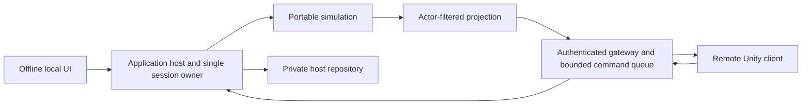

# Internet multiplayer

Decision date: 22 November 2026. **Agreed intended scope:** internet multiplayer, host/server authority, and a complete offline singleplayer game. **Proposed below:** protocol, deployment, persistence and scheduling details. **Open:** product and service choices listed at the end. This document is a design and implementation plan, not evidence of working multiplayer.

The [overnight authorization](../overnight-20261122.md) permits this design and bounded offline protocol/seam tests that do not impede save work. It does not authorize public deployment, exposed ports/firewall changes, purchases, default activation or a production identity policy. Earlier “multiplayer deferred/not authorized” statements in storage phase records describe their implementation authorization; the later owner decision expands intended scope, not all implementation phases. No multiplayer code or tests are introduced by this document.

Read with [architecture](../architecture.md), [tactical combat](tactical-combat.md), [weekly time and movement](time-movement-mobilisation.md), the [state repository ADR](state-repository-savegame-adr.md), and its [implementation authorization](state-repository-implementation-authorization-20261122.md). Networking must not force accounts, service startup, connection checks or subscriptions into offline New/Load/Save.

## Existing foundation and actual gaps

Document worktree base: `28409ec05f20d303aecd588a61e116eb50ffb9e7`. The receiving runtime examined here is the separately pinned [2fc0dbca46073121379dd9491c859a02a6f22dcd](https://github.com/AndreBal1983/HobbyDS9/tree/2fc0dbca46073121379dd9491c859a02a6f22dcd); do not substitute the older base source for playable runtime evidence. Its generated belt campaign uses the complete outer Format18/package5 carrier. This is not a promise that existing save editions accept multiple human civilizations.

| Existing contract at runtime pin | Consequence for multiplayer |
| --- | --- |
| [`CampaignTacticalReviewSession.Actor`](https://github.com/AndreBal1983/HobbyDS9/blob/2fc0dbca46073121379dd9491c859a02a6f22dcd/src/HobbyDS9.Simulation/CampaignTacticalReviewSession.cs#L124) checks civilization existence and `ControllerKind.Human`. | This is gameplay admission, **not connection authentication or account ownership**. A gateway must authorize the requested civilization before invoking it. |
| [Belt command header](https://github.com/AndreBal1983/HobbyDS9/blob/2fc0dbca46073121379dd9491c859a02a6f22dcd/src/HobbyDS9.Simulation/CampaignTacticalReviewSession.BeltBodies.cs#L34) checks actor, Planning, expected turn/revision and duplicate IDs. [Colonisation commands](https://github.com/AndreBal1983/HobbyDS9/blob/2fc0dbca46073121379dd9491c859a02a6f22dcd/src/HobbyDS9.Simulation/CampaignTacticalReviewSession.ColonisationCommands.cs#L45) have analogous checks. | Preserve the original command's preconditions. Networking must not replace its old revision with the current one to make it succeed. |
| [`CommitCampaignTacticalRoundDto`](https://github.com/AndreBal1983/HobbyDS9/blob/2fc0dbca46073121379dd9491c859a02a6f22dcd/src/HobbyDS9.Contracts/CampaignTacticalReviewContracts.cs#L87) carries expected turn, round and boundary revision. [`CommitRound`](https://github.com/AndreBal1983/HobbyDS9/blob/2fc0dbca46073121379dd9491c859a02a6f22dcd/src/HobbyDS9.Simulation/CampaignTacticalReviewSession.cs#L284) records commitments and resolves when active sides have committed. | Combat commitment is already boundary-scoped, not a global-revision command. Keep this distinction; the other side committing does not itself invalidate the original round boundary. |
| [Playable fixture admission](https://github.com/AndreBal1983/HobbyDS9/blob/2fc0dbca46073121379dd9491c859a02a6f22dcd/src/HobbyDS9.Simulation/CampaignTacticalReviewSession.Playable.cs#L43) requires one human; [playable combat](https://github.com/AndreBal1983/HobbyDS9/blob/2fc0dbca46073121379dd9491c859a02a6f22dcd/src/HobbyDS9.Simulation/CampaignTacticalReviewSession.cs#L316) requires an accepted human command to progress one actual round. | An unresolved first human commitment in a two-human encounter is an explicit profile/validation/replay gap. Do not remove the guard and call the current edition multiplayer-compatible. |
| [`CampaignTacticalBattleCheckpointDto`](https://github.com/AndreBal1983/HobbyDS9/blob/2fc0dbca46073121379dd9491c859a02a6f22dcd/src/HobbyDS9.Contracts/CampaignTacticalReviewContracts.cs#L60) contains commitments, hidden ship IDs, reports and resolved rounds. [Belt snapshots](https://github.com/AndreBal1983/HobbyDS9/blob/2fc0dbca46073121379dd9491c859a02a6f22dcd/src/HobbyDS9.Simulation/CampaignTacticalReviewSession.BeltBodies.cs#L141) distinguish current observation and retained knowledge. | Reuse disclosure rules, not persistence DTOs, as the basis of network views. Existing local snapshots still require a field-by-field wire audit. |
| [Checkpoint worker](https://github.com/AndreBal1983/HobbyDS9/blob/2fc0dbca46073121379dd9491c859a02a6f22dcd/prototypes/HobbyDS9.TacticalReviewClient/ColonisationCycleCheckpointSaveWork.cs) captures, copies and validates the complete carrier through load/replay before storage. | Keep this cost and compatibility proof initially. Neither command transport nor SQLite removes full capture, copying, serialization or replay. |

Authentication, civilization grants, a persistent network receipt ledger, lobby coordination, reconnect streams and internet transport are missing application boundaries. General support for multiple humans in a core DTO is not acceptance of those features in the playable profile.

## One authority, two entry paths

The host owns one authoritative session and its existing mutation owner/lease. The portable simulation retains game rules, deterministic RNG, legal orders and human/AI parity. The host adapter owns connections, authentication, admission queues, persistence and filtered delivery. Contracts/Simulation/Application gain no Unity Services, socket, SQLite or filesystem dependency. Remote Unity clients present views and submit intent; they do not resolve combat, run authoritative AI or submit replacement state. Offline singleplayer uses the local path without any network dependency.

Proposed host interfaces separate `AuthenticateConnection`, `ResolveCivilizationGrant`, `SubmitIntent`, `ReadRequestStatus` and `SubscribeActorView`. They are future seams, not existing API names. Avoid sharing a general-purpose host object exposing `ExportSave`, arbitrary queries, filesystem paths or controller overrides with the network adapter. AI calls remain trusted host-internal calls through the same gameplay validators.

## Internet connection and deployment alternatives

**Proposed first internet experiment:** an invited, player-hosted campaign using managed relay and an encrypted reliable message channel. Evaluate Unity Multiplayer Services/Relay with Unity Transport first because the client is Unity; pin packages only after a compatibility spike. Keep the command codec and host adapter independent of that SDK. No requirement for synchronized `GameObject` worlds or client-side deterministic lockstep follows from this choice.

| Option | Useful properties | Required decisions and limits |
| --- | --- | --- |
| Player host through managed relay | Players initiate outbound connections; a relay provides the rendezvous/data route without requiring the host to configure inbound port forwarding. Unity documents allocation, joining and host connection separately. | Relay is transport, not the authoritative campaign server. Host CPU, upload capacity, availability and trust still matter. Review service account, region, quotas, identity binding and costs before any live trial. [Unity connection flow](https://docs.unity.com/en-us/mps-sdk/advanced-config/connection-flow) |
| Direct player host, with ICE/STUN and relay fallback | Can avoid relaying successful direct paths. | NAT traversal is a protocol stack and operational service, not a checkbox. Some networks require relay; manual port forwarding alone is not an acceptable internet onboarding plan. Do not promise universal direct connectivity. [ICE RFC8445](https://www.rfc-editor.org/rfc/rfc8445.html), [TURN RFC8656](https://www.rfc-editor.org/rfc/rfc8656.html) |
| Dedicated host with secure WebSocket or another maintained encrypted reliable transport | Stable public endpoint; simulation and storage can run without a rendered Unity world. Clients need no inbound listener. Suitable if campaigns must outlive a player's PC. | Requires hosting, identity verification, certificates, patching, backup/recovery and capacity ownership. A headless application adapter is a separate build target, not evidence that the current Unity player is a server. WebSocket framing does not supply account authorization. [RFC6455, sections10.5–10.6](https://www.rfc-editor.org/rfc/rfc6455.html#section-10.5) |
| Steam Networking/Steam Datagram Relay | Potential platform identity and relay integration if distribution is Steam-based. | Steam availability and cross-store terms must fit the product. Open-source networking code does not itself grant access to Valve's relay network; non-Steam access has conditions. Dedicated-server tickets are distinct from civilization permissions. [Valve SDR documentation](https://partner.steamgames.com/doc/features/multiplayer/steamdatagramrelay) |

For a Unity relay trial, explicitly configure encrypted connections on both host and joining clients; Unity documents DTLS as a connection option. Do not infer end-to-end protection against the relay operator from transport-to-relay encryption. Identity credentials, relay allocation credentials and our civilization grants are different authorities. [Unity DTLS configuration](https://docs.unity.com/en-us/mps-sdk/networking/enable-dtls-encryption)

The trial must demonstrate how a verified principal is bound to the actual peer connection. A client-supplied player ID, display name or join code cannot prove that binding. Unity's authentication example uses anonymous sign-in for prototyping; durable account recovery and identity verification remain product/integration gates, not approved production choices. [Unity authentication initialization](https://docs.unity.com/en-us/mps-sdk/init-ugs)

A join code locates an invitation/session; it does not authorize command execution for a civilization. Session-host election also does not transfer our campaign, secret commitments or durable receipt history. Transparent host migration is deferred; Unity explicitly distinguishes host election from data migration and requires an appropriate migration handler. [Unity joining](https://docs.unity.com/en-us/mps-sdk/join-session), [Unity migration](https://docs.unity.com/en-us/mps-sdk/session-host-migration)

## Authenticated intent, original stamps and ordering

**Proposed envelope:** protocol version, opaque campaign/branch identity, host epoch, grant generation, request UUID, per-principal request sequence, command kind and bounded payload, plus the original observation/precondition stamp. These network identities need not expose repository keys. The host derives the principal from the authenticated connection. It resolves a persisted roster grant from principal to civilization and allowed role, checks its current generation, and rejects an actor mismatch before inspecting hidden targets. A human/AI enum or an `ActorId` supplied by a client is never a grant. Initial proposal is one controlling principal per civilization and one active controlling connection per principal; spectators and shared control need separate disclosure/permission rules.

Commands retain their existing domain preconditions: strategic turn and global revision for commands that use them; turn/encounter/round/boundary revision for combat. A proposed opaque observation token may map privately to the exact original authoritative stamp, so the wire need not disclose global revision increments caused by hidden rival actions. It must be scoped to actor/epoch and expire explicitly; resolving it must never select the latest revision. Tokens do not eliminate conflict/timing side channels. A privacy review must decide whether residual conflict feedback is acceptable before public play; report a generic refresh-needed response rather than hidden mutation counts.

Process each request in this order:

1. Enforce frame/decompression limits and authenticate the connection; resolve the current grant and epoch.
2. Look up the sequence identity under that principal, campaign, branch and epoch. Its canonical fingerprint covers the entire semantic intent: request UUID, protocol version, grant generation, principal request sequence, command kind, typed payload and original preconditions/observation token. The same sequence identity and fingerprint returns its retained actor-safe result/status. Within pending and retained receipts, a UUID also maps to exactly one sequence: changing its stamp, sequence or other semantic input conflicts and is rejected. Campaign, branch and epoch form part of the identity scope. Fingerprints are host-private.
3. For a new request, check queue/receipt capacity before reservation, then reserve a bounded receipt entry, resolve its original stamp and enqueue it under that principal. Busy means not admitted: it invokes no simulation, advances no request sequence and permits retry with the same ID, payload and original stamp. It is not a terminal gameplay rejection.
4. On the owning thread, recheck epoch/grant and invoke the existing typed validator once. Record the result and resulting authoritative order. A rejection changes no game state. Never turn a stale resource-consuming command into a fresh one automatically.
5. Publish only the authorized result and view, with the durability state defined below. Retrying a request never reruns a resolved RNG event.

Use one ordered mutation stream per campaign. A proposed bounded round-robin scheduler between principal queues prevents one producer from monopolizing admission; per-principal request order is preserved. An unseen request above the next expected sequence returns a gap/status response instead of overtaking its predecessor; the client reconciles missing requests before retrying. Reconnecting supersedes the old controlling connection so its later packets cannot race the replacement. The actual admitted sequence is recorded privately for diagnosis/replay. This is deterministic processing of an admitted order, not a promise that different network arrival orders produce identical campaigns. Client wall clocks do not decide ordering or resolve contested resources.

The existing accepted-ID collections are not a lifetime network retry ledger. The new ledger must survive reconnect and be atomic with any state claimed durable. Persist a per-principal sequence retirement floor and bounded retained receipts; a request at or below the retired floor returns Expired/refresh, never “unknown, apply as new.” Do not retire an unresolved request. Explicit abandonment may close an unused/admitted-but-unapplied sequence with a cancellation receipt; if already applied, return its outcome rather than undoing it.

**Proposed bounded uniqueness contract:** UUID reuse is detectable only while its receipt/tombstone is pending or retained. After eviction, the sequence floor still rejects the old sequence, but cannot recognize that old UUID paired with the next valid sequence; that combination is a new request, not a retry or a guarantee of deduplication against all history. Clients must never convert an expired retry into a new sequence automatically: obtain a fresh view and explicit player reconfirmation, then issue a new intent with a fresh UUID. Test both old-sequence rejection and new-sequence behavior after eviction. Grants, retirement floors and receipt retention require a versioned host metadata schema.

Concurrent Planning commands based on the same global revision can legitimately conflict. First implementation preserves this behavior and measures it. Per-actor revisions, automatic rebasing, batch planning and simultaneous strategic resource arbitration are separate game/contract changes. A network wrapper must not introduce them accidentally.

## Actor views and lifecycle

Create dedicated allowlisted wire DTOs from actor-filtered simulation projections. Never serialize the complete save, replay journals, hidden combat checkpoints, RNG state, full generated map, rival queues/equipment, database identifiers or private checkpoint/chunk hashes. Filtering happens on the host before serialization, compression, logging and caching; hiding a field in the Unity UI is insufficient. Reject messages and diagnostics also need the actor boundary.

Preserve explicit Unknown/Stale/Current observations and observed-at time. A stale value cannot be refreshed from live private state merely because it is available to the host. The belt occupied flag, for example, has a current-coverage-plus-survey gate and reveals no foreign installation details; networking must preserve that exact policy. Tactical reports must not expose opponent pending orders, unobserved units or ammunition through traces or commitment metadata. Public static content may be shared only after separating it from generated/private campaign data.

Start with complete **actor projections**, then add deltas only if measurements justify them. Each stream has an actor/grant/epoch, projection schema, stream sequence and optional delta base. A missing base requests a replacement actor view; it never requests a full campaign save. Stream counters and hashes cover only that actor's projection. Do not emit empty per-opponent-action updates or counts as an accidental hidden-activity feed. Loss of observation retains only knowledge the game rules allow; deltas must represent removal/changed visibility without revealing hidden new identities. Avoid compression contexts shared between different actors or with private credentials.

| Lifecycle | Proposed host behavior |
| --- | --- |
| Create lobby | Host selects compatible campaign/edition, admission roster, transport and recovery policy. Lobby metadata contains only intended public settings. No global seed/private package data as a convenience lobby field. |
| Join | Authenticate; negotiate protocol, projection schema, exact gameplay edition/resolver/content compatibility; obtain host-approved civilization grant; receive only that actor's view. Joining a running campaign does not silently change AI/human control. |
| Disconnect | Retain civilization ownership and request ledger. Presence changes are not game commands. Initially pause a required commitment barrier rather than silently choosing orders or transferring to AI. |
| Reconnect | Reauthenticate the same principal, bind a new connection, validate grant generation/host epoch and query unresolved request IDs. Resume a retained actor stream or send a fresh actor projection. Resending preserves the exact ID and original payload. |
| Leave/revoke | Remove connection/subscription; revoke or retain civilization grant according to an explicit campaign action. Revocation invalidates queued work and cached views under the old generation. Kicking a connection is not permission to discard a civilization or take its resources. |
| Restart/load/branch change | New host epoch; discard old stream bases, readiness tokens and late callbacks. Report recovered boundary and any rollback. Old-epoch packets cannot mutate the new session; a prior receipt can be reported as historical without re-executing it. |

Host-controlled saves remain private. A participating player can save their lawful view/preferences, not export the authoritative campaign. A player host necessarily has access to full state on its own machine; this architecture does not protect rivals against a dishonest host. Competitive play would require a trusted dedicated operator or a separately designed trust model. No client gets an omniscient migration copy as a shortcut.

## Strategic turns and tactical rounds

The strategic week remains a game turn, not a wall-clock deadline. **Proposed first multiplayer policy:** explicit readiness from every required human civilization; no automatic timer or disconnect-to-AI substitution. Define ready against that actor's acknowledged edit generation and turn. Later accepted edits by that actor clear readiness, including previously admitted edits drained after the barrier closes. Unrelated rival edits do not continually clear it. Readiness is future host coordination metadata, not an existing simulation command or permission to weaken command revisions.

Once the required roster is ready, close admission for that Planning boundary, settle all previously admitted work and recheck readiness. Draining an accepted edit still invalidates its actor's readiness even though admission is closed. If any required readiness is no longer valid, reopen Planning/Ready admission so players can review and ready again; do not advance or leave the barrier stuck closed. Only a successful recheck permits one authoritative advance using the host's current valid stamp. Late old-turn packets receive an explicit phase/stale response. The coordinator's advance is newly created host work; this does not justify rewriting the stamp of any player's earlier command. Run existing AI and consequences through the host. Advertise the resulting actual phase; do not increment the displayed calendar a second time at combat finalization or synthesize a Planning frame before the existing lifecycle has completed.

For tactical combat, preserve persistent orders and simultaneous commitments from the agreed combat design. Participants submit changed orders or retain standing intent against the same round boundary; the host keeps them sealed from opponents and resolves once all required active sides have committed. This is trusted-host confidentiality, not a client cryptographic commit/reveal scheme. The host runs the deterministic resolver; clients never upload combat outcomes. Battle participants alone need tactical order controls. Other players may inspect their lawful views, but cannot submit Planning mutations while the authoritative phase is AwaitingCombat.

Do not broadcast who changed which order, the order's size, or its private contents before resolution. Initially show a generic waiting state; whether named readiness is public is an explicit UI/disclosure choice. Existing commitments are one-way for a boundary (`AlreadyCommitted` rejects a second); withdrawing a tactical commitment is not part of this proposal. Strategic readiness withdrawal is a different operation and ends when its barrier locks.

Before enabling two-human combat, prove that the chosen new/extended profile can accept and save a first commitment without resolving, reload it exactly, accept the second commitment, resolve once and finalize once. Existing checkpoint fields make this plausible; current playable guards and edition replay do not prove it. Preserve the agreed three-round encounter cap and existing phase/consequence rules rather than changing combat to fit network timing. Timeout durations, disconnected-player standing-order defaults and simultaneous battles remain product decisions requiring explicit deterministic host policies.

## Durable acknowledgments and host recovery

Reuse the private host repository, complete carriers, writer lease, branch/reference CAS, validation and transaction receipts from the [storage ADR](state-repository-savegame-adr.md). Do not create another gameplay store or expose SQLite to clients. Gameplay revision, storage sequence, network request sequence and projection stream sequence remain distinct.

Legacy JSON import/export remains **game-only**: the complete existing gameplay carrier, without network grants or receipt history. The proposed versioned private host envelope adds that metadata alongside the carrier inside the host repository. Neither gameplay JSON nor ordinary gameplay wire messages may contain authentication secrets, private keys or provider access/refresh tokens. Provider credentials belong to the reviewed authentication flow and credential store, outside game saves, projections and logs; an opaque observation token is only a precondition reference, never authentication authority.

Importing game-only JSON cannot reconstruct a multiplayer roster or prove prior durable network acknowledgments. Start a new branch and host epoch, perform explicit multiplayer roster/grant setup, and tell participants that earlier request history is unavailable; never infer continuity from matching turn/revision or civilization IDs. Only a compatible private host checkpoint/backup with its ledger can preserve recoverable request outcomes. Exporting and reimporting game JSON is not a multiplayer host-migration mechanism.

**Proposed correctness-first multiplayer trial:** every accepted mutating request becomes durable before its success and resulting view are published to clients. Process at most one mutation/capture/commit at a time initially. Persist the complete compatible carrier plus corresponding network receipt, grant/coordination metadata and retirement floors as one recoverable checkpoint transaction. This adds a versioned host envelope/metadata contract; it is not a claim that Format18 already contains these fields. Pending first combat commitments must be included. Repository `PersistenceOperation` deduplication does not replace per-player request deduplication.

| Response/state | Meaning |
| --- | --- |
| Received/Queued | Authenticated transport/admission receipt only; no promise of game acceptance or survival after a crash. |
| Rejected | Stable actor-safe outcome for this request. It was not applied. Retain its disposition within the defined receipt window. |
| Accepted in RAM, saving | Internal pending state; if surfaced, explicitly labeled pending durability. No durable success or dependent published view yet. |
| Accepted durable | Exact request result and complete recovery state committed together under the configured durability contract. Reconnect can query the same receipt. |

If capture/validation/commit fails after a RAM mutation, stop further multiplayer mutations and retain the pending operation. Retry storage using its unchanged persistence identity; on ambiguous commit, query the repository receipt before trying again. Do not rerun the gameplay command. Either finish that commit or explicitly abandon the session and recover a validated checkpoint into a new epoch with rollback disclosure. Never claim success because the command is present only in RAM or because a transport send completed.

This deliberately differs from the agreed offline singleplayer policy of continuing after autosave failure. Full capture/replay can make durable-per-command latency unacceptable; measure it. A later proposal may batch commits or permit clearly marked volatile Planning acceptance while requiring durable turn/round barriers. That changes acknowledged-loss semantics and needs an explicit product decision; SQLite alone does not make it safe or fast. Do not publish post-barrier progress before the durability guarantee chosen for that barrier is met.

On process restart, acquire exclusive campaign ownership, validate the latest complete committed host checkpoint and reconcile operation receipts. New epoch fences delayed packets and prior workers. Disk loss is distinct from process failure: local durability is not remote backup. Manual rollback or loading an older checkpoint branches according to storage policy and announces the recovered boundary; it cannot silently continue the old acknowledged network history. Failover to another machine requires a separately designed private backup, authority-fencing and identity handover process. Automatic player-host migration is deferred.

**Proposed authorization recovery barrier:** world rollback must not automatically roll back access revocations or civilization transfers. A new epoch rejects old packets but does not stop a freshly authenticated principal from exploiting a stale restored grant. Keep remote admission and view delivery closed after older-backup/branch recovery until the host reconciles grants against current trusted authorization records, or explicitly reviews and approves a fresh roster when their currency cannot be established. Do not treat a restored checkpoint's roster as proof of present entitlement. Revocations apply immediately to live queues/subscriptions; confirming their durability requires a persisted control receipt, and an ambiguous recovery remains closed until reconciled. The precise independent authorization-record store and recovery UI remain a reviewed design gate. Test revocation/transfer, restore of an earlier backup, and fresh authentication by the former controller: no private view or command access before reconciliation.

## Acceptance and bounded measurements

Tests below are a backlog, not results. Backend owns portable protocol/session seams; Data owns atomic host metadata/checkpoints and recovery; GUI owns adapter/package and lawful UI integration; QA owns native/internet execution; independent review checks privacy and authority. Keep storage/provider/native gates separate from protocol tests.

| Probe | Required evidence |
| --- | --- |
| 1, 2, 8 and 32 command producers | Same seeded fixture and payload sizes; valid/conflicting mix reported separately. Record submitted, admitted, accepted, stale, Busy and duplicate counts. Producers are load generators, not a promise of 32 supported player civilizations. |
| Ordering and retry | Lost response, duplicate, reordered transport delivery, payload changed under ID, expired receipt, revoked grant, stale turn/revision/round and old epoch. After eviction, an old sequence is Expired; a next-valid-sequence request is distinct even if its UUID once existed, so the client must not manufacture that as an automatic retry. At most one mutation per accepted sequence identity; no silent restamp or RNG reroll. |
| Authentication/privacy | Spoofed actor/peer identity, unknown encounter, stale observations, belt reservations, hidden ships/orders/ammo, save/hash/log leak and shared-cache mistakes. Compare each actor's wire output against an allowed-view oracle, including rejection and reconnect paths. Test rival-only mutations for unintended wire changes. |
| Turn and combat barriers | Crossed Ready/edit packets; disconnect before/after lock; first human commitment reload; second commitment and finalization exactly once; AI-only continuation; late callbacks after Load. |
| Persistence failures | Crash before/after transaction commit and before response; disk-full/read-only/corrupt candidate; lease collision; retry receipt lookup; explicit older-checkpoint recovery. Revoke/transfer a grant, restore an earlier backup and freshly authenticate the former controller: admission stays closed until current grants are reconciled. Verify complete carrier plus host metadata, not just a matching revision number. |
| Network behavior | Simulated RTT 0/50/150/300 ms, loss 0/1/5%, duplicate/delayed packets and brief/long disconnections. Report assumptions; simulated packet loss is below the reliable transport, not permission to drop application commands silently. Later verify two real remote networks, restrictive NAT/relay and service outage. |
| Native boundary | Exact Unity/IL2CPP build and transport package pins; authenticated connection, encrypted transport, disconnect/reconnect and memory behavior. Headless .NET or loopback success does not establish this gate. |

Measure time from user submission to displayed outcome and separately queue wait, validation/mutation, projection, full checkpoint capture/copy/replay, storage commit and network delivery. Report p50/p95/p99 only with adequate samples, plus count, warmup, duration, fixture, hardware and failures. Do not infer internet latency or a runtime speedup from prior small pre-serialized storage probes.

Bound total pending requests by count and bytes, per-principal and per-campaign. Start trials with proposed 64 KiB uncompressed command envelopes, 8 pending requests per principal and 128 per campaign; commands exceeding that need explicit typed limits, not unrestricted decompression. Projection chunks need their own bounded transfer budget and cancellation, not the command queue. Tune only from valid payload measurements. Backpressure a slow client or replace its pending view with a newer complete actor view; never retain an unlimited history of full snapshots. Receipt metadata and reconnect history need independent caps.

Memory accounting must include the live session, staging copies, one complete checkpoint image and serialization/replay work, actor projection buffers, transport buffers and queues. Report peak managed/native memory, allocation volume, payload bytes, disk growth and retained receipt count for each producer level. Do not assume a delta wire format removes full simulation copies, or that 32 clients cost only 32 small command buffers.

## Operating cost model

No vendor price or free-tier entitlement is adopted here. Before choosing a live service, record the official dated tariff, region, currency, included quotas, metering direction and billing unit. Use measured legal wire payloads rather than full-save size as the network estimate.

For one accounting period, estimate:

`cost = host_hours × host_rate + relay_metered_GiB × relay_rate + egress_GiB × egress_rate + stored_GiB_month × storage_rate + auth/control_request_units × unit_rate + fixed_service_costs`.

Use GiB = 2^30 bytes internally; convert if the vendor bills decimal GB. Do not count a relay's two legs or an included egress allowance twice. Sum actual recipient traffic: `view_bytes = sum(actor_full_views + actor_deltas + reconnect_views + protocol_overhead)`, plus requests, receipts and retransmissions. Host upload scales with the sum of recipients' views, not only commands. Relay regions and reconnect frequency materially affect that total.

For dedicated capacity, measure campaigns per host under CPU, memory and latency limits; do not divide by an assumed player count. Monthly storage uses retained checkpoints, WAL/temporary space, receipts and backups; preserve full replay-bearing payload costs. Player hosting removes a dedicated simulation-instance bill but leaves relay/control-plane cost and host availability. Establish spend alerts, hard admission quotas and a service-outage behavior before paid/public deployment; all rates and budgets remain open.

## Phased backlog and morning decisions

| Phase | Deliverable and exit gate | Scope |
| --- | --- | --- |
| M0 — authority contract | Inventory multi-human profile/admission/replay gaps; version the envelope, grant, receipt and actor-view schemas. Define expiry and crash outcomes. Review against current save contracts. | Documentation and isolated offline seam tests are permitted by the overnight instruction if they do not impede save work. This document implements none. |
| M1 — in-process fake transport | Two distinct authenticated test principals; exact stamp/duplicate/privacy tests; deterministic scheduler and turn/round barrier fixtures; 1/2/8/32 producer results. | No service accounts, listening ports or production activation. A profile change needs its own gameplay/compatibility review. |
| M2 — private host recovery integration | Repository atomic metadata/carrier checkpoint; first commitment restore; crash/reconnect/epoch tests; bounded queue and memory evidence. | Depends on approved storage/native prerequisites; keep offline behavior unchanged. Loopback/native work needs a scoped implementation handoff. |
| M3 — invited internet trial | Selected provider/identity recipe and package pins; two remote machines/networks; lawful views, durable latency and host-loss receipt; clear trial UI. | Requires explicit deployment, account, cost and authentication review. No public launch implied. |
| M4 — product rollout | Accepted player count, deadlines/disconnect policy, support/backup/runbook and cost envelope; separate default/product decision. | Dedicated hosting, spectators, co-op control, cross-store identity and automatic host migration remain separately scoped. |

Morning choices, in dependency order:

1. Confirm invited player hosting as the first experiment, or require dedicated continuity; select the identity/relay candidate only after its peer-binding recipe is reviewable.
2. Choose account recovery, civilization transfer and disconnected-player policy. Initial proposal pauses required barriers; no silent AI takeover.
3. Accept or revise durable-per-command trial semantics after measuring full capture/replay latency. Define any acceptable acknowledged rollback explicitly.
4. Set supported players and readiness visibility/deadlines. The 32-producer stress case is not a product player limit.
5. Decide host-trust expectations, remote backup responsibility, regions and operating budget. Transparent migration and competitive anti-host-cheating guarantees are deferred.

Primary transport sources above were checked on 22 November 2026. Their SDK/provider availability is not a tested package pin or a production approval. The simulation source links are immutable; network, multi-human playable compatibility and native acceptance remain future evidence gates.
