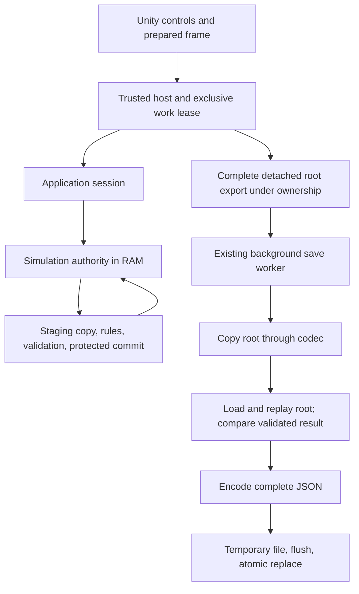
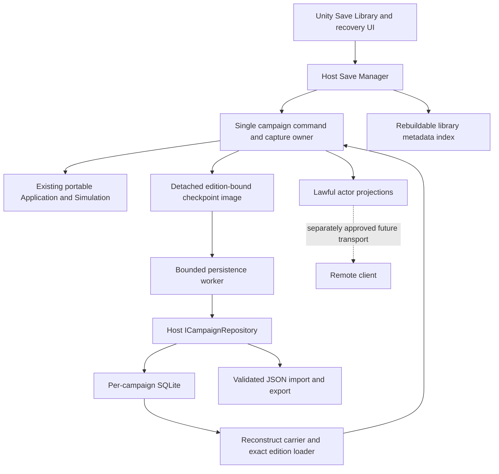

# ADR: offline campaign repository and recoverable saves

22 November 2026. **Direction and defaults agreed; scoped phased implementation authorized; default production activation remains a separate decision.** The [owner authorization](state-repository-implementation-authorization-20261122.md) approves the reviewed recommendations at `55a0c67b1a96d965c6a9c0214dc7f60d85743efe` / PR132 and supersedes the architecture-only hold in the [original assignment](../prompts/state-repository-savegame-redesign.md). Approval does not establish implementation or change an existing save format, content identity, validation rule or accepted player. Detailed interface/schema/UI sketches remain proposed unless explicitly settled below.

Authorized work is A2, B1/B2, C1/C2 and D1, with dependency and evidence gates preserved. Proceed with independent specifications/scaffolding while dependent activation waits for tested prerequisites. D2 requires a separate rollout decision; B3 chunking, E1 engine delta/copy refactors and E2 multiplayer are not authorized. This approval permits no main merge, rewrite of sealed players or destructive cleanup. The authorization's shared-use checkpoint, hard stop and reserve remain binding.

The [implementation contract](state-repository-implementation-contract.md) freezes A2/B1 source ownership, the provisional provider graph, host API semantics and phase handoff gates. Its trial package selection does not establish native acceptance; interface/schema sketches below remain design context until the corresponding implementation is reviewed.

## Recommendation and decision status

Implement a host-owned save manager with an embedded **per-campaign SQLite repository**, subject to the packaging and reliability gates below. Preserve the simulation's authoritative in-memory session and its exact edition-specific complete save carrier. Initially store immutable complete checkpoints with transactional named references; content-addressed chunks remain a separately authorized future optimization. Keep validated JSON import/export. **Do not begin with entity-level SQL persistence, command-only event sourcing, or removal of existing copies/replay validation.** Those are separate changes requiring scope approval, a complete authoritative commit representation and equivalence evidence.

This recommendation solves slot organization, transactional metadata and recovery retention. It does not by itself solve expensive export, validation, replay, UI capture or turn processing. The companion [measurement report](state-repository-measurements-20261122.md) distinguishes measured costs from hypotheses and outstanding benchmarks.

| Alternative | Advantages | Costs / decision |
| --- | --- | --- |
| JSON snapshots with dynamic filenames and a catalog | Lowest dependency and migration cost; existing validated payload/atomic file code reusable | A viable fallback, but multi-reference/branch/retention updates and a coherent catalog require their own transaction/recovery protocol. Keep export/fallback; do not reject it merely because it is JSON. |
| SQLite metadata plus immutable complete payloads, optional deduplicated chunks | Transactions cover refs/heads/payloads; bounded indexed listing; reusable immutable checkpoints | **Complete-payload direction agreed; chunks deferred.** Native provider/backup/GC complexity and possibly higher durable I/O; no assumed runtime speedup. |
| Entity-level relational world state | Potential targeted writes and queries | Reject for initial slice: duplicates rule/state mapping, threatens cross-system atomicity and creates migration burden before measured need or complete delta contracts. |
| Command-only event sourcing | Small append records | Reject as replacement: submitted commands omit internally committed consequences and existing replay proofs are edition-specific. Cold restore can become slower, not faster. |

| Decision | Status | Scope / reason |
| --- | --- | --- |
| Offline singleplayer, embedded installation, no account/server requirement; many named saves, independent recovery points; originals preserved | **Agreed constraints** | Scoped phased implementation authorized on 22 November; production default remains separately gated. |
| Simulation alone validates and mutates game state; portable C#9/netstandard2.1 core; exact deterministic identities, privacy and shared human/AI validation | **Agreed existing constraints** | Storage is a host adapter, not another rules engine. |
| Per-campaign SQLite, immutable checkpoints and references; JSON compatibility | **Agreed direction; implementation authorized** | Good failure isolation and transactional metadata; native feasibility gate still required. |
| WAL plus synchronous FULL; one writer; explicit durable-save receipts | **Agreed design baseline; evidence gated** | Local disk only; no promise against defective storage or actual power loss without testing. |
| Complete existing carrier first | **Agreed initial scope** | Preserve full capture/copy/replay validation; no verified delta API is assumed. |
| Content-addressed chunks and verified partition deltas | **Deferred; separate scope approval required** | B3/E1 are not authorized; disk deduplication would not remove full-state capture/serialization or genesis replay. |
| Completed-turn and valid combat-safe autosaves; 10 rolling points plus 3 milestones; 512 MiB soft automatic-storage budget | **Agreed defaults** | Changed-state coalescing and bounded memory; protected manual saves, no arbitrary three-slot cap. |
| Continue singleplayer after autosave failure with a persistent unsaved warning | **Agreed default** | Explicit manual Save/Save-and-Quit failure retains the session and recovery choices. |
| Branch on resuming older history; independent futures and manual pins | **Agreed direction** | Exact reference/UI schemas remain proposed; Quick Save is deferred. |
| Managed SQLite provider and native plugin build, measured native performance budgets, actual supported desktop matrix | **Open until measured/packaged** | Engine-only probe is not Unity IL2CPP evidence. |
| Gameplay-format migration, multiplayer transport/authentication and durable network acknowledgments | **Open, separately scoped** | No automatic 14→18 upgrade or multiplayer implementation in this proposal. |

## Evidence baseline: main and player are different

Review pins are fresh `origin/main` **`f5ebc86772f38e9c55aad9ec9e35dc368906de03`** and the combined receiving/runtime tree **`2fc0dbca46073121379dd9491c859a02a6f22dcd`**. The latter includes Backend `4b38e9e` and GUI receipt deltas. It is the inspected player source, not an inference of final native acceptance. The shared checkout and current QA player are untouched; probes build in a separate detached checkout.

| Area | Observed on main | Observed on receiving tree |
| --- | --- | --- |
| Version identity | `FoundationVersions`: save **14**, content **10**; older prose in architecture is historical | Outer belt campaign root **18**, package **5**, profile `generated-belt-bodies-v1`; inner foundational version is a separate identity, not replaced by the outer number. Format17 refinement semantics retained. |
| Slot mechanism | [SaveSlotStore](../../client/HobbyDS9.Unity/Assets/HobbyDS9/Runtime/SaveSlotStore.cs) enforces integer 1–3 and `campaign-{slot}.json` | [Cycle slot adapter](https://github.com/AndreBal1983/HobbyDS9/tree/2fc0dbca46073121379dd9491c859a02a6f22dcd/client/HobbyDS9.Unity/Assets/HobbyDS9/Review/Runtime) already uses validated string slots; the three visible choices are UI policy. Do not build the redesign solely around the older integer store. |
| User-data location | `persistentDataPath/CampaignSaves` | `persistentDataPath/HobbyDS9CampaignColonisationCycleOnly-v1-belt-bodies-v1`; filename prefix remains `unity-campaign-colonisation-cycle-v1-`. Older edition directories stay distinct. |
| Save execution | `CampaignHost.SaveJson` exports and serializes; file store flushes a same-directory temporary file, then Replace/Move | [Checkpoint worker](https://github.com/AndreBal1983/HobbyDS9/blob/2fc0dbca46073121379dd9491c859a02a6f22dcd/prototypes/HobbyDS9.TacticalReviewClient/ColonisationCycleCheckpointSaveWork.cs) already runs asynchronously: full export under host ownership, then JSON copy, complete load/replay validation, and store serialization/write. |
| Authority | [SimulationSession](../../src/HobbyDS9.Simulation/SimulationSession.cs) owns copied state behind a gate; accepted command stages/copies/validates/commits; export copies again | Complete Cycle root also carries nested campaign state, additional systems, operation histories and edition sidecars. Belt/refinement journals interleave by ordinary-journal offset and accepted revision. Saving only `GameStateDto` loses required facts. |
| Isolation | [Durable tactical review prototype](../tactical-review-durable-checkpoints.md) has useful atomic replacement, trusted private checkpoint and host-generation guards | Its successful isolated storage tests do not establish campaign autosave, SQLite support or a universal migration loader. |

Main's store uses `Flush(true)` and same-directory `File.Replace`/`File.Move`, never delete-then-copy. It does not constitute a process-wide writer lease or a proof of power-loss durability. Existing strict decoders, edition bounds and complete-root validation must survive a storage substitution. See the inventory and benchmark evidence linked from the measurement report.

### Current ownership and cost path



A visible spinner or worker thread does not prove that capture is cheap. SQLite changes the final storage portion unless another reviewed change alters the earlier nodes. No reusable, complete verified-state-delta API is assumed to exist.

The current asynchronous save also holds model `Busy`/exclusive-work ownership: it is not an already implemented autosave service concurrent with unrestricted gameplay. New autosave capture must occur **after outer session adoption**, not inside a nested staged phase or immediately after an inner method succeeds. Accepted turns can advance revision by more than one because staged AI commands also advance it; repository sequencing must not infer one action from each numerical revision step.

## Proposed ownership and interfaces



`ICampaignRepository` belongs to a host-only assembly; Contracts/Simulation/Application acquire no SQLite, task scheduler, filesystem, Unity or network dependency. Its methods operate on storage identities and owned bytes, never on a mutable session: `ListReferences(cursor, filter)`, `ReadCheckpoint(id, limits)`, `CommitCheckpoint(request, expectedHead)`, `Create/Rename/Replace/DeleteReference(expectedGeneration)`, `Export`, `Backup`, `InspectHealth`. Return stable error categories and a **durable receipt** containing checkpoint ID, branch/storage sequence, source turn/revision and committed timestamp. This API sketch is proposed, not a new production interface.

The Save Manager coordinates edition codecs/loaders and UI generations. An edition descriptor includes carrier kind/root format, inner format, package format/profile/hash, scenario/content/rules/resolver/RNG identities and codec version. A scalar `SaveFormatVersion` cannot identify every nested carrier. Repository metadata must agree with decoded authoritative contents; indexed metadata alone is never sufficient to load a game.

Storage UUIDs, timestamps and display names are host metadata and never consume campaign RNG or entity allocation. Metadata naming a civilization, turn summary or thumbnail uses only the local authorized player's existing projection. Complete payloads remain private host data. Hashes detect accidental damage; they are not anti-cheat signatures or proof of trusted origin.

### Layout and schema sketch

```text
<persistent user data>/CampaignLibrary-v1/
  catalog.json                 # disposable discovery cache, rebuilt from repositories
  campaigns/<host-UUID>/campaign.sqlite
  campaigns/<host-UUID>/campaign.sqlite-wal / -shm   # SQLite-managed when open
  campaigns/<host-UUID>/writer.lock                 # held OS handle, not a stale flag
  exports/                     # only explicitly requested exports
  migration-backups/           # verified backups; no legacy deletion
```

Prefer a database per campaign over one per manual save (duplicates/history fragmentation) and a single shared library database (one failure blocks all campaigns and enlarges migration blast radius). Logical saves/branches share immutable data within a campaign. Cross-campaign duplication is an explicit export/import into a new host UUID. The catalog is reconstructible; losing it must not lose campaigns. Moving a whole campaign uses a consistent backup/export, not a copy of the live `.sqlite` file alone.

Costs of this choice include per-database schema upgrades/backups, connection/lease management and reconciliation of the cross-campaign index. Limit open connections to active operations; discover metadata lazily and make bulk migration resumable per campaign. One damaged repository must not block unrelated games.

| Proposed table | Core fields and invariant |
| --- | --- |
| `RepositoryMeta` | One local CampaignId, StorageSchemaVersion, complete edition descriptor, next monotonic StorageSequence. |
| `Branch` | BranchId, origin checkpoint, current checkpoint, generation. Branch head moves by compare-and-swap in a transaction. |
| `Checkpoint` | Immutable ID, parent, branch, sequence, turn/revision/phase, trigger, payload codec/length/hash, edition identity. Turn/revision is **not** a unique key. |
| `Chunk` / `CheckpointChunk` | Optional immutable byte blocks keyed by hash and length, and contiguous ordered manifest. Reconstruct exact root bytes and verify full hash. Initial version may use one full payload blob instead. |
| `SaveReference` | Stable RefId, kind (`Manual`, `Auto`, optional `Quick`, `Milestone`), name/notes, checkpoint ID, generation, creation/update time, retention group. Names are data, not paths. |
| `ImportReceipt` | Original file digest, edition descriptor, imported checkpoint, original path display hint and result; idempotency by digest plus identity. |
| `PersistenceOperation` | Caller-assigned operation ID and immutable request fingerprint, committed checkpoint/reference generations and durable result. Recorded in the same transaction as the save; repeated identical requests return that result. |

Foreign keys are enabled on every connection; length/count limits are enforced before allocations. SQL is parameterized. All referenced chunks and the checkpoint, head move and intended reference updates commit together. Partial rows are not discoverable as valid saves. Shared immutable blobs can be reused for duplicate saves; overwrite moves a reference, not immutable historical bytes. Delete removes only the requested reference. Garbage collection traverses all live branch/reference/export/migration pins; it never cascades through a checkpoint still needed by another branch or restore chain.

Distinguish ancestry metadata from restore dependencies. A complete checkpoint may retain a parent-ID tombstone without pinning that parent's payload forever; a delta checkpoint must pin its full base/chain. Otherwise every live branch would retain all old autosaves despite the stated retention policy. Preserve required gameplay replay history *inside* each complete carrier; this is unrelated to collecting unreferenced storage copies.

## Transaction, asynchronous work and durability

1. The existing single session owner validates and commits a gameplay action in RAM. **Accepted gameplay is not a durable-save acknowledgment.** Keep gameplay revision separate from repository sequence and a host session epoch that changes on New/Load.
2. At a valid boundary, capture one complete detached checkpoint under the existing ownership/lease rules. Attach source epoch, branch ID, expected branch head/generation and exact turn/revision. The worker never reads mutable live DTOs. Until an immutable commit-image API exists, this is still the full export.
3. Perform existing edition copy/replay validation in the worker initially. Encode a bounded image; apply hashes and optional chunk comparison. No inferred change-set is allowed to omit data simply because it is not currently rendered.
4. One database writer holds an exclusive OS-level campaign lease and starts a short transaction (`BEGIN IMMEDIATE` proposed). Validate expected branch/reference generations. Insert all new data and update the intended references; commit. Do not hold a database transaction during world replay, capture or a modal confirmation.
5. Publish a durable receipt only after successful SQLite commit at the configured durability level. On return, match session epoch/work token before updating the visible "last saved" indicator. A late receipt may be retained in its original branch, but cannot move a newly loaded branch's head or claim its current state was saved.

Commit can succeed before a response is lost, a connection errors or the process exits. Every persistence request therefore carries an operation UUID and fingerprint. After an ambiguous outcome, reopen/query its receipt: **committed**, **confirmed not committed**, or **outcome unknown pending recovery**. Reuse that ID on retry; reject reuse with different payload/target/generation. Check known receipts before reapplying head/ref changes. Do not misreport definite failure, create duplicate checkpoints blindly, or claim rollback merely because no UI receipt arrived. Restart discovery includes committed references even if their initiating UI never received a reply.

**Bounded queue:** one in-flight image plus at most one coalesced autosave intent; a pending intent holds a stamp/reason, not another full world. Capture only when the worker can accept an image. If the image permit is occupied, Manual Save remains a cancellable *request waiting for admission*, not an accepted save of the earlier frame. When the permit becomes free, review/revalidate the current stamp and target generation, then capture under exclusive session ownership. Do not retain a second full image or describe later capture as the originally reviewed state. Once admitted, a manual image cannot be silently replaced with a newer autosave. Busy UI reports requested/saving accurately and permits safe navigation. Cancel before commit abandons that request; after commit, cancellation cannot truthfully erase success. Load waits for or safely retires the existing epoch's work according to its lease, never swaps authority while a worker still owns it.

After a preceding write fails or is ambiguous, resolve its operation receipt and read the durable branch head before admitting the next intent. A new request uses that confirmed head; an already stamped request gets a conflict and explicit revalidation, never an automatic head change under the same operation ID. Manual reference-generation conflicts always require renewed confirmation.

Autosave overload coalesces to the latest valid boundary, updates recovery age, and cannot grow RAM without bound. Important combat transitions retain the latest complete combat state; if a product requirement demands *every* boundary be durable, enable explicit backpressure on further mutations until commit. That stricter policy is a separate choice with measured latency, not an implicit consequence of SQLite.

**Failure contract:** transient busy is retried a bounded three times with backoff on the worker; disk-full, permissions, corruption and incompatible schema are not blindly retried. Leave the last good reference intact. Show last successful durable turn/revision plus current unsaved progress; offer retry/export and storage settings. The agreed singleplayer default permits continuing after an autosave failure. A confirmed failed Manual Save remains failed, and Save-and-Quit stays in game until a successful save or explicit Quit without saving; resolve unknown commit outcomes through the receipt protocol above. Never roll back already accepted game actions because a background write failed. A process crash may lose progress since the last durable checkpoint; display recovery age honestly.

Use WAL + `synchronous=FULL` initially, one writer and short reader transactions. Checkpoint WAL off the UI thread when the worker is idle; monitor WAL growth and long readers. Do not lower durability to manufacture timing wins. Database correctness still depends on filesystem/hardware behavior. The product ships no daemon and never uses a network filesystem as a shared campaign mutation mechanism.

## Save Library, autosave and recovery

Manual saves have stable IDs, Unicode display names (proposed 1–120 characters), optional notes (1,000-character bound), turn/revision/phase and compatible edition summary. Names need not be unique; disambiguate with date and checkpoint. Page lists by stable sort key/ID; default newest first, with campaign/name/edition/health filters. Do not parse/replay hundreds of payloads merely to display the list. Cached labels are untrusted metadata and health is revalidated before loading. A thumbnail is optional and comes from the authorized view, never hidden-state reconstruction.

Create, rename, duplicate, load, export and delete are distinct operations. Overwrite/delete require confirmation naming the target and an expected reference generation, so a stale dialog cannot overwrite a changed save. Duplicate creates a new Manual reference to an immutable checkpoint. Loading an older point creates a **new continuation branch** on the first accepted mutation (or explicit new branch); load/fork itself deletes no later checkpoints or references. Save health distinguishes available, checking/loading, incompatible, corrupt, recovery available and storage-migrated; "migrated" never implies gameplay-format conversion.

Only the current active branch head is an automatic permanent recovery pin. Inactive automatic branches retain recovery payloads according to the visible rolling policy, not forever merely because branch metadata exists. **Keep branch** creates an explicit manual recovery reference; Archive hides a branch without changing its pins; Delete continuation requires confirmation and never silently deletes its manual saves. Expired automatic heads retain metadata/tombstones, clearly marked unavailable, rather than dangling load actions. Later autosave retention may expire unpinned automatic history on inactive branches, but never erase a named manual future. Quarantined corrupt checkpoints remain separately pinned until explicit disposal/export; report their storage and stop new autosaves if space is exhausted instead of silently destroying them.

Accepted default autosave policy, with optional details marked proposed or deferred:

| Trigger / policy | Behavior / status |
| --- | --- |
| Completed strategic turn | Enabled; capture only after authoritative Completed state, not after individual staged phases. |
| Enter AwaitingCombat | Enabled; persist complete requests, RNG/allocation and phase. Do not repeat the strategic turn on restore. |
| Accepted buffered combat result and finalization | Enabled, coalescing redundant captures; preserve resolved results so they are not resolved twice. Detailed tactical round boundaries need their own edition-safe export contract. |
| Clock interval | Off by default; optional timer proposal: 5-minute minimum, only at a stable exported boundary and only when the authoritative stamp changed. Clock never enters simulation rules. |
| Rolling retention | Newest **10** autosaves across the campaign, plus **3** milestones (proposed one each 10 completed turns). Current active-branch recovery and all manual/quick/kept-branch refs stay pinned; inactive automatic branches follow the stated expiry policy. |
| Storage budget | **512 MiB soft budget** for reclaimable automatic data, adjustable. Warn at 80%; prune oldest unpinned autosaves after a successful new commit. Preserve at least the latest good recovery point. |
| Low disk | Do not delete the last good checkpoint to make room for its uncommitted replacement. If space cannot hold a new complete transaction plus WAL, report failure; user controls export/delete. No automatic deletion of manual saves. |
| Quick save | Deferred; not authorized in the initial implementation. A later scope would need its own confirmed reference/retention policy, never a manual-name alias. |

Physical bytes shared by manual/auto references complicate quotas: report total repository size and reclaimable automatic bytes separately. A quota is not a hard guarantee on live WAL size. Keep full checkpoints/chunks needed by retained chains; compact in bounded maintenance transactions and reserve temporary free space. Unlimited logical slot growth does not mean unbounded metadata strings or unpaginated UI.

On startup, inspect repository schema and incomplete-work markers, then offer Resume latest **validated complete** recovery point or Browse saves. If the newest checkpoint fails checksum/codec/edition validation, quarantine its metadata, retain it for diagnosis and offer the next good candidate with the loss window shown. Do not silently substitute an older point or overwrite the broken database. Run quick/integrity checks as appropriate; database integrity alone does not prove game-state validity.

## Compatibility, import, backup and rollback

Maintain **three version layers**: storage schema; payload codec/carrier edition; gameplay/content/rules identity. A storage schema migration may reorganize bytes without changing game facts. A gameplay format conversion requires its own versioned migration design and tests. Never relabel main14, refinement17 or belt18 as interchangeable, and never promote decorative legacy belts into resource deposits.

Even the number 14 is ambiguous: foundational `SaveEnvelopeDto` and outer Cycle Format14 are different carriers. Dispatch by type/profile and complete descriptor, not number or filename alone. Generated/refined component definitions and access/publication state are part of authoritative continuation data; their catalogue-like shape does not make them immutable shipped content that can be omitted.

Import flow: explicit user selection/discovery in known legacy directories → bounded read/strict decode → exact matching edition/package loader and full validation → reconstruct and compare supported complete root → create repository/checkpoint/reference transaction → record digest/import result. Originals remain byte-for-byte untouched. `campaign-1.json` through `campaign-3.json` use the old foundational loader when compatible; Review/Cycle names and profile suffixes use their own loaders. Unknown future formats, missing content packages, corrupted bytes and unsupported tactical-review carriers are separate errors. A missing compatible loader is **not** permission to guess defaults; allow the existing edition/player to remain usable until an importer is accepted.

Before a database schema upgrade, take a consistent verified backup, verify sufficient disk space, perform a transactional supported migration and reopen/validate. Reject future schema versions with an actionable message. Downgrade uses the untouched backup or explicit compatible export; never attempt reverse migration silently. Preserve exact required content/package bytes by installed pinned package or an explicitly bundled licensed archive. Cosmetic content rehashing is still a compatibility change under existing exact-byte hashes.

JSON export reconstructs the complete original edition carrier and validates it through the same loader. Existing codec output is preserved for that edition; a storage hash is over exact encoded bytes, not a newly claimed cross-version canonical logical hash. Write exports using the proven same-directory temporary/flush/replace discipline. Whole-campaign backup uses SQLite's consistent backup mechanism or a tested close/checkpoint/exclusive-copy procedure; copying only an open main file can omit committed WAL data. Verify backup reopen and game-load before declaring export complete.

Paths are rooted under an owned user-data directory and generated host IDs. Reject traversal/reparse-point hazards, bound imported files and decoded collections, and retain existing depth/count/64 MiB root limits where applicable. Do not follow arbitrary directories to delete saves. Titles and notes are parameterized SQL values, never executable fragments or path segments. Local saves contain private game information; future remote clients must never receive them as normal replication traffic.

## Incremental writes and the separate in-memory problem

**Stage 1:** complete immutable payloads with metadata references. This already makes rename/duplicate/list operations small and permits autosave coalescing. It can write as many or more bytes than JSON for a changed full checkpoint; it is not advertised as a save-speed optimization.

**Stage 2, deferred pending separate B3 authorization and measured benefit:** encode the exact complete root, partition into deterministic bounded byte chunks, store only missing chunks and commit an ordered hash manifest. Reconstruct exact bytes, verify full length/hash, strict decode and load through the current edition loader. Byte-level storage diffs do not need a claim that engine changes are semantically complete. However, inserted JSON fields/list entries can shift every following fixed-size chunk, reducing reuse. Hashing, full export, full serialization and load/replay still happen. Static data can be deduplicated by identical bytes without dropping it from a carrier; externalizing definitions requires a separate payload/version change.

**Stage 3, deferred pending separate E1 authorization:** a portable, versioned immutable post-commit image or typed partition delta must cover every authoritative mutation, not merely submitted player commands: AI, research/economy/movement, resolver requests/results, pending commits, RNG/IDs, dedup ledgers, queues, disclosure history, refinement and belt state. Define expected base hash/sequence, replacements/deletions with stable IDs, total deterministic order, post-state hash, strict bounds and schema compatibility. Compare application to a complete export under fault injection. Preserve exact ordered arrays. Missing fields cannot default to empty; deletion is explicit.

Do not treat existing operation journals as a universal write-ahead change log. Their offsets, cross-stream accepted revisions, package/rules pins and whole-root replay verification are part of the current contract. Compacting history or restoring from a new trusted mid-game snapshot requires proof that all historical validation invariants and provenance survive. The database cannot make a replay-only save suddenly load without replay.

Copy reduction is another explicit workstream: instrument staging copies, validation, protected commit copies, projections and export separately; then consider ownership transfer of frozen partitions or copy-on-write with retained-reference tests. Preserve rollback on late exceptions and prevent handler/phase/worker references from mutating authority after commit. Optimize measured dominant paths before redesigning every entity table. No delta/probe result authorizes deleting defensive copies.

## Embedded SQLite and native feasibility gate

The isolated storage probe establishes only the tested local SQLite engine behavior in its stated host/runtime. It does **not** certify a managed provider, Unity import, linker retention or IL2CPP P/Invoke. [Provider and official-source evidence](../evidence/state-repository-20261122/storage-feasibility.md) propose the first packaging trial as `Microsoft.Data.Sqlite.Core` with explicitly pinned SQLitePCLRaw provider/native dependencies, without an ORM. If its dependency/AOT footprint fails, evaluate direct SQLitePCLRaw behind the same narrow host adapter before maintaining a custom C ABI binding. SQLitePCLRaw3.x changes native-package recipes, so lock and inspect the actual resolved graph rather than copying older bundle advice. Pin the SQLite build/compile options; do not rely on a developer-machine DLL or an unversioned OS library. This is a trial order, not provider acceptance.

Windows x64 is the first native gate: bundle native SQLite and managed interop with the player, verify architecture/plugin import paths, IL2CPP translation/linker preservation, non-ASCII user paths, offline launch, create/commit/reopen/backup/restore, and fault recovery in the actual shipped player. Current source ProjectVersion and installed acceptance editor can differ; record the exact editor/player used. Linux/macOS headless CI is useful but is not native desktop-player acceptance. Each further supported desktop target needs its own binary/signing/licensing/reopen test. Record SQLite public-domain status and each wrapper's separate license/notices before distribution. No library is added to the portable core or current Unity package in this ADR.

## Future multiplayer boundary, without implementation

One host owns a session and local database writer lease. Peers would submit authenticated/authorized stamped intents to a host queue, never SQL. Existing Human/AI controller flags are not network authentication. Assign a host ordering sequence; validate original expected turn/revision, command ID, actor ownership and permissions. With 2/8/32 simultaneous producers, requests can arrive together but authority executes one at a time. Global-revision conflicts return stale/refresh; do not silently rebase or automatically retry resource-consuming actions. Fairness/scheduling is an explicit later policy.

A network retry ledger must scope idempotency to campaign/branch/host epoch and bounded request retention; the current per-planning-turn accepted-ID ledger alone is not a lifetime network dedup guarantee. Restore from a checkpoint creates a new host epoch; reconnect must identify that rollback rather than pretending the old sequence continued. A durable multiplayer acknowledgment policy could pause publication until storage commit, but that differs from the agreed singleplayer RAM acknowledgment and needs separate latency/failure design.

Replicate actor-filtered snapshots/deltas with independent sequence/base stamps, authorization, loss/resync handling and reconnect catch-up. Validate against authoritative lawful views on every publication; do not broadcast the repository's complete root or its private chunk hashes/metadata as a shortcut. Host failure restores the newest durable checkpoint and explicitly resets peers; automatic host migration is not designed here. Save files belong to the hosting user; database backups are not credentials. Measure arrival-to-visible response and network/reconnect latency separately from local SQLite commit.

## Phased backlog and go/no-go gates

Each row is a small reviewable PR or bounded pair; estimates are relative, not promised dates. The [owner authorization](state-repository-implementation-authorization-20261122.md) approves A2, B1/B2, C1/C2 and D1, preserving the dependency and acceptance gates in this table. It does not approve B3, D2, E1 or E2. Continue authorized work as gates pass without asking for permission again; failed gates block dependent activation, while independent work may continue. Approval is not evidence that a phase is implemented or accepted.

| Phase / PR | Deliverable and dependency | Risk / cost | Go/no-go evidence |
| --- | --- | --- | --- |
| A1 (this review) | Pins/inventory, ADR, isolated real-path baseline and storage probe | Small; measurement coverage limited | Reproducible scripts/results, source links, constraints and unmeasured cases clearly recorded. |
| A2 | Native provider packaging spike and representative profiling; no default activation | Medium; AOT/native distribution, large-world replay | Offline Windows x64 IL2CPP create/write/reopen/backup; allocation/CPU/disk profiles; agreed latency budgets. |
| B1 | Host-only repository interface, complete payload adapter, per-campaign lease/schema | Medium; transaction/error handling | Duplicate/stale/CAS requests; schema/identity/size checks; two writer processes rejected. Production path stays default. |
| B2 | Checkpoint refs/branches/import/export/backup and JSON rollback | Medium; compatibility/data loss | Hundreds of names, independent branches, original JSON hashes unchanged, known-version loads, failed migrations preserve backup. |
| B3 (not authorized) | Optional chunk manifests, only with separate scope approval and measured benefit; initial full-payload retention/GC belongs to B1/B2/C2 | Medium; reuse/GC correctness | Exact byte reconstruction and game equivalence, missing/tampered chunks rejected, shared pins retained, honest logical/physical byte comparison. |
| C1 | Save Library UI and manual operations behind explicit feature gate | Medium; stale dialogs, metadata privacy | Pagination/filter/rename/duplicate/confirm-delete and disk errors; 1920x1080 default, smaller windows best-effort. |
| C2 | Coalescing autosave/recovery queue and progress/failure UX | Medium/high; capture stalls/epochs/retention | Trigger matrix, bounded memory/backpressure, manual protection, restart recovery, late callbacks cannot affect replacement session. |
| D1 | Native integration and controlled opt-in rollout | High; distribution/platform failures | Actual player new/save/load/quit/cold-reopen, crash fault matrix, no-network run, owner save preservation; explicit switch-back to JSON. |
| D2 | Default activation only after independent receiving review | Separate owner decision | No open data-loss/compatibility/privacy failures, measured workload targets met, retained legacy loader/exports. |
| E1 (not authorized) | Verified commit partitions and copy reduction, requiring separate scope approval and profiling evidence | High; broad authority/rollback risk | Complete-state equivalence including combat/AI/sidecars; negative retained-reference tests; new codec/version and deterministic goldens. |
| E2 (not authorized) | Optional authenticated multiplayer transport and durability policy | Separately scoped | Single writer, 1/2/8/32 producer stress, stale/retry policy, privacy/reconnect/host failure and measured network latency. |

### Reliability matrix required before activation

| Category | Required evidence |
| --- | --- |
| Library/branches | Hundreds of Unicode names; stable IDs and pagination; rename/duplicate/overwrite/delete generation conflicts; two continuations retain their separate futures. |
| Capture/restore | Exact exported-state equality and next RNG/allocator behavior; accepted-command dedup; pending/partially buffered/finalized combat; interleaved refinement/belt and ordinary operations. |
| Autosave | Changed-stamp coalescing, turn/combat boundaries, paused/in-flight sessions, manual refs protected, age indicator, retention and WAL growth under long reads. |
| Failures | Disk-full, read-only directory, failed serialization/validation/migration; process termination before/after commit; commit success with receipt loss and idempotent retry; corruption/tampering and next-good recovery without silent substitution. Process kill is not power-loss proof. |
| Compatibility | Core14, actual17/18 and other explicitly supported carriers; unknown future format/package mismatch/missing content rejected; legacy files unchanged; schema backup/rollback and portable export reopen. |
| Concurrency/privacy | Two process writers rejected; stale branch/reference generations; session-epoch late callbacks; request resubmissions; actor-filtered metadata/thumbnails; traversal/reparse/oversized-file cases. |
| Distribution | Offline install/start/save/recover, bundled native dependencies/licenses, actual Windows x64 IL2CPP, supported desktop targets and headless CI. |
| Performance | Representative worlds and progression, 1/2/8/32 host producers; capture/export/replay/serialization/durable I/O measured independently; foreground-frame, memory and disk profiles. |

## Review decisions still needed

The owner has accepted rolling 10 + 3 milestone retention, the 512 MiB soft automatic budget, continued singleplayer play after autosave failure, valid combat-safe checkpoint/coalescing behavior and branch-on-resume with manual protection. Do not reopen those decisions merely to start authorized work. Quick Save remains deferred. Detailed UI/schema choices, milestone cadence and optional clock settings remain proposals where marked; recovery-loss targets and final performance budgets require measured review. Provider/packaging and independent native reliability gates remain open. D2 default rollout is a separate decision after a concrete accepted candidate; B3 chunks, E1 commit-image/copy refactors and E2 multiplayer require separate scope authorization. Preserve all existing gameplay, disclosure and save compatibility contracts throughout implementation.
