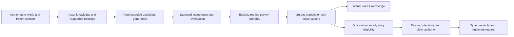

# Survey foundation and procedural mission framework

SURVEY-FRAMEWORK-01, 13 November 2026. **Review proposal; no runtime implementation or schema change.**

**Agreed owner direction:** “Both: routine surveying is the foundation, with story missions layered on top.” Routine work must remain useful when no story occurs. Exact frequency, durations, costs, risks, rewards, faction preferences and numerical balance remain **proposed/open**.

Inspection baseline: `1fb8bbe84543291b191b9074a6b5f84422610f93`, the current PB integration source, not main. Remote main was `e99c151f9d7f876300457ddac6b7c3c939330140` when inspected. The combined PB is a receiving candidate with separate QA qualifications; source presence is not acceptance of the complete survey roadmap. Historical accepted Frontier/streamed milestones are evidence for their own scopes. This document proposes a future opt-in increment after owner review.

Read with the [exploration design](design/exploration-missions.md), [AI design](design/strategic-ai.md), [weekly time/movement](design/time-movement-mobilisation.md), [ship model](design/ship-design.md), [architecture](architecture.md) and [current campaign editions](current-demo-implementation.md). These distinguish intended design from implemented behavior.

## Recommendation

Extend the existing planetary-survey and activity-study authorities. Add a small mission orchestration layer that binds real observed targets, delegates work to those authorities, and derives progress from their receipts. Do not build a parallel survey simulation or reuse the Frontier Commission as a random generator.

Start with procedurally assembled **local body surveys and bounded sets of observed bodies**. Successful surveys disclose actual environments/resources/control under the existing observation rules. That knowledge is their useful result; the first slice needs no new Science payout, consumables, danger roll or story frequency. Then add an optional story hook that can bind an already existing, legitimately discovered site to the existing finite study/claim path. Persistent branching narratives follow later.

Knowledge and survey completion do not wait for story acceptance. A story does not reset or replace a completed survey, and cannot grant the same survey result again.

## Implemented inventory at the pin

| Concern | Actual implemented surface | Boundary/gap |
|---|---|---|
| Navigation exploration | [Frontier v1](frontier-reconnaissance-v1.md), `CaptureDiscovery`, accepted travel, arrival receipts; generated profiles retain actor knowledge and frozen geometry | Arrival charts navigation under explicit policies. It is not a body survey. A preview, neighbouring charted node or partial edge is not evidence of body investigation. |
| Coarse astronomy | [Static astronomy v2](generated-static-astronomy-v2-contract.md), `CaptureKnownAstronomy` | Actor-filtered coarse nebula proxies derived from charted polygons. Cosmetic influence radii are not physical hazards, survey difficulty, sensor coverage or resource facts. |
| Actual planetary survey | `StartPlanetSurvey`, `CancelPlanetSurvey`, `PlanetSurveyDto`, `CaptureColonisationPlanets` | Already implemented in colonisation editions, including Cycle. One actual owned, living, stationary, supported ship; two successful settlement-week ticks; no proportional StudyWork speed-up. Not a general system/star/moon/phenomenon mission engine. |
| Body knowledge | `ColonisationPlanetsForActor` | Physical presence/retained arrival/owned worlds disclose planetary existence. Completed own survey or owned colony exposes Environment; control may be current under coverage or retained with an observation turn. Adjacent star-chart topology alone does not disclose bodies. No generic confidence or per-instrument evidence vocabulary. |
| Identity | `PlanetId`, `BodyId`, `SystemId`, navigation associations, frozen colonisation inventory, activity `SiteId` | These are separate identities. Activity-only profiles have authored survey-body/site records; colonisation supplies physical planet bindings. Do not equate a rendered globe, an activity body, a navigation region and a physical planet by string/name. |
| Equipment/capability | `ActivityCapability`, `PublishedTacticalSupportCompiler.EvaluateActivities/EvaluateColonisation`, supported published versions | Recompiles frozen actual fit, ownership and supported Survey power. Produces StudyWork/ContactCapacity. A ship name, aggregate technology level, preview sensor/Science rating or art model does not authorize work. Probes and expedition self-repair are not supplied by this surface. |
| Site studies | [Activities](campaign-activities-v1.md), `StartStudy`, `ClaimFinding`, `AbortStudy`, `ActivityFindingDto` | Observed site, local stationary participant, capability/relation/credit checks; active work and finite deadline; AwaitingClaim then explicit revalidated claim. No arbitrary scripting or general mission graph. |
| Existing procedural placement | `SeedActivitySites`, policy `activity-placement-frontier-v2` | Seeds four finite science sites/two minor encounters on real generated systems, with nearby opportunities at genesis. Uses deterministic hash ordering and actual topology. Placement does not reveal sites. Reuse this infrastructure; do not silently change old map/site placement or claim every seeded activity is a physical anomaly inferred from astronomical data. |
| Existing outcomes | `ResolveActivity`, Science insight adapter, finding receipts, minor relation state, bounded hull risk | Actual finite insight accounting; consent/refusal and local relation vocabulary; disclosed nonlethal scripted hull risk. Not a complete diplomacy/population-memory/repair/resource-transfer consequence bus. |
| Existing mission report | [Frontier Commission](frontier-commission-v1.md), `CaptureFrontierCommission` | Pure projection of four historical accomplishments from retained real evidence, gated to official content fingerprint. No random mission selection, new state, rewards or campaign terminal state. A completed planetary survey is not currently its scientific-finding objective. |
| Persistence/transactions | Typed generated/activities/colonisation/Cycle roots, full ordered replay, detached candidates, capacity admission | Existing domains and stores are distinct. Old roots do not accept arbitrary new mission fields; no save migration or generic durable offer/branch/effect ledger exists. Mission liabilities must join existing admission, not bypass it. |
| AI | Arrival exploration AI and scoped colonisation expansion planners | Existing AI obtains own body observations and submits survey actions through the shared handler. Automatic activity AI is not a general scientific/story mission planner or the full strategic-AI design. New planner goals/preferences remain outside the first slice. |

Source anchors: [planetary survey commands/observations](../src/HobbyDS9.Simulation/CampaignTacticalReviewSession.ColonisationCommands.cs), [settlement tick and validation](../src/HobbyDS9.Simulation/CampaignTacticalReviewSession.ColonisationSettlement.cs), [activity studies/claims](../src/HobbyDS9.Simulation/CampaignTacticalReviewSession.ActivityFindings.cs), [placement](../src/HobbyDS9.Simulation/CampaignTacticalReviewSession.Activities.cs), [capability compiler](../src/HobbyDS9.Simulation/ActivityTacticalSupportCompiler.cs), [generated world assembly](../src/HobbyDS9.Simulation/GeneratedCampaignFactory.cs), [frozen inventory](../src/HobbyDS9.Simulation/ColonisationData.Inventory.cs), [Commission](../src/HobbyDS9.Simulation/CampaignTacticalReviewSession.FrontierCommission.cs), [AI survey selection](../src/HobbyDS9.Simulation/CampaignTacticalReviewSession.ColonisationAi.cs).

### Existing lifecycle details that must be preserved or explicitly changed

- Routine survey: one row per actor/planet. Active/completed duplicates reject, as does another active survey on the ship. Starting a survey also checks active/awaiting-claim findings on that ship. Cancel or interruption resets CompletedWeeks to zero; a restart replaces the prior noncompleted row with a new allocated survey identity. Completion removes the active allocated-identity entry but retains the completed survey record. Do not advertise resumable partial routine progress today.
- Activity study: one actor/site/finding identity, including terminated attempts. Alternative choices sharing a FindingId cannot pay it twice. Accepted credits are consumed up front; abort, loss, departure/reorganisation and expiry do not refund them. A ship has at most one active/awaiting-claim finding. Claim revalidates participant, location, capability and current relation.
- Activity outcomes use domain-separated deterministic hashes of wrapper identity/map seed/actor/site/finding. No new campaign RNG draw occurs on preview/claim. Consent and hull risk have different domains. Current risk cannot reduce a surviving vessel below one hull; that is this content rule, not a general expedition-survival guarantee.
- Named insight uses `ScienceRules.GrantActivityInsight`, preserving prior banks, weights, Engineering and discovery seed. Learned plus explicitly unlearnable insight accounts for the finite grant. Routine planetary surveys do not currently pay such a grant.
- Survey/study occupancy is not a documented unified scheduler. Source inspection shows a study-conflict check in StartPlanetSurvey, but no matching active-survey check in StartActivityStudy's local checks. This is an **inspection risk, not an executed exploit finding**; test both command orders/full candidate validation before promising mutual exclusion or fixing it in an implementation task.

### Turn boundary and acceptance status

In the inspected physical turn path, Economy → Research → Production → Movement precedes `TickActivityFindings`, then encounter allocation. Findings may reach AwaitingClaim before combat, but phase validation prevents a Planning claim during AwaitingCombat; departures/losses are reconciled and claim rechecks actual state. Routine `TickPlanetSurveys` runs through `CompleteColonisationWeek`: once on a successful no-combat boundary, or once during explicit aftermath when combat intervenes. `LastSettlementTurn` prevents double settlement ticks. Presentation, rejected advance, load and repeated finalization are not work ticks.

The new orchestrator must follow those owning-system boundaries. It must not add another survey tick, run a story claim inside Research retroactively, or publish a pre-combat expected survey completion as earned. Pending encounter saves and complete-but-unfinalized saves must retain the same next decision.

The existing [streamed acceptance](campaign-activities-streamed-v1.md) and Commission records describe accepted bounded journeys; Frontier arrival acceptance covers its own profile. QA's current PB `1fb8bbe` combat/menu observations do not establish native procedural-survey acceptance. Tests inspected for this proposal include [colonisation expeditions](../tests/HobbyDS9.Simulation.Tests/ColonisationExpeditionTests.cs), [activities](../tests/HobbyDS9.Simulation.Tests/CampaignActivitiesTests.cs), [Science grants](../tests/HobbyDS9.Simulation.Tests/ActivityScienceGrantTests.cs), [Commission](../tests/HobbyDS9.Simulation.Tests/FrontierCommissionTests.cs) and [actor-filtered expansion selection](../tests/HobbyDS9.Simulation.Tests/ColonisationExpansionKernelTests.cs). They were read, not rerun for these documentation edits.

## Proposed data and authority split

Names below are design notation, **not implemented DTOs or approved schema**.

| Proposed record | Fields/responsibility |
|---|---|
| SurveyMissionTemplate | Stable ID/revision, objective kind, typed binding requirements, disclosure prerequisites, capability adapter ID, prerequisite evidence, leaf executor, interruption policy, completion predicates, optional hook category, text keys and technical caps. Content contains data, not executable predicates/scripts. |
| SurveyCandidate | Actor, template identity, exact observed subject IDs, evidence/disclosure revision, candidate key, turn/revision and declared requirements. Pure detached result; allocates/reserves nothing and grants no permission. |
| SurveyMissionInstance | Allocated ID on accepted command, owner, frozen template revision, bound subject set/participant, source leaf-job IDs, lifecycle, accepted command IDs and last committed evidence. Progress references the leaf authority; no second copy of authoritative survey percentage. |
| SurveyCompletionEvidence | Stable receipt/provenance, actor, physical subject IDs, owning survey ID, committed completion turn and observation scope. Completion and current control observation are different facts. |
| NarrativeInstance | Optional parent evidence, frozen template/stage, bound existing site/actors where lawfully discoverable, chosen approach, progress adapter, deadlines, stored random decision/outcome and applied-effect receipts. Missing optional story is a valid result. |

Template eligibility uses a closed vocabulary: subject kinds, known/observed predicates, actual supported capability, location/access, existing completion and finite finding availability. Content requiring an unsupported effect or capability fails catalogue admission or stays explicitly fixture-only; an evocative description cannot make it live.

The world owns physical bodies/resources/governments. Actor knowledge owns what is disclosed. Existing survey/study handlers own work and world changes. The director owns composition and bounded selection. Application exposes detached actor-filtered views and submits commands; Unity owns labels/layout only. AI gets the equivalent own-knowledge/capability view and same command validation, never the complete save, hidden deposits or another actor's reports.

### Initial objective kinds

1. **SurveyObservedBody**: bind one actual disclosed, not-yet-surveyed physical planet. Delegate to StartPlanetSurvey and its existing successful boundary/knowledge result. Do not infer habitability, ownership or resource quality while choosing an unsurveyed target.
2. **SurveyObservedBodySet**: bind a bounded, frozen ordered set of at least two already observed bodies in one system. This composes the same leaf jobs and real receipts. Caption “survey these observed bodies,” not “fully survey the system”: unobserved bodies may exist. First implementation may require explicit next-body acceptance rather than automatic movement/assignment; automatic local queuing is an owner decision.
3. **StudyObservedSite**: later optional extension binding a real observed ActivitySite and its supported finite finding. Delegate to existing study/work/claim authority. It is not a second planetary-survey flag.

No body-set is invented when only one body is known. Real variety comes from target sets, actual systems/locations, actual remaining knowledge, ship capability constraints and existing discovered phenomena—not random names or varying unsupported payouts. A sparse seed may legitimately offer fewer tasks.

## Proposed generation and disclosure

Two stages must remain separate:

- **World/content genesis:** retain frozen physical inventory and existing seeded site placement. Privileged generation can populate an explicitly versioned world, but does not confer actor knowledge. New site kinds or changed placement belong to their own content/profile increment.
- **Actor mission selection:** enumerate only legally observed subjects/evidence, compatible templates and supported actions. Filter before ranking/capping. Never pick a hidden wealthy/inhabited body and reveal it through a title, disabled choice, surprising offer count, list ordering or private route.

For MVP, generate local opportunities from current planet observations and owned supported ships. Preview known routes through existing actor-scoped route queries if a future phase adds travel plans. A path preview is not permission, arrival, discovery or a promise of continued access. “No suitable local vessel” is distinct from a promise to fabricate or move one.

CandidateKey should be a canonical semantic tuple (actor, template/revision, objective kind, stable subject set and prerequisite evidence scope), not a GUID, localized name, command ID, current wall clock or rendering order. Sort subjects/templates ordinally and validate duplicate/missing/cyclic references before generation. Candidate views are pure: repeated refreshes consume no RNG, IDs, resources or mission state. Acceptance recomputes/validates the candidate at the observed stamp and atomically starts the underlying work; a stale offer never retries silently.

Generation is bounded by versioned technical counts for templates, eligible bindings, candidates, objective-set size, active instances and follow-ups per boundary. Use existing world admission caps and deterministic work counters; choose concrete budgets during implementation review, then test worst admitted inputs. Do not scan unbounded target combinations or use a wall-clock cutoff that changes results. Exhaustion has an explicit deterministic no-additional-offer result; it never reveals all or silently lowers eligibility.

## Proposed lifecycle and progress

For routine work: virtual **Available → Active → Completed**, with explicit **Cancelled / Interrupted / Failed** outcomes. Accept atomically allocates/binds one mission instance and invokes the existing leaf validation inside the same candidate transaction. Mission completion is derived from actual bound leaf receipts, never elapsed UI time or predicted ETA. A body-set counts each distinct bound receipt once; already completed knowledge is not a repeatable reward.

Retain current two-tick body survey semantics for the first compatibility-conscious slice. StudyWork remains an eligibility capability here, not an unapproved speed multiplier. A faster skill-based survey law, partial-progress retention or automatic travel would be a separately reviewed rule/version change.

Proposed common occupancy admission must cover surveys, active/awaiting-claim studies and incompatible transport commitments symmetrically, irrespective of command order. Begin with one participant/leaf at a time; do not infer that identical ships can multiply a finite reward. A pre-existing active survey can be shown as such; the director must not start a competing survey to obtain its own receipt. Joining/coalescing existing jobs needs an explicit decision.

Cancellation delegates to the leaf. Current routine cancellation/interruption loses partial work; completed knowledge remains. An old mission bound to survey ID A must not complete because a later restarted survey ID B finishes. Preserve terminal mission/evidence references before replacing a leaf's old noncompleted row. Activity abort/expiry retains its existing consumed funding and finite-attempt record. No retargeting, refund, new charge or reroll happens implicitly.

For later story layers: **Eligible/Offered → Active → AwaitingChoice → Resolving → Completed**, plus content-defined paused/cancelled/expired/failed paths. A ship loss, lost access, changed government, blocked route, lack of resources or invalidated binding follows a declared policy and revalidation. AwaitingChoice never blocks the whole campaign. Autonomous/communications-blackout execution requires explicit pre-authorized limits and safe fallback; it is not an initial survey feature.

## Proposed story hooks, randomness and consequences

At a committed routine completion/observation boundary, emit one internal typed evidence item or derive it from a durable receipt. The story extension examines this evidence and the actor's new lawful observations. It may bind a discovered existing site; **no story** is normal. A generic template cannot spawn an inhabited world, supply cache, hull damage or missing repair dock merely to fill a story slot.

Persist the once-only hook decision, including “no event,” under a key based on actor + stable subject + semantic finding/stage + policy. Retain the triggering receipt separately as provenance; allocated mission/survey IDs, command IDs, retry counts and global entity sequence are not new roll identities. Duplicate notifications, save/reload, cancel/reaccept, renaming and template text updates cannot create a second chance. Template revisions alone must not reset the underlying finite finding. New instruments may expose genuinely new findings only through an explicitly approved content identity.

MVP routine generation can use a domain-separated stable hash to order equivalent known candidates; it needs no campaign RNG draws or new success rolls. Proposed later selection inputs are frozen generation seed/domain/policy, template identity, stable subject IDs and committed trigger evidence. Use the existing activities hash approach where its semantics fit. If weighted sampling or multiple stage draws are introduced, version the policy, canonicalize weights/order, bound draws and persist the decision; use a specified integer sampler with an explicit exhaustion result. Selection frequency and weight values remain open. No randomness occurs in rendering, previews, route queries or loading beyond validation of the exact historical outcome.

Start with two authoritative consequence adapters:

- **Routine knowledge:** existing planetary completion/observation, exactly once; no Science grant added.
- **Existing finite finding:** existing ClaimFinding and Science/consent/hull-risk receipts for an actually supported site/choice, with its current costs and limits. Do not duplicate those changes in a mission completion callback.

Later typed effects require stable origin/stage/effect IDs, target identities, expected prerequisite facts, timing and lawful visibility, with complete-batch validation and atomic progress/effect/ledger commit. Research delegates to Science's finite-budget accounting; physical goods need real named stock/transport; military retaliation uses real hostility/encounter/combat once. Environmental risk and combat must not both charge the same damage. Population/diplomatic consequences need actual groups, lawful observation and owning-system adapters; current minor relation labels are not general diplomacy authority.

A mission record is not another world inventory or a replacement event-sourced simulation. Retain applied-effect receipts in the authoritative typed state and replay path; a report string never authorizes an effect. Presentation may describe only committed observations/results. Unsupported effect batches reject atomically, without consuming outcome decisions or offering a replacement roll.

## Deliberate boundaries between mission families

| Family | Reuse now | Future dependency |
|---|---|---|
| Routine planet survey | Actual physical planet/knowledge and existing survey leaf | Broader stars/moons/belts, instrument confidence and throughput laws require scoped support; preserve explicit identity adapters. |
| Anomaly study | Existing observed finite activity sites, choices, capability and claim | New anomaly physics/placement/hazards cannot be inferred from cosmetic astronomy. |
| First contact | Existing observed minor assessments and consent/refusal only | Mutual detection, editable non-interference, governments/cohorts, negotiation and delayed political reactions need their own supported adapters. |
| Damaged expedition/repair | Bind real damage/known alternatives later; existing physical hull/combat persistence | No generic probe inventory, fabrication, remote supplier or self-repair command is established by survey support. Rates, resources and the design's suggested90% ceiling remain open. Existing finite tactical ammunition is not scientific probe stock. |
| Long expedition/black hole | Retained real site evidence can be a future prerequisite | Proper-time budget, autonomous blackout policy, return/data recovery, consumables and finite discipline rewards remain proposed. Never slow the entire empire clock or manufacture an unavoidable crisis. |

## Proposed persistence and delivery phases

Target the current colonisation/Cycle capability family first. Earlier Frontier5, generated/static astronomy and activities editions retain their typed contracts and exact old saves; they do not gain body survey authority merely because they share a UI. Mission/template/outcome records require a reviewed new package/outer-root identity, strict codec, copy/preflight budgets, command replay and save directory policy. Data & Persistence and Backend must agree ownership before implementation; no version number or migration is chosen here. SF1 must already prove equal eligibility/cost/validation through human and trusted-AI adapters; the later AI phase adds autonomous selection/planning, not delayed rule parity.

Load must use trusted matching content and stored frozen map, replay accepted commands/derived historical decisions, and compare the complete root. Persist bound template revisions, leaf IDs, consumed finding/effect keys, decision inputs/results and interruption state. Do not regenerate a new offer/story from current content while loading an old save. Failed load cannot replace the live campaign. Admission must reserve real future terminal/claim/abort obligations and revisions under the existing streamed capacity rules; optional stories must not consume required escape capacity. Bounded history/compaction needs a separate replay proof, not silent pruning.

| Phase, all proposed until review | Reviewable outcome | Acceptance gate |
|---|---|---|
| SF0: contracts/identity and occupancy audit | Typed actor-known subject/capability/evidence adapters, exact timing table, content validation; determine cross-order occupancy behavior | Reorder/privacy/query-purity cases; no source behavior change bundled as a cleanup. |
| SF1: routine vertical slice | Data-driven single-body and observed-body-set candidates; accepted instances delegate existing survey work; real knowledge completion; no story RNG/rewards | Two genuine targets/set sizes from actual observed world facts; supported unsupported ship cases; normal commands and replay, sparse no-offer case. |
| SF2: optional existing-site hook | Once-only completion hook, no-event decision, optional real observed-site study through current finding executor | Routine knowledge commits even with no/declined story; no hidden site disclosure or duplicate work/reward; native ordinary survey journey. |
| SF3: persistent narrative templates | Versioned stages/choices/deadlines, typed supported outcomes and follow-up budget | Save/reload at every stage, invalidation/access/resource changes, batch rollback and finite findings. New effects reviewed individually. |
| SF4: AI and additional capabilities | Equivalent knowledge ports, scoped planner adapters and diagnostics; later sensors/probes/repair where separately agreed | Identical legality/costs; no hidden selection, replay/RNG drift or unsupported rewards; paired bounded scenarios. |

Do not implement a new universal generator before proving SF1 can delegate both existing leaf paths where applicable. Commission remains a separately gated historical report; new mission completion must not spoof its official fingerprint or four accomplishment predicates.

## Acceptance examples and owner decisions

| Example | Required result in the proposed implementation |
|---|---|
| Normal newly visited system | Only its lawfully observed bodies enter candidates. Accept a body survey with a real stationary supported ship; two successful owning ticks reveal actual environment. No story is necessary for this useful result. |
| Two observed bodies, different hidden deposits | Body-set binds those two IDs. No pre-survey “rich world” label, ranking or eligibility difference leaks deposits; each real completion supplies its own evidence. No claim that unobserved bodies are finished. |
| Unsupported or remote vessel | No invented Survey capability from Science/sensor preview values. Acceptance rejects stale location/capability/ownership, unchanged state/IDs/RNG; a known route never teleports the participant. |
| Resource-constrained story | Routine result remains earned. Existing credit-funded study cannot start without its real funds; unsupported probes/repair stay unavailable, without charging substitute credits/materials. No fabricated reward to fund itself. |
| Cancel/restart, overlapping tasks | Existing partial survey cancellation semantics are preserved. An old wrapper cannot consume a new leaf receipt; same ship cannot gain two incompatible work streams by reversing command order. Duplicate findings/effects never repay. |
| Combat interruption | Work advances only at the owning boundary. Save AwaitingCombat, resolve normally, explicitly finalize once; a destroyed/departed participant gets the declared terminal outcome, no expected reward. Reload/finalize cannot add a second tick. |
| Story/no-story and exhausted Science | Survey knowledge is the same under no story, declined hook or full research. A supported finite finding records learned/unlearnable amounts once; report text and repeated claims cannot grant extra points. |
| Unknown-world tampering / AI | Hidden and nonexistent supplied IDs have equivalent rejection disclosure. Human and AI adapters use the same known facts, costs, occupancy and validation. Different private enemy/world data with identical actor knowledge cannot alter routine offer presentation. |
| Candidate/content reorder and replay | Reordering catalogues/dictionaries produces the same canonical candidates/decisions. Refresh and save/load consume no campaign RNG. Every accepted phase and every failed command/batch has complete-root parity/rollback. |
| Pacing/capacity exhaustion | Sparse world or exhausted budgets return a disclosed bounded absence/limit; no infinite scan, reroll-until-interesting, hidden-target fallback, recursive same-turn chain or lost terminal command reserve. |
| Old profile / feature disabled | Existing saves, command outcomes, canonical bytes, RNG draws and global allocation sequence remain exact. New rendering/query calls never activate missions in an old profile. |

Consequential choices for owner review (recommendations are **proposed**, not approvals):

1. Approve SF1's two routine objective kinds and local-only first slice, or require remote travel automation in the first delivery. Recommendation: local first, with existing explicit travel.
2. Retain current fixed two-tick survey/cancel-reset semantics initially, or commission a capability-scaled/retained-progress rule. Recommendation: preserve them first; introduce any new law under an explicit content/rules identity.
3. Choose whether body-set progression is explicit next-body acceptance or automatic local queueing, and whether accepted existing jobs can be joined. Recommendation: explicit/no overlap initially; owner retains cancellation control.
4. Choose SF2 hook policy/frequency/concurrency and presentation. Recommendation: optional post-observation hook, durable no-event result, no new numerical frequency until content review. Mundane surveys remain complete without a prompt.
5. Choose the first genuinely new evidence/reward/effect family beyond existing knowledge and finite study. Recommendation: no new routine payouts, probe supplies, diplomacy or repair in SF1/SF2; review each later family with its authority/resource accounting.
6. Choose new-edition compatibility versus a separately funded migration. Recommendation: explicit opt-in identity/store and refusal of incompatible saves, preserving all old profiles. No migration or default activation is authorized by this proposal.

The high-level routine-plus-story direction is agreed. These implementation boundaries and all listed detailed choices still require review before runtime work.
